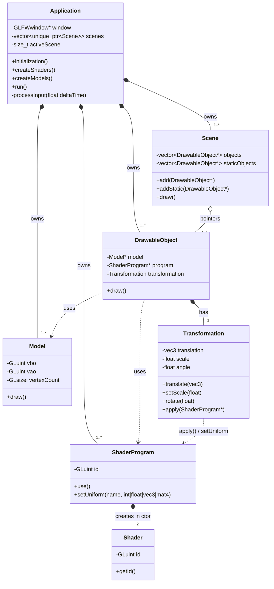

<!-- Author: Matt Hejtman, login: HEJ0094 -->
# ZPG – cvičení 1 + 2: podrobná dokumentace kódu

Tento dokument prochází **každý soubor projektu řádek po řádku**. U každého řádku (nebo malé skupiny souvisejících řádků) vysvětluje, **co dělá** a **proč je napsaný právě takhle**. Soubory jsou seřazené tak, jak dávají smysl při čtení: nejdřív build, pak `main`, nejjednodušší třídy, nakonec `Application`, která všechno spojuje.

> **Verze:** kapitoly 1–15 popisují základ z cvičení 1 + 2. Kapitola 16 popisuje změny cvičení 3 (uniformy, `Transformation` jako jednoduchá třída, `transform.vert`, ovládání, les, login). Kapitola 17 popisuje cvičení 4 (modelová matice, vzor Kompozit, náhodný les, sluneční soustava). Kapitola 18 popisuje cvičení 5 (kamera, Observer, procházení lesa, hodiny). Kapitola 19 popisuje cvičení 6 (světlo a osvětlovací modely). Kapitola 20 popisuje cvičení 7 (normálová matice, ukázky chyb, materiál, útlum, noční les). **Platí vždy nejnovější kapitola.** Ve cvičení 7 byla odstraněna scéna s koulí barvenou normálami a pevné `AMBIENT`/`shininess` v shaderech nahradila třída Material. Ve cvičení 5 byl odstraněn obrácený test hloubky z cvičení 4 a parametr `view` scény (nahradila je kamera). Ve cvičení 4 byl `transform.vert` nahrazen `model.vert`, třída `Transformation` se stala abstraktní a `constant.frag` byl odstraněn.

## Obsah
1. [Celkový přehled architektury](#1-celkový-přehled-architektury)
2. [Struktura složek](#2-struktura-složek)
3. [CMakeLists.txt](#3-cmakeliststxt)
4. [main.cpp](#4-maincpp)
5. [Shader.h / Shader.cpp](#5-shaderh--shadercpp)
6. [ShaderProgram.h / ShaderProgram.cpp](#6-shaderprogramh--shaderprogramcpp)
7. [Model.h / Model.cpp](#7-modelh--modelcpp)
8. [DrawableObject.h / DrawableObject.cpp](#8-drawableobjecth--drawableobjectcpp)
9. [Scene.h / Scene.cpp](#9-sceneh--scenecpp)
10. [BasicModels.h](#10-basicmodelsh)
11. [Application.h](#11-applicationh)
12. [Application.cpp](#12-applicationcpp)
13. [Shadery (color.vert, color.frag, constant.frag)](#13-shadery)
14. [Průchod programem od startu po konec](#14-průchod-programem-od-startu-po-konec)
15. [Rozhodnutí, která nejsou na první pohled vidět](#15-rozhodnutí-která-nejsou-na-první-pohled-vidět)
16. [Cvičení 3: transformace, uniformy, scény](#16-cvičení-3-transformace-uniformy-scény)
17. [Cvičení 4: modelová matice, Kompozit, les, sluneční soustava](#17-cvičení-4-modelová-matice-kompozit-les-sluneční-soustava)
18. [Cvičení 5: kamera, Observer, procházení lesa, hodiny](#18-cvičení-5-kamera-observer-procházení-lesa-hodiny)
19. [Cvičení 6: osvětlovací modely](#19-cvičení-6-osvětlovací-modely)
20. [Cvičení 7: normálová matice, ukázky chyb, noční les](#20-cvičení-7-normálová-matice-ukázky-chyb-noční-les)

---

## 1. Celkový přehled architektury

```
main()
  └── Application                 vlastní okno, všechny zdroje a scény, řídí smyčku
        ├── ShaderProgram ×2      colorProgram, constantProgram
        │     └── Shader ×2       (dočasně: vertex + fragment, jen při stavbě programu)
        ├── Model ×3              triangle, square, sphere (VBO + VAO)
        ├── DrawableObject ×5     dvojice (Model*, ShaderProgram*)
        └── Scene ×4              seznam DrawableObject* v pořadí kreslení
```

**Vlastnictví:** všechno vlastní `Application` (přes `std::unique_ptr` ve vektorech). `DrawableObject` a `Scene` drží jen **ne-vlastnící** surové ukazatele. Díky tomu jeden model nebo shader může sdílet víc objektů. Například trojúhelník je ve scéně 1 i 4, ale na GPU je nahraný jen jednou.

**Proč takhle:** zadání říká, že se do architektury mají další cvičení jen přidávat. Kamera, transformace a světla přijdou jako nové třídy nebo nové členy `DrawableObject`. Nic z dnešního kódu se nebude muset přepisovat.

---

## 2. Struktura složek

```
ZPG/
├── CMakeLists.txt          popis buildu (místo .sln/.vcxproj)
├── README.md               build + souhrn k odevzdání
├── DOKUMENTACE.md          tento soubor
├── src/                    všechny .h/.cpp
├── assets/
│   ├── shaders/            .vert / .frag
│   └── models/             přiložené modely (cizí soubory, needitované)
├── libs/
│   ├── glad/include/glad/gl.h   vygenerovaný GLAD 2, header-only
│   ├── glm/glm/...              GLM 1.0.1, header-only
│   └── glfw/                    (jen pro Windows) include/ + lib-vc2022/
└── screenshots/
```

- **`assets/` místo `shaders/` a `models/` v kořeni:** složky `src/` a `assets/models/` už v projektu existovaly, tak jsem je zachoval a shadery přidal vedle modelů. Funkčně je to totéž, cesta v kódu je jen `assets/shaders/...`.
- **GLAD jako header-only:** zadání chce `#define GLAD_GL_IMPLEMENTATION` právě jednou. To je přesně model GLAD 2 v režimu `--header-only`: hlavička obsahuje deklarace i implementaci a implementace se vloží jen tam, kde je makro definované. Nepotřebujeme tedy žádné `glad.c`.
- **GLFW na Linuxu ze systému:** knihovna `libglfw3-dev` je nainstalovaná v systému (verze 3.3.10). Na Windows se prebuilt binárky dají do `libs/glfw/`. V repozitáři je nemáme, protože nejsou pro Linux.

---

## 3. CMakeLists.txt

Projekt je na Linuxu, kde Visual Studio není. CMake umí Visual Studio otevřít přímo (*File → Open → Folder*), takže jeden soubor pokryje obě platformy.

```cmake
# Author: Matt Hejtman, login: HEJ0094
```
Hlavička se jménem a loginem, kterou zadání vyžaduje v každém mém souboru. V CMake je komentář `#`.

```cmake
cmake_minimum_required(VERSION 3.16)
```
Nejnižší verze CMake, kterou projekt potřebuje. 3.16 má vše použité níže (`target_link_directories` od 3.13, `CONFIGURE_DEPENDS` od 3.12) a je dostatečně stará, aby ji měl každý systém i Visual Studio 2019/2022.

```cmake
project(ZPG CXX)
```
Název projektu a jazyk. `CXX` = C++. Céčko neuvádím, protože žádný `.c` soubor nemáme (GLAD je header-only). CMake pak zbytečně nehledá C kompilátor.

```cmake
set(CMAKE_CXX_STANDARD 17)
set(CMAKE_CXX_STANDARD_REQUIRED ON)
```
Překlad v C++17. Kód používá `std::make_unique` (C++14) a moderní syntaxi. `REQUIRED ON` znamená: když kompilátor C++17 neumí, build selže hned, místo aby tiše použil starší standard.

```cmake
file(GLOB SOURCES CONFIGURE_DEPENDS ${CMAKE_SOURCE_DIR}/src/*.cpp)
file(GLOB HEADERS CONFIGURE_DEPENDS ${CMAKE_SOURCE_DIR}/src/*.h)
```
Najde všechny `.cpp` a `.h` ve `src/`. **Proč glob:** v dalších cvičeních přibudou třídy (Camera, Transformation…) a nechci pokaždé editovat CMakeLists. `CONFIGURE_DEPENDS` zajistí, že CMake při každém buildu zkontroluje, jestli nepřibyl nový soubor. Bez toho by nový soubor nebyl vidět, dokud ručně nespustíš `cmake` znovu.

```cmake
add_executable(ZPG ${SOURCES} ${HEADERS})
```
Vytvoří spustitelný soubor `ZPG`. Hlavičky se nepřekládají, ale přidávám je, aby je Visual Studio ukázalo v Solution Exploreru.

```cmake
target_include_directories(ZPG PRIVATE
    ${CMAKE_SOURCE_DIR}/src
    ${CMAKE_SOURCE_DIR}/assets/models
    ${CMAKE_SOURCE_DIR}/libs/glad/include
    ${CMAKE_SOURCE_DIR}/libs/glm)
```
Složky, kde kompilátor hledá `#include`. **Všechny cesty začínají `${CMAKE_SOURCE_DIR}`** (složka s CMakeLists.txt). Je to přesný ekvivalent `$(SolutionDir)` z Visual Studia, tedy splnění úkolu 6: žádné `C:\Users\...`.
- `src`: aby šlo psát `#include "Model.h"` odkudkoliv.
- `assets/models`: aby šlo psát `#include "sphere.h"` bez dlouhé cesty.
- `libs/glad/include`: `#include <glad/gl.h>`.
- `libs/glm`: `#include <glm/glm.hpp>` (zatím nepoužito, připraveno na cvičení 3).

`PRIVATE` znamená, že cesty platí jen pro tento cíl. Je to správná praxe, i když máme jen jeden cíl.

```cmake
if(WIN32)
    target_include_directories(ZPG PRIVATE ${CMAKE_SOURCE_DIR}/libs/glfw/include)
    target_link_directories(ZPG PRIVATE ${CMAKE_SOURCE_DIR}/libs/glfw/lib-vc2022)
    target_link_libraries(ZPG PRIVATE glfw3.lib opengl32.lib)
```
Větev pro Windows. Hlavičky i `.lib` GLFW se berou z `libs/glfw` (opět relativně). Linkují se přesně ty dvě knihovny, které zadání požaduje: `glfw3.lib` a `opengl32.lib`. `lib-vc2022` je název složky v oficiálním balíčku GLFW pro Visual Studio 2022.

```cmake
    set_property(TARGET ZPG PROPERTY VS_DEBUGGER_WORKING_DIRECTORY ${CMAKE_SOURCE_DIR})
    set_property(DIRECTORY ${CMAKE_SOURCE_DIR} PROPERTY VS_STARTUP_PROJECT ZPG)
```
- `VS_DEBUGGER_WORKING_DIRECTORY`: když se aplikace spustí z Visual Studia (F5), pracovní adresář bude kořen projektu. Relativní cesta `assets/shaders/color.vert` se pak najde.
- `VS_STARTUP_PROJECT`: ve vygenerovaném .sln bude jako spouštěný projekt `ZPG`, ne pomocný `ALL_BUILD`.

```cmake
else()
    find_package(glfw3 REQUIRED)
    find_package(OpenGL REQUIRED)
    target_link_libraries(ZPG PRIVATE glfw OpenGL::GL ${CMAKE_DL_LIBS})
    target_compile_options(ZPG PRIVATE -Wall -Wextra)
endif()
```
Větev pro Linux/macOS.
- `find_package(glfw3)` najde systémovou GLFW (balíček `libglfw3-dev` instaluje CMake konfiguraci) a vytvoří cíl `glfw`.
- `find_package(OpenGL)` vytvoří cíl `OpenGL::GL` (libGL), linuxový ekvivalent `opengl32.lib`.
- `${CMAKE_DL_LIBS}` = `-ldl`. GLAD načítá funkce za běhu a na starších glibc k tomu potřebuje `libdl`.
- `-Wall -Wextra` zapne většinu varování. Projekt se s nimi překládá bez jediného varování. Na MSVC tyto přepínače nefungují, proto jsou jen v této větvi.

```cmake
add_custom_command(TARGET ZPG POST_BUILD
    COMMAND ${CMAKE_COMMAND} -E copy_directory
            ${CMAKE_SOURCE_DIR}/assets $<TARGET_FILE_DIR:ZPG>/assets)
```
Po každém buildu zkopíruje celou složku `assets/` vedle spustitelného souboru. **Proč:** shadery se načítají relativní cestou, která se vyhodnocuje vůči *pracovnímu adresáři*. Díky kopii funguje spuštění z kořene projektu (`./build/ZPG`), ze složky build (`cd build && ./ZPG`) i dvojklikem na exe. `${CMAKE_COMMAND} -E copy_directory` je přenositelný příkaz, funguje stejně na Windows i Linuxu. `$<TARGET_FILE_DIR:ZPG>` je generátorový výraz, který se rozbalí na složku s exe (na Windows např. `build/Debug`).

---

## 4. main.cpp

```cpp
// Author: Matt Hejtman, login: HEJ0094
#include "Application.h"
```
Jediný include. `main.cpp` podle zadání **nesmí obsahovat OpenGL kód**, proto nezná ani GLAD, ani GLFW. Zná jen rozhraní třídy `Application`.

```cpp
int main()
{
    Application app;
```
Aplikace je lokální proměnná na zásobníku, ne `new`. Destruktor se pak zavolá automaticky na konci `main`, takže nemůže vzniknout únik paměti.

```cpp
    app.initialization();
    app.createShaders();
    app.createModels();
    app.run();
```
Čtyři volání přesně v pořadí ze zadání. **Pořadí je povinné:** shadery i modely volají OpenGL funkce (`glCreateShader`, `glGenBuffers`), a ty existují až po `initialization()`, kde se vytvoří kontext a načte GLAD. Modely jsou po shaderech, protože `createModels()` skládá objekty z modelů *a* programů, takže programy už musí existovat.

```cpp
    return 0;
}
```
Úspěšné ukončení. Chybové stavy se řeší uvnitř tříd přes `std::exit(EXIT_FAILURE)`, takže sem se program dostane jen při normálním zavření okna.

---

## 5. Shader.h / Shader.cpp

Třída reprezentuje **jeden zkompilovaný shader** (jednu fázi pipeline).

### Shader.h

```cpp
#pragma once
```
Ochrana proti vícenásobnému vložení hlavičky. Je kratší a méně chybová než `#ifndef/#define/#endif` a podporují ji všechny běžné kompilátory.

```cpp
#include <glad/gl.h>
#include <string>
```
`glad/gl.h` kvůli typům `GLenum` a `GLuint`. Tady se vkládá **bez** `GLAD_GL_IMPLEMENTATION`, takže jen deklarace. `<string>` kvůli parametru cesty.

```cpp
class Shader
{
public:
    Shader(GLenum type, const std::string& path);
```
Konstruktor dostane typ (`GL_VERTEX_SHADER` / `GL_FRAGMENT_SHADER`) a relativní cestu, jak zadání chce. Cesta je `const std::string&`, aby se řetězec zbytečně nekopíroval. **Celá práce (načtení, kompilace, kontrola) je v konstruktoru:** když objekt existuje, je zaručeně platný. Tomu se říká RAII.

```cpp
    ~Shader();
```
Destruktor zavolá `glDeleteShader`, tedy uvolnění zdroje na GPU.

```cpp
    Shader(const Shader&) = delete;
    Shader& operator=(const Shader&) = delete;
```
**Zákaz kopírování.** Objekt drží ID prostředku na GPU. Kdyby šel zkopírovat, měly by dvě kopie stejné ID a obě by v destruktoru volaly `glDeleteShader`. Druhé volání by smazalo už smazaný (nebo mezitím jinému objektu přidělený) shader. Smazáním kopírování to kompilátor vůbec nedovolí.

```cpp
    GLuint getId() const { return id; }
```
Vrátí ID, které potřebuje `ShaderProgram` pro `glAttachShader`. Metoda je `const` (nic nemění) a inline v hlavičce, protože jde o triviální getter.

```cpp
private:
    GLuint id = 0;
};
```
ID shaderu přidělené OpenGL. Inicializace na `0`: nula v OpenGL znamená „žádný objekt“ a `glDeleteShader(0)` se tiše ignoruje, takže je to bezpečná výchozí hodnota.

### Shader.cpp

```cpp
#include "Shader.h"

#include <cstdlib>
#include <fstream>
#include <iostream>
#include <sstream>
#include <vector>
```
- `<cstdlib>`: `std::exit`, `EXIT_FAILURE`
- `<fstream>`: `std::ifstream` pro čtení souboru
- `<iostream>`: `std::cerr`
- `<sstream>`: `std::stringstream` pro načtení celého souboru najednou
- `<vector>`: buffer pro chybový log

Vlastní hlavičku vkládám **první**. Tím se ověří, že `Shader.h` je soběstačná, tedy že obsahuje všechny includy, které sama potřebuje.

```cpp
static std::string readFile(const std::string& path)
```
Pomocná funkce. `static` = viditelná jen v tomto `.cpp` (vnitřní linkování), nezaplevelí globální jmenný prostor. Není to metoda třídy, protože nepotřebuje žádná data objektu.

```cpp
{
    std::ifstream file(path);
    if (!file.is_open())
    {
        std::cerr << "Unable to open file " << path << std::endl;
        std::exit(EXIT_FAILURE);
    }
```
Otevře soubor. Když se to nepovede (špatná cesta, špatný pracovní adresář), vypíše **přesně** text ze zadání `Unable to open file <cesta>` a ukončí program. Výpis jde do `std::cerr` (chybový výstup), protože je to chyba. `EXIT_FAILURE` je přenositelný nenulový návratový kód, takže skript nebo IDE pozná, že program selhal.

```cpp
    std::stringstream buffer;
    buffer << file.rdbuf();
    return buffer.str();
}
```
Idiom pro načtení **celého** souboru do řetězce: `rdbuf()` vrátí interní buffer streamu a `<<` ho celý přečte. Je to jednodušší a spolehlivější než číst po řádcích a ručně přidávat `\n`. `ifstream` se zavře sám na konci funkce.

```cpp
Shader::Shader(GLenum type, const std::string& path)
{
    const std::string source = readFile(path);
    const char* sourcePtr = source.c_str();
```
Načte zdroj shaderu. `glShaderSource` chce pole C řetězců (`const char**`), proto si vyrobím ukazatel `sourcePtr`. Řetězec `source` žije až do konce konstruktoru, takže ukazatel je po celou dobu platný.

```cpp
    id = glCreateShader(type);
```
Požádá OpenGL o nový prázdný shader daného typu a uloží jeho ID.

```cpp
    glShaderSource(id, 1, &sourcePtr, nullptr);
```
Předá zdrojový kód. Parametry: ID, počet řetězců (1), adresa pole řetězců, délky. `nullptr` jako délky znamená, že řetězce jsou ukončené nulou a OpenGL si délku spočítá sám.

```cpp
    glCompileShader(id);
```
Zkompiluje GLSL kód ovladačem grafické karty.

```cpp
    GLint status = GL_FALSE;
    glGetShaderiv(id, GL_COMPILE_STATUS, &status);
```
Zeptá se na výsledek kompilace. `glCompileShader` sám nic nevrací a chybu nehlásí, **výsledek se musí explicitně zjistit**. Inicializace na `GL_FALSE`: kdyby dotaz z nějakého důvodu hodnotu nezapsal, bereme to jako chybu, ne jako úspěch.

```cpp
    if (status == GL_FALSE)
    {
        GLint logLength = 0;
        glGetShaderiv(id, GL_INFO_LOG_LENGTH, &logLength);
```
Při chybě se nejdřív zeptám na délku logu, abych alokoval přesně tolik paměti, kolik je potřeba. Pevný buffer (např. `char log[512]`) by u dlouhých chyb zprávu uřízl.

```cpp
        std::vector<char> log(logLength > 0 ? logLength : 1, '\0');
```
Buffer na text chyby. `std::vector` místo `new char[]`, aby se paměť uvolnila sama. `logLength > 0 ? logLength : 1` je ochrana: kdyby ovladač vrátil délku 0, vektor bude mít aspoň jeden znak `'\0'` a `log.data()` bude platný prázdný řetězec.

```cpp
        glGetShaderInfoLog(id, static_cast<GLsizei>(log.size()), nullptr, log.data());
```
Zkopíruje text chyby do bufferu. `static_cast<GLsizei>` je explicitní převod `size_t` → `int`, aby `-Wextra` nehlásil varování o znaménkovém převodu.

```cpp
        std::cerr << "Shader compile error in file " << path << ":\n" << log.data() << std::endl;
        std::exit(EXIT_FAILURE);
    }
}
```
Vypíše **cestu k souboru** a **text chyby**, obojí zadání vyžaduje (úkol 2). Cesta je důležitá, protože ovladač hlásí jen číslo řádku (`0:11(1): error ...`) a nevíme, ve kterém z několika shaderů. Pak program ukončí. **Proč ukončit:** s nezkompilovaným shaderem nejde slinkovat program a aplikace by kreslila jen černou obrazovku bez vysvětlení.

```cpp
Shader::~Shader()
{
    glDeleteShader(id);
}
```
Uvolní shader na GPU. Bezpečné je to i hned po slinkování programu: OpenGL shader fyzicky smaže až ve chvíli, kdy už není připojený k žádnému programu, a program si zkompilovaný kód drží sám.

---

## 6. ShaderProgram.h / ShaderProgram.cpp

Slinkovaný program = vertex + fragment shader spojené dohromady. `glUseProgram` pak říká GPU, jakým programem má kreslit.

### ShaderProgram.h

```cpp
#pragma once
#include <glad/gl.h>
#include <string>

class ShaderProgram
{
public:
    ShaderProgram(const std::string& vertexPath, const std::string& fragmentPath);
```
Konstruktor dostane **cesty** k oběma shaderům, ne hotové objekty `Shader`. Volající (`Application`) tak vůbec nemusí třídu `Shader` znát. Ta je jen interní detail stavby programu.

```cpp
    ~ShaderProgram();
    ShaderProgram(const ShaderProgram&) = delete;
    ShaderProgram& operator=(const ShaderProgram&) = delete;
```
Destruktor (`glDeleteProgram`) a zákaz kopírování, ze stejného důvodu jako u `Shader`: vlastní GPU prostředek.

```cpp
    void use() const;

private:
    GLuint id = 0;
};
```
`use()` aktivuje program. Je `const`, protože nemění stav objektu (mění jen stav OpenGL).

### ShaderProgram.cpp

```cpp
#include "ShaderProgram.h"
#include "Shader.h"

#include <cstdlib>
#include <iostream>
#include <vector>
```
`Shader.h` se vkládá až tady v `.cpp`, ne v hlavičce. Kdo vkládá `ShaderProgram.h`, nemusí kvůli tomu překládat i `Shader.h`.

```cpp
ShaderProgram::ShaderProgram(const std::string& vertexPath, const std::string& fragmentPath)
{
    Shader vertexShader(GL_VERTEX_SHADER, vertexPath);
    Shader fragmentShader(GL_FRAGMENT_SHADER, fragmentPath);
```
Vytvoří oba shadery jako **lokální proměnné**. Když kterýkoliv selže, program skončí uvnitř konstruktoru `Shader` s chybovou hláškou. Na konci tohoto konstruktoru se oba automaticky zničí (zavolá se `glDeleteShader`). Shadery po slinkování nepotřebujeme, takže je není důvod držet jako členy.

```cpp
    id = glCreateProgram();
    glAttachShader(id, vertexShader.getId());
    glAttachShader(id, fragmentShader.getId());
    glLinkProgram(id);
```
Vytvoří prázdný program, připojí oba shadery a slinkuje je. Při linkování OpenGL propojí výstupy vertex shaderu se vstupy fragment shaderu (`out vec3 vertexColor` ↔ `in vec3 vertexColor`), musí sedět jméno i typ.

```cpp
    GLint status = GL_FALSE;
    glGetProgramiv(id, GL_LINK_STATUS, &status);
    if (status == GL_FALSE)
    {
        GLint logLength = 0;
        glGetProgramiv(id, GL_INFO_LOG_LENGTH, &logLength);
        std::vector<char> log(logLength > 0 ? logLength : 1, '\0');
        glGetProgramInfoLog(id, static_cast<GLsizei>(log.size()), nullptr, log.data());
        std::cerr << "Shader program link error (" << vertexPath << " + " << fragmentPath
                  << "):\n" << log.data() << std::endl;
        std::exit(EXIT_FAILURE);
    }
```
Kontrola `GL_LINK_STATUS`, stejný vzor jako u kompilace, jen s funkcemi `glGetProgram*`. Linkování může selhat, i když oba shadery jdou zkompilovat, typicky když fragment shader čte `in` proměnnou, kterou vertex shader nemá. Proto výpis obsahuje **obě** cesty: chyba je ve vztahu mezi nimi.

```cpp
    glDetachShader(id, vertexShader.getId());
    glDetachShader(id, fragmentShader.getId());
}
```
Odpojí shadery. Program si po slinkování drží vlastní spustitelný kód, shadery už nepotřebuje. Po odpojení může následné `glDeleteShader` (z destruktorů lokálních `Shader`) paměť skutečně uvolnit. Bez odpojení by OpenGL shadery držel naživu, dokud existuje program.

```cpp
ShaderProgram::~ShaderProgram()
{
    glDeleteProgram(id);
}

void ShaderProgram::use() const
{
    glUseProgram(id);
}
```
Uvolnění programu na GPU a jeho aktivace. Všechna následující volání `glDraw*` použijí tento program, dokud se neaktivuje jiný.

---

## 7. Model.h / Model.cpp

Geometrie uložená na grafické kartě: **VBO** (data) + **VAO** (popis, jak data číst).

### Model.h

```cpp
#pragma once
#include <glad/gl.h>
#include <cstddef>
```
`<cstddef>` kvůli `std::size_t`.

```cpp
class Model
{
public:
    Model(const float* data, std::size_t floatCount);
```
Konstruktor dostane ukazatel na pole floatů a **počet floatů** (ne bajtů, ne vrcholů). Počet floatů je nejpřirozenější: volající ho spočítá jako `sizeof(pole) / sizeof(float)` a model si z něj sám odvodí vrcholy i bajty. Ukazatel je `const`, data nikdy neměníme. `std::size_t` je správný typ pro velikosti (nemůže být záporný a stačí na libovolně velké pole).

```cpp
    ~Model();
    Model(const Model&) = delete;
    Model& operator=(const Model&) = delete;

    void draw() const;
```
Destruktor smaže VAO i VBO. Kopírování je zakázané (vlastní GPU prostředky).

```cpp
private:
    static constexpr int FLOATS_PER_VERTEX = 6;
```
Pojmenovaná konstanta místo „magického čísla“ 6 rozesetého po kódu. `static constexpr` = jedna hodnota pro celou třídu, známá při překladu. Formát vrcholu je podle zadání pevný: 3 floaty pozice + 3 floaty barvy nebo normály.

```cpp
    GLuint vbo = 0;
    GLuint vao = 0;
    GLsizei vertexCount = 0;
};
```
ID bufferu, ID vertex array objektu a počet vrcholů pro `glDrawArrays`. Typ `GLsizei` je přesně ten, který `glDrawArrays` očekává.

### Model.cpp

```cpp
Model::Model(const float* data, std::size_t floatCount)
    : vertexCount(static_cast<GLsizei>(floatCount / FLOATS_PER_VERTEX))
```
Počet vrcholů = počet floatů / 6, jak zadání chce. Spočítá se v inicializačním seznamu (nastaví člen hned při konstrukci, ne až v těle). Pro kouli: 17 280 / 6 = 2 880 vrcholů, což odpovídá komentáři v `sphere.h` (`glDrawArrays(GL_TRIANGLES, 0, 2880)`).

```cpp
{
    glGenBuffers(1, &vbo);
```
Vygeneruje jedno jméno (ID) bufferu. Paměť na GPU se zatím nealokuje.

```cpp
    glBindBuffer(GL_ARRAY_BUFFER, vbo);
```
Naváže buffer na cíl `GL_ARRAY_BUFFER` (buffer s vrcholy). OpenGL je stavový automat: další buffer příkazy pracují s tím, co je zrovna navázané.

```cpp
    glBufferData(GL_ARRAY_BUFFER, floatCount * sizeof(float), data, GL_STATIC_DRAW);
```
Alokuje paměť na GPU a zkopíruje do ní data. Velikost je **v bajtech**, proto `* sizeof(float)`. `GL_STATIC_DRAW` je nápověda pro ovladač: data se nahrají jednou a budou se často kreslit. Ovladač je pak může uložit do nejrychlejší paměti GPU. Zadání tuto hodnotu explicitně požaduje.

```cpp
    glGenVertexArrays(1, &vao);
    glBindVertexArray(vao);
```
Vytvoří a naváže VAO. **Od teď si VAO zapamatuje** všechna nastavení atributů (`glEnableVertexAttribArray`, `glVertexAttribPointer`) včetně toho, ze kterého VBO se čte. V core profilu OpenGL 3.3 je VAO povinné: bez navázaného VAO kreslení nefunguje.

```cpp
    const GLsizei stride = FLOATS_PER_VERTEX * sizeof(float);
```
**Stride** = vzdálenost v bajtech mezi začátky dvou po sobě jdoucích vrcholů. Vrchol má 6 floatů → 6 × 4 = 24 bajtů. Pozice vrcholu *i* je na bajtu `24·i`, barva na `24·i + 12`.

```cpp
    glEnableVertexAttribArray(0); // position
    glVertexAttribPointer(0, 3, GL_FLOAT, GL_FALSE, stride, reinterpret_cast<void*>(0));
```
Atribut 0 = pozice. Parametry `glVertexAttribPointer`:
| parametr | hodnota | význam |
|---|---|---|
| index | `0` | odpovídá `layout(location = 0)` ve vertex shaderu |
| size | `3` | 3 složky (x, y, z) → `vec3` |
| type | `GL_FLOAT` | každá složka je float |
| normalized | `GL_FALSE` | hodnoty se nepřevádějí (to je jen pro celočíselná data) |
| stride | `24` | viz výše |
| pointer | `0` | **offset** v bajtech od začátku vrcholu, pozice je hned na začátku |

`glEnableVertexAttribArray` atribut zapne. Bez toho by shader dostal konstantní výchozí hodnotu místo dat z bufferu. Offset se z historických důvodů předává jako `void*`, proto `reinterpret_cast`.

```cpp
    glEnableVertexAttribArray(1); // color or normal
    glVertexAttribPointer(1, 3, GL_FLOAT, GL_FALSE, stride, reinterpret_cast<void*>(3 * sizeof(float)));
```
Atribut 1 = barva (u trojúhelníku a čtverce) nebo normála (u koule). Stejný stride, ale **offset 3 × sizeof(float) = 12 bajtů**, protože barva začíná za třemi floaty pozice. Model neví a nepotřebuje vědět, jestli jde o barvu, nebo normálu. Pro něj jsou to prostě 3 floaty. Interpretaci určuje shader.

```cpp
    glBindVertexArray(0);
    glBindBuffer(GL_ARRAY_BUFFER, 0);
}
```
Odváže VAO i VBO. **Proč:** kdyby VAO zůstalo navázané, jakékoliv pozdější volání `glVertexAttribPointer` (např. při vytváření dalšího modelu před jeho vlastním `glBindVertexArray`) by omylem přepsalo nastavení tohoto modelu. Pořadí je důležité: **nejdřív VAO, pak VBO**. Odvázání `GL_ARRAY_BUFFER` VAO neovlivní (VAO si buffer zapamatoval už při `glVertexAttribPointer`), ale je to čistší.

```cpp
Model::~Model()
{
    glDeleteVertexArrays(1, &vao);
    glDeleteBuffers(1, &vbo);
}
```
Smaže VAO i VBO, jak zadání chce, a uvolní paměť na GPU.

```cpp
void Model::draw() const
{
    glBindVertexArray(vao);
    glDrawArrays(GL_TRIANGLES, 0, vertexCount);
}
```
Naváže VAO (tím se obnoví celé nastavení atributů i buffer) a vykreslí. `GL_TRIANGLES` bere vrcholy po trojicích, každá trojice je samostatný trojúhelník. `0` = začít prvním vrcholem, `vertexCount` = kolik vrcholů. VAO se tu neodvazuje: další `draw()` si stejně naváže své a odvazování by bylo zbytečné volání navíc v každém snímku.

---

## 8. DrawableObject.h / DrawableObject.cpp

Spojuje **co kreslit** (Model) s **jak to kreslit** (ShaderProgram).

### DrawableObject.h

```cpp
#pragma once

class Model;
class ShaderProgram;
```
**Dopředné deklarace** místo `#include`. Hlavička pracuje jen s ukazateli a kompilátor u ukazatele nepotřebuje znát velikost ani obsah třídy. Výhody: rychlejší překlad a menší provázanost. Změna v `Model.h` nevyvolá přeložení všeho, co vkládá `DrawableObject.h`.

```cpp
class DrawableObject
{
public:
    DrawableObject(Model* model, ShaderProgram* program);

    void draw() const;

private:
    Model* model;
    ShaderProgram* program;
};
```
Dva **ne-vlastnící** ukazatele. Zadání říká: „nevlastní je, jen je používá.“ Proto žádný destruktor, který by je mazal. Kdyby objekt vlastnil model, nešlo by stejný model použít ve víc objektech (trojúhelník ve scéně 1 i 4) bez nahrání dat na GPU dvakrát. Za životnost modelů a programů zodpovídá `Application`. V dalších cvičeních sem přibude transformace (matice modelu), proto je to samostatná třída, a ne jen `std::pair`.

### DrawableObject.cpp

```cpp
#include "DrawableObject.h"
#include "Model.h"
#include "ShaderProgram.h"
```
Tady už úplné hlavičky potřebujeme, protože voláme metody `draw()` a `use()`.

```cpp
DrawableObject::DrawableObject(Model* model, ShaderProgram* program)
    : model(model), program(program)
{
}
```
Uloží ukazatele. Inicializační seznam: `model(model)` znamená „člen `model` inicializuj parametrem `model`“. Kompilátor jména správně rozliší, i když jsou stejná.

```cpp
void DrawableObject::draw() const
{
    program->use();
    model->draw();
}
```
Nejdřív aktivuje svůj shader program, pak vykreslí model. **Pořadí je zásadní:** `glDrawArrays` použije program aktivní v okamžiku volání. Protože si každý objekt aktivuje svůj program sám, ve scéně 4 se trojúhelník kreslí `colorProgram` a čtverec `constantProgram`, přesně podle poznámky k úkolu 5.

---

## 9. Scene.h / Scene.cpp

### Scene.h

```cpp
#pragma once
#include <vector>

class DrawableObject;

class Scene
{
public:
    void add(DrawableObject* object);
    void draw() const;

private:
    std::vector<DrawableObject*> objects;
};
```
Scéna = seznam objektů. `std::vector` zachovává pořadí vložení, které zadání vyžaduje („v pořadí přidání“). Ukazatele jsou opět ne-vlastnící (vlastní je `Application`), takže stejný objekt by teoreticky mohl být ve víc scénách. Konstruktor ani destruktor není potřeba: výchozí stačí, prázdný vektor se vytvoří a zničí sám.

### Scene.cpp

```cpp
void Scene::add(DrawableObject* object)
{
    objects.push_back(object);
}
```
Přidá objekt na konec seznamu.

```cpp
void Scene::draw() const
{
    for (const DrawableObject* object : objects)
        object->draw();
}
```
Range-based for přes všechny objekty v pořadí vložení. `const DrawableObject*`: scéna objekty při kreslení nemění, a `DrawableObject::draw()` je `const`, takže to jde.

---

## 10. BasicModels.h

Moje vlastní modely (trojúhelník, čtverec). Přiložené modely jsou cizí soubory a nesmím je upravovat, proto jsou moje data v samostatné hlavičce.

```cpp
#pragma once

// Vertex format: x, y, z, r, g, b
```
Komentář popisuje formát, aby čtenář věděl, které číslo co znamená.

```cpp
const float triangle[] = {
    -0.9f, -0.5f, 0.0f,   1.0f, 0.0f, 0.0f,
    -0.1f, -0.5f, 0.0f,   0.0f, 1.0f, 0.0f,
    -0.5f,  0.5f, 0.0f,   0.0f, 0.0f, 1.0f,
};
```
- **`const`** na úrovni jmenného prostoru má v C++ vnitřní linkování. Každý `.cpp`, který hlavičku vloží, dostane vlastní kopii a linker nehlásí „multiple definition“. Stejně jsou napsané i přiložené modely (`const float sphere[17280]`).
- **`[]` bez velikosti:** kompilátor velikost spočítá sám z inicializátoru. `sizeof(triangle)` pak vrátí správnou velikost (18 × 4 = 72 bajtů) a nemůže se rozejít s počtem hodnot.
- **Souřadnice:** jsou v normalizovaných souřadnicích zařízení (NDC), kde okno je od −1 do 1 v obou osách. Všechna x jsou záporná (−0,9 až −0,1), takže trojúhelník leží v **levé polovině** okna. Ve scéně 4 se tak nepřekrývá se čtvercem (posun maticemi přijde až ve cvičení 3–4).
- **Barvy:** červená (1,0,0), zelená (0,1,0), modrá (0,0,1), každý vrchol jiná, podle zadání. Rasterizér barvy mezi vrcholy interpoluje, proto výsledný přechod.
- **Pořadí vrcholů** je proti směru hodinových ručiček (vlevo dole → vpravo dole → nahoře). To je v OpenGL výchozí „přední strana“. Zatím to nehraje roli (face culling je vypnutý), ale je to správný návyk.
- `f` za čísly = literál typu `float` místo `double`, aby nedocházelo k implicitnímu zužujícímu převodu.

```cpp
const float square[] = {
    // first triangle
    0.1f, -0.4f, 0.0f,   1.0f, 0.0f, 0.0f, // bottom-left  (red)
    0.9f, -0.4f, 0.0f,   0.0f, 1.0f, 0.0f, // bottom-right (green)
    0.9f,  0.4f, 0.0f,   0.0f, 0.0f, 1.0f, // top-right    (blue)
    // second triangle
    0.1f, -0.4f, 0.0f,   1.0f, 0.0f, 0.0f, // bottom-left  (red)
    0.9f,  0.4f, 0.0f,   0.0f, 0.0f, 1.0f, // top-right    (blue)
    0.1f,  0.4f, 0.0f,   1.0f, 1.0f, 0.0f, // top-left     (yellow)
};
```
- **6 vrcholů = 2 trojúhelníky.** `GL_TRIANGLES` kreslí jen trojúhelníky, čtverec se tedy rozdělí úhlopříčkou (levý dolní ↔ pravý horní).
- **Sdílené vrcholy** (levý dolní a pravý horní) jsou v poli dvakrát a **mají stejnou barvu**. Kdyby měly různou, byl by podél úhlopříčky vidět ostrý zlom v barevném přechodu (zadání to výslovně požaduje).
- **Čtvrtý roh** (levý horní) je **žlutý (1,1,0)** = červená + zelená, podle úkolu 3.
- x je od 0,1 do 0,9, tedy **pravá polovina** okna, aby se ve scéně 4 nepřekrýval s trojúhelníkem.
- Oba trojúhelníky jsou proti směru hodinových ručiček, stejně jako u trojúhelníku výše.
- Alternativa by byla `GL_TRIANGLE_STRIP` se 4 vrcholy. Zvolil jsem 6 vrcholů a `GL_TRIANGLES`, protože `Model::draw()` je jednotná pro všechny modely a nemusí rozlišovat typ primitiv.

---

## 11. Application.h

```cpp
#pragma once
#include <memory>
#include <vector>
```
`<memory>` kvůli `std::unique_ptr`, `<vector>` kvůli seznamům.

```cpp
struct GLFWwindow;
class ShaderProgram;
class Model;
class DrawableObject;
class Scene;
```
Dopředné deklarace. Hlavně `struct GLFWwindow;` je důležitá: díky ní `Application.h` **nevkládá GLFW ani GLAD**. `main.cpp` tak opravdu neobsahuje žádný OpenGL kód, ani nepřímo přes include. (GLFW deklaruje okno jako `typedef struct GLFWwindow GLFWwindow;`, takže dopředná deklarace `struct` je s ní kompatibilní.)

```cpp
class Application
{
public:
    Application();
    ~Application();
```
Konstruktor a destruktor jsou jen **deklarované** v hlavičce a definované (`= default`) v `.cpp`. **Proč:** `std::unique_ptr<Model>` potřebuje v místě destrukce znát úplný typ `Model`, aby mohl zavolat jeho destruktor. Kdyby se destruktor `Application` vygeneroval v hlavičce, v `main.cpp` by `Model` byl jen dopředně deklarovaný a překlad by selhal (`invalid application of sizeof to incomplete type`). V `Application.cpp` jsou všechny hlavičky vložené, takže tam to funguje.

```cpp
    void initialization();
    void createShaders();
    void createModels();
    void run();
```
Veřejné rozhraní, přesně čtyři metody ze zadání, které volá `main`.

```cpp
private:
    static void errorCallback(int error, const char* description);
    static void keyCallback(GLFWwindow* window, int key, int scancode, int action, int mods);
```
Callbacky pro GLFW. **Musí být `static`:** GLFW je knihovna v C a chce obyčejný ukazatel na funkci. Nestatická metoda má skrytý parametr `this`, takže by se jako C callback předat nedala. Jako statické metody třídy mají ale přístup k privátním členům, což `keyCallback` využívá (`app->scenes`, `app->activeScene`).

```cpp
    void releaseResources();
```
Pomocná metoda, která uvolní všechny GL objekty, dokud ještě existuje kontext. Detaily v `run()`.

```cpp
    GLFWwindow* window = nullptr;
```
Ukazatel na okno. `nullptr` jako výchozí hodnota znamená „okno zatím neexistuje“.

```cpp
    ShaderProgram* colorProgram = nullptr;
    ShaderProgram* constantProgram = nullptr;
```
Pojmenované zkratky na dva programy, aby se v `createModels()` dalo psát `colorProgram` místo `shaderPrograms[0].get()`. Jsou ne-vlastnící, vlastník je vektor níže.

```cpp
    std::vector<std::unique_ptr<ShaderProgram>> shaderPrograms;
    std::vector<std::unique_ptr<Model>> models;
    std::vector<std::unique_ptr<DrawableObject>> objects;
    std::vector<std::unique_ptr<Scene>> scenes;
```
**Tady se rozhoduje o vlastnictví.** `Application` všechno vlastní přes `std::unique_ptr`. Proč zrovna takhle:
- **`unique_ptr` místo `new`/`delete`:** paměť se uvolní automaticky, nemůže se zapomenout `delete` a nemůže vzniknout únik.
- **`unique_ptr` místo ukládání objektů přímo do vektoru (`std::vector<Model>`):** vektor při růstu objekty přesouvá na jinou adresu. `DrawableObject` drží ukazatel `Model*`, který by po přesunu ukazoval na neplatnou paměť. Navíc `Model` je nekopírovatelný. U `unique_ptr` se přesouvá jen ukazatel, objekt sám zůstává na stejné adrese, takže surové ukazatele v `DrawableObject` a `Scene` zůstávají platné.

```cpp
    std::size_t activeScene = 0;
};
```
Index aktivní scény. Výchozí je 0 = scéna 1. `size_t`, protože je to index do vektoru.

---

## 12. Application.cpp

### Includy a GLAD

```cpp
#include "Application.h"
#include "DrawableObject.h"
#include "Model.h"
#include "Scene.h"
#include "ShaderProgram.h"
```
Úplné definice všech tříd, které `Application` vytváří.

```cpp
// GLAD implementation is defined exactly once in the whole project - here.
// It must come after the project headers (they include glad/gl.h without it)
// and before GLFW.
#define GLAD_GL_IMPLEMENTATION
#include <glad/gl.h>
#include <GLFW/glfw3.h>
```
**Nejzáludnější místo celého projektu.**
- `GLAD_GL_IMPLEMENTATION` říká hlavičce GLAD, aby kromě deklarací vložila i **definice**: globální ukazatele na všechny GL funkce a funkci `gladLoadGL`. Musí to být **přesně v jednom** `.cpp` v projektu. Kdyby byla ve dvou, linker by našel stejné symboly dvakrát. Kdyby nebyla nikde, chyběly by.
- **Proč až za vlastními hlavičkami:** `Model.h`, `Shader.h` a `ShaderProgram.h` vkládají `glad/gl.h` bez makra (jen deklarace). GLAD 2 má implementační část chráněnou zvlášť a vloží ji při každém includu, kdy je makro definované. Původně jsem makro dal na začátek souboru, a pak se implementace vložila znovu s každou další hlavičkou → stovky chyb `redefinition of 'int GLAD_GL_VERSION_1_0'`. Když je makro až za nimi, deklarace se vloží jednou (přes hlavičky projektu) a implementace taky jednou (tady).
- **Proč GLAD před GLFW:** GLFW standardně vkládá systémovou hlavičku `GL/gl.h`, která by kolidovala s GLAD. Když je GLAD vložený dřív, GLFW to pozná (GLAD definuje makro `__gl_h_`) a vlastní GL hlavičku vynechá.

```cpp
#include "BasicModels.h"
#include "sphere.h"
```
Data modelů. Vkládají se **jen do tohoto souboru**, protože `sphere.h` má 17 280 čísel a nemá smysl ho překládat ve víc souborech.

```cpp
#include <cstdlib>
#include <iostream>
```
`std::exit` a výpisy.

### Konstruktor, destruktor

```cpp
Application::Application() = default;
Application::~Application() = default;
```
Výchozí implementace, ale **vygenerované tady**, kde jsou známé úplné typy pro `unique_ptr` (viz vysvětlení u `Application.h`).

### errorCallback

```cpp
void Application::errorCallback(int error, const char* description)
{
    std::cerr << "GLFW error " << error << ": " << description << std::endl;
}
```
GLFW tuto funkci zavolá při jakékoliv své chybě, například když ovladač nepodporuje OpenGL 3.3 a okno se nepodaří vytvořit. Bez callbacku by `glfwCreateWindow` jen vrátilo `NULL` a nevěděli bychom proč. S ním je v konzoli konkrétní důvod (např. „Requested OpenGL version 3.3, got version 2.1“).

### initialization()

```cpp
void Application::initialization()
{
    glfwSetErrorCallback(errorCallback);
```
Callback se nastavuje **jako úplně první věc, ještě před `glfwInit`**. Je to jediná GLFW funkce, kterou lze volat před inicializací, a díky tomu zachytí i chyby samotného `glfwInit`.

```cpp
    if (!glfwInit())
    {
        std::cerr << "ERROR: could not start GLFW" << std::endl;
        std::exit(EXIT_FAILURE);
    }
```
Inicializace GLFW (připojení k okennímu systému, X11/Wayland/Win32). Při selhání chybová hláška a konec, jak zadání chce („pokud cokoliv selže, vypíše chybu a ukončí program“).

```cpp
    glfwWindowHint(GLFW_CONTEXT_VERSION_MAJOR, 3);
    glfwWindowHint(GLFW_CONTEXT_VERSION_MINOR, 3);
```
Požadavek na OpenGL **3.3**. Je to první verze moderní programovatelné pipeline s `layout(location = ...)` v GLSL 330. Hinty se musí nastavit **před** `glfwCreateWindow`, protože ovlivňují vytvářený kontext.

```cpp
    glfwWindowHint(GLFW_OPENGL_PROFILE, GLFW_OPENGL_CORE_PROFILE);
```
**Core profil** = bez zastaralých funkcí (`glBegin/glEnd`, fixní pipeline, `glColor`…). Cílem cvičení je převést projekt na programovatelnou pipeline. Core profil zaručí, že starý kód omylem nepoužijeme: zastaralé funkce v něm prostě neexistují.

```cpp
    glfwWindowHint(GLFW_OPENGL_FORWARD_COMPAT, GLFW_TRUE); // required on macOS
```
Forward-compatible kontext. Na Windows a Linuxu nic nemění, ale **macOS bez něj core kontext nevytvoří**. Je tu, aby projekt šel spustit na jakémkoliv počítači.

```cpp
    window = glfwCreateWindow(800, 600, "ZPG", nullptr, nullptr);
```
Okno 800 × 600 s titulkem „ZPG“ podle zadání. Čtvrtý parametr `nullptr` = okno, ne fullscreen (jinak by se předával monitor). Pátý `nullptr` = nesdílíme kontext s jiným oknem.

```cpp
    if (!window)
    {
        std::cerr << "ERROR: could not create window" << std::endl;
        glfwTerminate();
        std::exit(EXIT_FAILURE);
    }
```
Vytvoření okna selže typicky tehdy, když ovladač neumí OpenGL 3.3. Před ukončením zavolám `glfwTerminate()`, aby se GLFW korektně odpojilo od okenního systému.

```cpp
    glfwMakeContextCurrent(window);
```
Nastaví OpenGL kontext okna jako **aktuální pro toto vlákno**. Všechna další `gl*` volání půjdou do tohoto kontextu.

```cpp
    glfwSwapInterval(1);
```
**V-sync:** výměna bufferů počká na jedno obnovení monitoru. Smyčka pak běží rychlostí monitoru (např. 60 FPS) místo tisíců snímků za sekundu, které by zbytečně vytěžovaly CPU/GPU a mohly způsobit trhání obrazu (tearing). Musí se volat až po `glfwMakeContextCurrent`, protože se týká aktuálního kontextu.

```cpp
    if (!gladLoadGL(glfwGetProcAddress))
    {
        std::cerr << "ERROR: could not load OpenGL functions (GLAD)" << std::endl;
        glfwDestroyWindow(window);
        glfwTerminate();
        std::exit(EXIT_FAILURE);
    }
```
**Načtení OpenGL funkcí.** Funkce novější než OpenGL 1.1 (`glCreateShader`, `glGenVertexArrays`…) nejsou v systémové knihovně jako běžné symboly. Jejich adresy se musí za běhu vyžádat od ovladače. GLAD to udělá pro všechny funkce najednou a uloží je do globálních ukazatelů. Funkci, která adresy vrací, dodá GLFW (`glfwGetProcAddress`), protože GLFW ví, jak se na dané platformě ptát (wgl/glX/EGL).

**Proč až po `glfwMakeContextCurrent`:** adresy funkcí vrací ovladač **pro aktuální kontext**. Bez aktivního kontextu by dostal NULL (nebo na Windows dokonce adresy, které nefungují). To je i jedna z otázek ze zadání.

GLAD 2 vrací číslo verze (0 = selhání), proto `!`. Při chybě se nejdřív zničí okno, pak GLFW, v opačném pořadí, než vznikly.

```cpp
    std::cout << "OpenGL Version: " << glGetString(GL_VERSION) << std::endl;
    std::cout << "Vendor:         " << glGetString(GL_VENDOR) << std::endl;
    std::cout << "Renderer:       " << glGetString(GL_RENDERER) << std::endl;
    std::cout << "GLSL:           " << glGetString(GL_SHADING_LANGUAGE_VERSION) << std::endl;
    std::cout << "GLFW:           " << glfwGetVersionString() << std::endl;
```
Výpis verze OpenGL, výrobce, rendereru, verze GLSL a GLFW, přesně podle zadání. Užitečné pro diagnostiku: hned je vidět, jestli běžíme na dedikované grafice, nebo na softwarovém rendereru (např. `llvmpipe`), a jakou verzi kontext skutečně dostal (může být vyšší než požadovaná 3.3, třeba 4.5). Musí to být až po `gladLoadGL`, protože i `glGetString` jde přes GLAD. Zarovnání mezerami je jen pro čitelnost výstupu.

```cpp
    glEnable(GL_DEPTH_TEST);
```
Zapne **test hloubky**. Pro každý pixel se ukládá hloubka nejbližšího dosud nakresleného fragmentu a vzdálenější fragmenty se zahodí. Bez toho by se plochy kreslily prostě v pořadí, v jakém přijdou, a u koule by zadní strana mohla přemalovat přední. Je to stav kontextu, takže stačí zapnout jednou.

```cpp
    glfwSetWindowUserPointer(window, this);
    glfwSetKeyCallback(window, keyCallback);
}
```
- `glfwSetWindowUserPointer` uloží do okna libovolný ukazatel, tady `this`. **Proč:** statický `keyCallback` nemá `this`, dostane jen `GLFWwindow*`. Přes user pointer se z okna dostane zpět k objektu `Application`. Je to standardní a doporučený způsob, jak propojit C callbacky GLFW s C++ objektem, a lepší než globální proměnná.
- `glfwSetKeyCallback` zaregistruje funkci, kterou GLFW zavolá při každém stisku nebo puštění klávesy (během `glfwPollEvents`).

### createShaders()

```cpp
void Application::createShaders()
{
    shaderPrograms.push_back(std::make_unique<ShaderProgram>(
        "assets/shaders/color.vert", "assets/shaders/color.frag"));
    colorProgram = shaderPrograms.back().get();
```
Vytvoří `colorProgram` = color.vert + color.frag. `std::make_unique` alokuje objekt a rovnou ho zabalí do `unique_ptr` (bezpečnější než `unique_ptr<T>(new T(...))`). `push_back` ho přesune do vektoru (vlastnictví přechází na vektor). `.back().get()` pak vrátí surový ukazatel na právě vložený program a uloží ho do pojmenovaného členu.

**Cesty jsou relativní** (`assets/shaders/...`), vyhodnocují se vůči pracovnímu adresáři. To je úkol 6. Proč to funguje ze všech míst, popisuje sekce o CMake (kopie `assets` vedle exe + pracovní adresář ve VS).

```cpp
    shaderPrograms.push_back(std::make_unique<ShaderProgram>(
        "assets/shaders/color.vert", "assets/shaders/constant.frag"));
    constantProgram = shaderPrograms.back().get();
}
```
Druhý program: **stejný** vertex shader, jiný fragment shader. Je to ukázka, že jeden shader soubor lze použít ve více programech. Zadání chce alespoň dva různé programy (úkol 5).

### createModels()

```cpp
void Application::createModels()
{
    models.push_back(std::make_unique<Model>(triangle, sizeof(triangle) / sizeof(float)));
    Model* triangleModel = models.back().get();
    models.push_back(std::make_unique<Model>(square, sizeof(square) / sizeof(float)));
    Model* squareModel = models.back().get();
    models.push_back(std::make_unique<Model>(sphere, sizeof(sphere) / sizeof(float)));
    Model* sphereModel = models.back().get();
```
Vytvoří tři modely (každý = jeden VBO + VAO na GPU). Velikost se počítá jako `sizeof(pole) / sizeof(float)`:
- `sizeof(pole)` = velikost celého pole v bajtech (funguje jen proto, že `triangle` je skutečné pole, ne ukazatel; v tomto místě kompilátor jeho velikost zná),
- děleno 4 bajty = počet floatů.

**Proč ne natvrdo psané číslo (např. 17280):** kdybych přidal vrchol nebo vyměnil model, číslo by přestalo sedět. `sizeof` je vždy správně. Pro kouli vyjde 17 280, `Model` z toho spočítá 2 880 vrcholů.

Lokální ukazatele `triangleModel` atd. jsou jen pro čitelnost kódu níže.

```cpp
    auto makeObject = [this](Model* model, ShaderProgram* program) {
        objects.push_back(std::make_unique<DrawableObject>(model, program));
        return objects.back().get();
    };
```
Lambda, pomocná funkce: vytvoří `DrawableObject`, předá vlastnictví do vektoru `objects` a vrátí surový ukazatel, který se dá rovnou vložit do scény. `[this]` = lambda zachytí ukazatel na aplikaci, aby mohla sahat na `objects`. **Proč lambda:** bez ní by se dvojice řádků `push_back` + `back().get()` opakovala pětkrát. Lambda je lokální, takže nezaplevelí rozhraní třídy další metodou.

```cpp
    auto makeScene = [this]() {
        scenes.push_back(std::make_unique<Scene>());
        return scenes.back().get();
    };
```
Totéž pro scény.

```cpp
    // Scene 1: colored triangle
    makeScene()->add(makeObject(triangleModel, colorProgram));
```
Scéna 1 (klávesa 1) = trojúhelník s `colorProgram`, úkol 1. Na jednom řádku se vytvoří scéna, vytvoří objekt a vloží se do ní.

```cpp
    // Scene 2: square with a yellow corner
    makeScene()->add(makeObject(squareModel, colorProgram));
```
Scéna 2 = čtverec se žlutým rohem, úkol 3.

```cpp
    // Scene 3: sphere, normals displayed as colors
    makeScene()->add(makeObject(sphereModel, colorProgram));
```
Scéna 3 = koule, úkol 4. Používá **stejný** `colorProgram`. Koule má místo barvy normálu, ale shader to neví: druhé 3 floaty vrcholu prostě vezme jako barvu. Normála (x, y, z) ∈ ⟨−1, 1⟩ se tak zobrazí jako (R, G, B). Záporné složky se při zápisu do framebufferu ořežou na 0, proto je část koule černá. Koule má poloměr 1, takže vyplní celé okno, a protože okno není čtvercové (800 × 600) a zatím nemáme projekční matici, je roztažená do elipsy. Obojí je v tomto cvičení očekávané.

```cpp
    // Scene 4: two models with two different shader programs
    Scene* scene4 = makeScene();
    scene4->add(makeObject(triangleModel, colorProgram));
    scene4->add(makeObject(squareModel, constantProgram));
}
```
Scéna 4 = dva modely, dva programy najednou, úkol 5. **Trojúhelník i čtverec se znovu použijí:** vznikají nové `DrawableObject`, ale ukazují na **tytéž** modely jako ve scénách 1 a 2. Data na GPU se nenahrávají podruhé. Přesně kvůli tomu `DrawableObject` drží jen ukazatele. Čtverec se kreslí `constantProgram`, takže je celý modrý, přestože má ve VBO barvy vrcholů.

### keyCallback()

```cpp
void Application::keyCallback(GLFWwindow* window, int key, int /*scancode*/, int action, int /*mods*/)
```
Signatura je daná knihovnou GLFW. Parametry `scancode` a `mods` nepoužívám, proto mají jméno jen v komentáři. Kompilátor pak nehlásí varování „unused parameter“, ale je pořád vidět, co znamenají.

```cpp
{
    auto* app = static_cast<Application*>(glfwGetWindowUserPointer(window));
```
Vytáhne z okna ukazatel uložený v `initialization()` a převede ho z `void*` zpět na `Application*`. `static_cast` je správný a bezpečný převod z `void*` na typ, který tam byl uložen.

```cpp
    if (!app || action != GLFW_PRESS)
        return;
```
- `!app`: obrana pro případ, že by user pointer nebyl nastavený.
- `action != GLFW_PRESS`: GLFW volá callback i při puštění klávesy (`GLFW_RELEASE`) a při jejím držení (`GLFW_REPEAT`). Reagujeme jen na stisk, aby se akce provedla jednou.

```cpp
    if (key == GLFW_KEY_ESCAPE)
    {
        glfwSetWindowShouldClose(window, GLFW_TRUE);
        return;
    }
```
Esc zavře aplikaci. Okno se nezničí hned, jen se nastaví příznak. Smyčka v `run()` ho při další kontrole uvidí a skončí normální cestou včetně úklidu. Není to v zadání, ale je to pohodlné při testování.

```cpp
    if (key >= GLFW_KEY_1 && key <= GLFW_KEY_9)
    {
        const std::size_t index = static_cast<std::size_t>(key - GLFW_KEY_1);
```
Kódy kláves `GLFW_KEY_1` až `GLFW_KEY_9` jdou v GLFW za sebou (odpovídají ASCII '1'–'9'). Odečtením `GLFW_KEY_1` dostanu index 0–8. Klávesa 1 → scéna s indexem 0 atd. **Proč rozsah 1–9, když jsou jen 4 scény:** v dalších cvičeních přibudou scény a tenhle kód se nebude muset měnit.

```cpp
        if (index < app->scenes.size())
        {
            app->activeScene = index;
            std::cout << "Active scene: " << index + 1 << std::endl;
        }
    }
}
```
Kontrola, že scéna s tímto indexem existuje. Klávesa 7 při čtyřech scénách se tiše ignoruje, místo aby se četlo mimo vektor. Výpis do konzole potvrzuje přepnutí (`index + 1`, aby číslo odpovídalo klávese).

Callback jen **změní index**, sám nekreslí. Kreslí výhradně smyčka v `run()`. Je to čistší oddělení vstupu a vykreslování.

### run()

```cpp
void Application::run()
{
    while (!glfwWindowShouldClose(window))
    {
```
Hlavní smyčka běží, dokud uživatel nezavře okno (křížek nebo Esc).

```cpp
        glClear(GL_COLOR_BUFFER_BIT | GL_DEPTH_BUFFER_BIT);
```
Smaže barevný **i hloubkový** buffer. Bez mazání barvy by zůstávaly obrazy minulých snímků. Bez mazání hloubky by hloubkový buffer obsahoval hodnoty z minulého snímku a test hloubky by zahodil i fragmenty, které mají být vidět. Výchozí barva mazání je černá (`glClearColor` jsem neměnil).

```cpp
        if (activeScene < scenes.size())
            scenes[activeScene]->draw();
```
Vykreslí aktivní scénu. Kontrola rozsahu je pojistka pro případ, že by žádná scéna nebyla vytvořená (např. při ladění se zakomentovaným `createModels()`): program pak jen ukáže černé okno, místo aby spadl.

```cpp
        glfwPollEvents();
        glfwSwapBuffers(window);
    }
```
- `glfwPollEvents()` zpracuje události okenního systému (klávesy, myš, zavření okna). Během ní se volá `keyCallback`. Bez ní by okno „zamrzlo“ a systém by hlásil, že aplikace neodpovídá.
- `glfwSwapBuffers()`: kreslí se do zadního (neviditelného) bufferu a tato funkce ho prohodí s předním (viditelným). Uživatel tak nikdy nevidí rozpracovaný snímek (double buffering). Díky `glfwSwapInterval(1)` zde funkce čeká na v-sync.

Pořadí (poll, pak swap) je převzaté ze zadání. Funkčně je zaměnitelné.

```cpp
    releaseResources();
    glfwDestroyWindow(window);
    window = nullptr;
    glfwTerminate();
}
```
Úklid po skončení smyčky.
1. **`releaseResources()` jako první:** smaže všechny VBO, VAO a programy. **Musí to být, dokud kontext existuje.** Kdyby se GL objekty mazaly až v destruktoru `Application` (na konci `main`), okno i kontext by už byly zničené a volání `glDeleteBuffers` apod. bez platného kontextu je nedefinované chování (často pád).
2. `glfwDestroyWindow`: zničí okno i jeho kontext.
3. `window = nullptr`: ukazatel nezůstane „viset“ na zničeném okně.
4. `glfwTerminate`: uvolní zbytek prostředků GLFW. Zadání chce okno zničit a GLFW ukončit právě tady.

### releaseResources()

```cpp
void Application::releaseResources()
{
    scenes.clear();
    objects.clear();
    models.clear();
    shaderPrograms.clear();
    colorProgram = nullptr;
    constantProgram = nullptr;
}
```
`clear()` na vektoru `unique_ptr` zničí všechny objekty. Zavolají se destruktory → `glDeleteVertexArrays`, `glDeleteBuffers`, `glDeleteProgram`.

**Pořadí je od uživatelů k používaným:** nejdřív scény (drží ukazatele na objekty), pak objekty (drží ukazatele na modely a programy), nakonec modely a programy. Žádný ukazatel tak ani na okamžik neukazuje na zničený objekt. Prakticky by na pořadí teď nezáleželo, protože destruktory scén a objektů ukazatele nepoužívají, ale je to bezpečný návyk do budoucna.

Pojmenované ukazatele se vynulují, aby nezůstaly viset na smazaných programech.

---

## 13. Shadery

GLSL kód běží na grafické kartě. **Vertex shader** se spustí jednou pro každý vrchol, **fragment shader** jednou pro každý pixel (fragment) pokrytý trojúhelníkem.

### color.vert

```glsl
// Author: Matt Hejtman, login: HEJ0094
```
Hlavička. GLSL podporuje komentáře `//` jako C++. Komentář smí být před `#version`.

```glsl
#version 330 core
```
GLSL verze 3.30, odpovídá OpenGL 3.3. `core` = bez zastaralých prvků. Musí to být první direktiva v souboru, jinak kompilace selže.

```glsl
layout(location = 0) in vec3 position;
layout(location = 1) in vec3 color;
```
Vstupní atributy vrcholu. **`location` je spojnice s C++ kódem:** `location = 0` odpovídá `glVertexAttribPointer(0, ...)` v `Model.cpp` (pozice), `location = 1` odpovídá atributu 1 (barva/normála). Explicitní `layout` je spolehlivější než `glGetAttribLocation`: čísla jsou pevná a stejná pro všechny programy. Proto jeden VAO funguje s libovolným programem, který dodrží tuto konvenci. `vec3`, protože každý atribut má 3 floaty (`size = 3`).

```glsl
out vec3 vertexColor;
```
Výstup do další fáze. Rasterizér hodnotu **interpoluje** mezi vrcholy trojúhelníku a fragment shader dostane pro každý pixel přechodovou hodnotu. Proto barevné přechody.

```glsl
void main()
{
    gl_Position = vec4(position, 1.0);
    vertexColor = color;
}
```
- `gl_Position` je vestavěný výstup: pozice vrcholu v *clip space*. Pozici z modelu předáváme beze změny (bez matic, ty přijdou ve cvičení 3–4), takže souřadnice v polích jsou přímo souřadnice v okně (−1…1).
- **`1.0` jako čtvrtá složka (w):** homogenní souřadnice. GPU nakonec dělí x, y, z hodnotou w. S w = 1 zůstanou souřadnice beze změny. U pozic je w vždy 1, aby na ně později fungovalo i posunutí maticí.
- `vertexColor = color`: barva se jen předá dál.

### color.frag

```glsl
#version 330 core

in vec3 vertexColor;
```
Vstup, který **musí mít stejné jméno a typ** jako `out` ve vertex shaderu, jinak linkování selže.

```glsl
out vec4 fragColor;
```
Výstupní barva pixelu. V core profilu se používá vlastní `out` proměnná (zastaralé `gl_FragColor` neexistuje). Protože je jediná, OpenGL ji automaticky přiřadí do barevného výstupu 0, tedy do okna.

```glsl
void main()
{
    fragColor = vec4(vertexColor, 1.0);
}
```
Výsledná barva = interpolovaná barva vrcholů + **alfa 1,0** (plně neprůhledná). `vec4(vec3, float)` je konstruktor GLSL, který složí 3 + 1 složku.

**Úkol 2 se testuje tady:** když se na tomto řádku smaže středník, ovladač vrátí `0:11(1): error: syntax error, unexpected '}', expecting ',' or ';'`. Chyba hlásí řádek 11 (následující `}`), protože kompilátor zjistí chybějící středník až u dalšího tokenu. Aplikace vypíše `Shader compile error in file assets/shaders/color.frag:` s tímto textem a skončí s kódem 1. Ověřeno.

### constant.frag

```glsl
#version 330 core

in vec3 vertexColor; // ignored, every fragment gets the same color
```
Vstup je deklarovaný, i když se nepoužívá. **Proč:** program vzniká z `color.vert`, který `vertexColor` posílá. Deklarace vstupu dokumentuje, že shader se vertex shaderem počítá, a dává jasné propojení rozhraní. (Kdyby chyběla, linkování by stejně prošlo, nepoužitý výstup vertex shaderu se zahodí. Takhle je ale rozhraní obou shaderů symetrické.)

```glsl
out vec4 fragColor;

void main()
{
    fragColor = vec4(0.2, 0.4, 1.0, 1.0);
}
```
Pevná modrá barva pro všechny pixely, bez ohledu na data vrcholů (zadání: „ignoruje barvu vrcholu a vrací jednu pevnou barvu“). Odstín (0,2, 0,4, 1,0) místo čisté (0, 0, 1) je jen proto, že čistá modrá na černém pozadí špatně vyniká. Ve scéně 4 je díky tomu jasně vidět, že čtverec kreslí jiný program než trojúhelník.

---

## 14. Průchod programem od startu po konec

1. `main` vytvoří `Application` (prázdné vektory, `window = nullptr`).
2. **`initialization()`**: error callback → `glfwInit` → hinty 3.3 core → okno 800×600 → aktivní kontext → v-sync → `gladLoadGL` → výpis informací → `GL_DEPTH_TEST` → user pointer + key callback.
3. **`createShaders()`**: 2× `ShaderProgram` → každý načte 2 soubory, zkompiluje, zkontroluje, slinkuje, zkontroluje. Dočasné `Shader` objekty zaniknou. Při jakékoliv chybě konec s hláškou.
4. **`createModels()`**: 3× `Model` (data → VBO, popis → VAO), 5× `DrawableObject`, 4× `Scene`.
5. **`run()`**, každý snímek: smazat buffery → `scenes[active]->draw()` → pro každý objekt `glUseProgram` + `glBindVertexArray` + `glDrawArrays` → zpracovat události (klávesa může změnit `activeScene`) → prohodit buffery.
6. Zavření okna → konec smyčky → `releaseResources()` (smazání GL objektů, kontext ještě žije) → zničení okna → `glfwTerminate`.
7. Návrat do `main`, `return 0`. Destruktor `Application` už má prázdné vektory, nic dalšího nedělá.

---

## 15. Rozhodnutí, která nejsou na první pohled vidět

| Rozhodnutí | Důvod |
|---|---|
| CMake místo .sln/.vcxproj | Vývoj probíhá na Linuxu. CMake otevře i Visual Studio, takže jeden popis buildu pro obě platformy. |
| `${CMAKE_SOURCE_DIR}` všude | Ekvivalent `$(SolutionDir)`, žádné absolutní cesty (úkol 6). Ověřeno zkopírováním celé složky jinam a novým buildem. |
| Kopie `assets/` vedle exe | Relativní cesty k shaderům fungují bez ohledu na to, odkud se program spustí. |
| GLAD 2 header-only | Přesně odpovídá požadavku „`#define GLAD_GL_IMPLEMENTATION` právě jednou“. Není potřeba žádný `.c` soubor. |
| Makro GLAD až za vlastními hlavičkami | Jinak se implementace vloží vícekrát a překlad selže na „redefinition“. |
| `struct GLFWwindow;` v Application.h | `main.cpp` tak nepřímo nevkládá GLFW ani OpenGL. |
| Konstruktor/destruktor `= default` v .cpp | `unique_ptr` s dopředně deklarovaným typem potřebuje destruktor tam, kde je typ úplný. |
| `std::unique_ptr` ve vektorech | Automatické uvolnění a stabilní adresy objektů, takže surové ukazatele v `DrawableObject`/`Scene` zůstávají platné. |
| Zakázané kopírování Shader/ShaderProgram/Model | Zabraňuje dvojitému smazání stejného GPU objektu. |
| `releaseResources()` před `glfwDestroyWindow` | GL objekty se smí mazat jen s platným kontextem. |
| `std::exit(EXIT_FAILURE)` při chybě | Zadání to vyžaduje. Program s rozbitým shaderem by jen kreslil černou obrazovku. |
| Velikost log bufferu podle `GL_INFO_LOG_LENGTH` | Celá chybová zpráva se vždy vypíše, nic se neuřízne. |
| `sizeof(pole) / sizeof(float)` | Počet floatů nemůže přestat sedět s daty. |
| `layout(location = N)` v shaderu | Pevné propojení s `glVertexAttribPointer(N, ...)`. Jeden VAO funguje s více programy. |
| Callback mění jen index, kreslí smyčka | Oddělení vstupu od vykreslování. |
| Klávesy 1–9 místo 1–4 | Připraveno na další scény v dalších cvičeních, bez změny kódu. |
| `glfwSwapInterval(1)` | V-sync: rozumná snímková frekvence a žádný tearing. |
| `GLFW_OPENGL_FORWARD_COMPAT` | Nutné pro core profil na macOS. Jinde neškodí. |

---

## 16. Cvičení 3: transformace, uniformy, scény

Cíl cvičení: posun, měřítko a rotace se počítají **rovnicemi ve vertex shaderu** (ještě bez matic), hodnoty se do shaderu posílají jako **uniformy** a scény se přepínají klávesami. Architektura z cvičení 1 + 2 zůstala. Přibyla jedna třída (`Transformation`) a tři existující třídy dostaly nové metody. Nic se nepřepisovalo od základu.

### 16.1 Přehled změn

| Soubor | Změna |
|---|---|
| `ShaderProgram.h/.cpp` | přetížené `setUniform` (int, float, vec3, mat4), kontrola −1, `unbind()` |
| `Transformation.h/.cpp` | **nová třída**: posun, měřítko, úhel + `apply()` |
| `DrawableObject.h/.cpp` | drží vlastní `Transformation`, `draw()` ji nejdřív aplikuje |
| `Scene.h/.cpp` | `addStatic()` pro objekty mimo ovládání, `getObjects()`, `glUseProgram(0)` na konci |
| `Application.h/.cpp` | 3 programy, 6 modelů, nové scény, les, podpis, `processInput()` |
| `transform.vert` | **nový** vertex shader s rovnicemi (nahradil `color.vert`) |
| `normal.frag` | **nový** fragment shader, `abs()` normály |
| `constant.frag` | barva změněna z modré na žlutou (slunce) |
| `BasicModels.h` | přidána `ground` (zem lesa) |
| `loginModel.h` + `tools/convert_login.py` | login převedený na formát 6 floatů |
| `main.cpp` | **beze změny** (úkol 6) |

Třídní diagram: `docs/class_diagram.png`.



---

### 16.2 ShaderProgram: uniformy

**Co je uniform:** proměnná shaderu, která má **stejnou hodnotu pro všechny vrcholy jednoho vykreslení** (na rozdíl od atributu, který má každý vrchol vlastní). Nastavuje se z C++ před `glDrawArrays`. Hodí se přesně pro transformaci objektu: všechny vrcholy stromu se posunou o stejný vektor.

#### ShaderProgram.h (nové řádky)

```cpp
#include <glm/glm.hpp>
```
Typy `glm::vec3` a `glm::mat4` pro parametry `setUniform`. GLM je header-only knihovna, jejíž typy odpovídají typům GLSL (`vec3`, `mat4`), takže se dají poslat přímo do shaderu.

```cpp
#include <unordered_set>
```
Množina názvů uniformů, které už byly nahlášené jako nenalezené (viz níže).

```cpp
    static void unbind();
```
Statická metoda, která zavolá `glUseProgram(0)`. Je statická, protože se netýká konkrétního programu, ale odpojí *jakýkoliv* aktivní program.

```cpp
    void setUniform(const std::string& name, int value);
    void setUniform(const std::string& name, float value);
    void setUniform(const std::string& name, const glm::vec3& value);
    void setUniform(const std::string& name, const glm::mat4& value);
```
**Přetížení:** čtyři metody se stejným názvem a jiným typem druhého parametru. Kompilátor podle typu argumentu vybere správnou verzi už při překladu: `setUniform("scale", 1.0f)` zavolá verzi s `float`, `setUniform("translation", glm::vec3(...))` verzi s `vec3`. **Proč přetížení:** volající nemusí znát názvy funkcí `glUniform1f`/`glUniform3fv`/… a nemůže omylem zavolat špatnou (např. `glUniform1i` na float uniform, které by tiše selhalo s `GL_INVALID_OPERATION`). `vec3` a `mat4` se předávají přes `const&`, aby se nekopírovaly (mat4 má 64 bajtů). `int` a `float` hodnotou, protože jsou malé. Verze s `mat4` se zatím nepoužívá, připravujeme ji pro cvičení 4 (matice).

```cpp
private:
    GLint getUniformLocation(const std::string& name);
```
Společná část všech čtyř metod: zjištění umístění a kontrola −1. Napsaná jednou, aby se kód neopakoval čtyřikrát. Je privátní, protože je to vnitřní detail.

```cpp
    std::string description;                  // "vert + frag" paths, used in messages
    std::unordered_set<std::string> missing;  // uniforms already reported as not found
```
- `description`: textový popis programu (cesty k oběma shaderům). Hláška o nenalezeném uniformu díky tomu řekne, **ve kterém** programu chybí. Programů je víc a stejný název uniformu může v jednom existovat a v jiném ne.
- `missing`: názvy, které už byly nahlášené. **Proč:** `setUniform` se volá každý snímek (60× za sekundu) pro každý objekt. Bez této množiny by se hláška opakovala stokrát za sekundu a konzole by byla nečitelná. Zadání chce hlášku vypsat a nic nenastavit, a to platí každé volání (každé volání zkontroluje −1 a nic nenastaví). Jen *výpis* se opakuje jednou.

#### ShaderProgram.cpp (nové a změněné řádky)

```cpp
#include <glm/gtc/type_ptr.hpp>
```
Funkce `glm::value_ptr`, která vrátí ukazatel na první float vektoru nebo matice. `glUniform3fv` a `glUniformMatrix4fv` chtějí `const float*`.

```cpp
ShaderProgram::ShaderProgram(const std::string& vertexPath, const std::string& fragmentPath)
    : description(vertexPath + " + " + fragmentPath)
```
Popis se sestaví v inicializačním seznamu a použije ho i chybová hláška při linkování (dřív se tam skládal ručně).

```cpp
void ShaderProgram::unbind()
{
    glUseProgram(0);
}
```
`0` = žádný program. Odpovídá na otázku ze zadání *„K čemu glUseProgram(0)?“*: odpojí aktivní program, takže případné další `glUniform*` nespadnou omylem do programu, který zůstal aktivní z minula, a stav OpenGL je čistý a předvídatelný. (Volání `glUniform*` bez aktivního programu vyvolá chybu `GL_INVALID_OPERATION`, kterou jde odhalit, místo aby tiše změnilo jiný program.)

```cpp
GLint ShaderProgram::getUniformLocation(const std::string& name)
{
    const GLint location = glGetUniformLocation(id, name.c_str());
```
Zeptá se slinkovaného programu, na jakém „čísle“ (location) uniform s tímto jménem je. Uniformy se nastavují přes location, ne přes jméno. `c_str()`, protože OpenGL je C API a chce `const char*`.

```cpp
    if (location == -1 && missing.insert(name).second)
    {
        std::cerr << "Uniform " << name << " not found (" << description << ")" << std::endl;
    }
    return location;
}
```
- **−1 = uniform neexistuje.** To se stane při překlepu v názvu (`"tranlation"`), nebo když uniform v shaderu je, ale **nepoužívá se**: kompilátor GLSL ho jako mrtvý kód vyhodí a program ho pak nemá. To je odpověď na otázku *„Proč kontrola −1?“*: bez ní by se hodnota **tiše** nenastavila a objekt by se nehýbal bez jakéhokoliv vysvětlení.
- `missing.insert(name).second`: `insert` vrací dvojici (iterátor, bool). `bool` je `true`, jen když prvek v množině ještě nebyl. Výpis se tedy provede jen **poprvé** pro daný název. Díky `&&` se `insert` volá jen tehdy, když je location −1. Nalezené uniformy se do množiny vůbec nedostanou.
- Program **nepadá** (žádné `exit`), jak zadání chce. Chybějící uniform není fatální chyba, objekt se jen nakreslí bez té hodnoty.

```cpp
void ShaderProgram::setUniform(const std::string& name, int value)
{
    const GLint location = getUniformLocation(name);
    if (location == -1)
        return;
    use();
    glUniform1i(location, value);
}
```
Vzor společný všem čtyřem metodám:
1. zjistit location (a případně nahlásit),
2. při −1 **nic nenastavit** a skončit,
3. `use()`, protože **`glUniform*` vždy míří do právě aktivního programu**. Funkce nemá parametr „který program“. Kdyby byl aktivní jiný program, hodnota by se zapsala do něj (nebo by nastala chyba). Proto `use()` těsně před zápisem, jak zadání vyžaduje,
4. vlastní zápis: `glUniform1i` = 1 hodnota typu int.

```cpp
    glUniform1f(location, value);                                 // float
    glUniform3fv(location, 1, glm::value_ptr(value));             // vec3
    glUniformMatrix4fv(location, 1, GL_FALSE, glm::value_ptr(value)); // mat4
```
Zbylé tři metody se liší jen voláním:
- `glUniform1f`: jeden float.
- `glUniform3fv`: `v` = předává se ukazatel (vector). `1` = jeden `vec3` (u pole uniformů by tu byl počet prvků).
- `glUniformMatrix4fv`: matice 4×4. `GL_FALSE` = **netransponovat**: GLM ukládá matice po sloupcích (column-major), stejně jako OpenGL, takže transpozice není potřeba.

---

### 16.3 Transformation (nová třída)

#### Transformation.h

```cpp
#pragma once
#include <glm/glm.hpp>

class ShaderProgram;
```
GLM kvůli `glm::vec3`. `ShaderProgram` stačí dopředně deklarovat, protože hlavička s ním pracuje jen přes ukazatel.

```cpp
class Transformation
{
public:
    void translate(const glm::vec3& delta);   // adds delta to the current translation
    void setTranslation(const glm::vec3& value);
    void setScale(float value);
    void rotate(float deltaAngle);            // adds to the current angle (radians)
```
- `translate` **přičítá** posun. Hodí se pro klávesy: každý snímek se objekt posune o malý kousek.
- `setTranslation` posun **nastaví**. Hodí se při stavbě scény, kdy chceme strom umístit na přesné místo. Zadání žádá `translate`, `setScale`, `rotate`. `setTranslation` je navíc, protože by jinak umístění objektu záviselo na tom, že začíná v nule.
- `setScale` nastaví měřítko. Klávesa +/− ho násobí (`setScale(getScale() * faktor)`), takže zvětšování je plynulé a nikdy nepřejde do záporných hodnot.
- `rotate` přičte úhel v **radiánech**. GLSL funkce `sin`/`cos` pracují v radiánech, takže se nic nepřevádí.

```cpp
    const glm::vec3& getTranslation() const { return translation; }
    float getScale() const { return scale; }
    float getAngle() const { return angle; }
```
Gettery. `getScale` potřebuje `processInput` (násobení měřítka). Ostatní jsou pro úplnost a pro budoucí cvičení.

```cpp
    void apply(ShaderProgram* program) const;
```
Pošle hodnoty do shaderu. Je `const`, protože transformaci nemění. Program dostává jako parametr: transformace neví, kterým programem se objekt kreslí. To ví `DrawableObject`.

```cpp
private:
    glm::vec3 translation = glm::vec3(0.0f);
    float scale = 1.0f;
    float angle = 0.0f;
};
```
Výchozí hodnoty podle zadání. Výsledkem je **identita**: objekt bez úprav zůstane, jak je v modelu. Měřítko 1 (ne 0!), jinak by se celý objekt smrštil do bodu.

#### Transformation.cpp

```cpp
void Transformation::translate(const glm::vec3& delta)
{
    translation += delta;
}
```
GLM má přetížené operátory, takže sčítání vektorů se píše stejně jako s čísly.

```cpp
void Transformation::apply(ShaderProgram* program) const
{
    program->setUniform("translation", translation);
    program->setUniform("scale", scale);
    program->setUniform("angle", angle);
}
```
Tři volání přetíženého `setUniform`. Kompilátor podle typu vybere verzi `vec3`, `float`, `float`. **Názvy musí přesně odpovídat** deklaracím `uniform` v `transform.vert`. Při překlepu se díky kontrole −1 vypíše hláška.

---

### 16.4 DrawableObject: vlastní transformace

#### DrawableObject.h

```cpp
#include "Transformation.h"
```
Tady **nestačí** dopředná deklarace, protože `Transformation` je člen hodnotou (ne ukazatel) a kompilátor musí znát jeho velikost.

```cpp
    Transformation& getTransformation() { return transformation; }
```
Vrací **referenci**, takže volající mění přímo transformaci objektu (`obj->getTransformation().setScale(0.5f)`), ne její kopii. Kdyby se vracela hodnota, změna by se ztratila.

```cpp
    void draw() const;
```
Zůstává `const`: objekt při kreslení nemění svůj stav. Volání `program->setUniform(...)` je povolené i v `const` metodě, protože `const` se vztahuje na ukazatel `program` (nelze ho přesměrovat), ne na objekt, na který ukazuje. Stejně je `const` i `Transformation::apply`.

```cpp
    Transformation transformation;
```
**Hodnotou, ne ukazatelem**: každý objekt má svou vlastní transformaci (zadání: „drží vlastní instanci“). Na rozdíl od modelu a programu se transformace nesdílí. 13 stromů sdílí jeden model, ale každý stojí jinde. Hodnota se vytvoří a zničí s objektem, žádná správa paměti.

#### DrawableObject.cpp

```cpp
void DrawableObject::draw()
{
    transformation.apply(program);
    program->use();
    model->draw();
}
```
1. `apply`: nastaví uniformy `translation`, `scale`, `angle` v programu tohoto objektu. **Musí to být před kreslením a pro každý objekt znovu.** Uniform si program pamatuje, a protože 13 stromů sdílí jeden program, bez nového nastavení by se každý strom nakreslil s hodnotami předchozího stromu.
2. `use()`: `setUniform` sice `use()` volá, ale jen když uniform existuje. Explicitní `use()` zaručí, že se model nakreslí správným programem i v případě, že by žádný uniform nebyl nalezen.
3. Vykreslení modelu.

---

### 16.5 Scene: statické objekty, getObjects, glUseProgram(0)

```cpp
    void add(DrawableObject* object);
    void addStatic(DrawableObject* object);
```
Dva seznamy. `add` = objekt, se kterým hýbou klávesy. `addStatic` = objekt, na který klávesy nepůsobí. **Proč:** zadání říká, že klávesy platí pro všechny objekty scény. Kdyby se ale otáčela zem lesa (je to svislý obdélník), při rotaci kolem y by se zúžila do čáry, a podpis loginu by při posunu „utekl“ z rohu. Podpis má být podpis, ne ovládaný objekt.

```cpp
    const std::vector<DrawableObject*>& getObjects() const { return objects; }
```
Vrátí **jen ovládatelné** objekty. `Application::processInput` přes ně iteruje. Vrací `const&`, takže se vektor nekopíruje a volající ho nemůže změnit (může ale měnit objekty, na které ukazatele míří, a to je záměr).

```cpp
void Scene::draw() const
{
    for (DrawableObject* object : staticObjects)
        object->draw();
    for (DrawableObject* object : objects)
        object->draw();

    ShaderProgram::unbind();
}
```
- Statické objekty se kreslí první. Díky testu hloubky na pořadí kvůli překrývání nezáleží (rozhoduje z), ale zem jako pozadí je logicky první.
- `ShaderProgram::unbind()` na konci scény = `glUseProgram(0)`, viz 16.2. Jednou za snímek, ne za objekt: stačí to a je to levné.

---

### 16.6 Vertex shader transform.vert

```glsl
#version 330 core

layout(location = 0) in vec3 position;
layout(location = 1) in vec3 color;   // color or normal, depends on the model
```
Vstupy stejné jako dřív v `color.vert`, takže **VAO z třídy `Model` funguje beze změny**.

```glsl
uniform vec3 translation;
uniform float scale;
uniform float angle;                  // rotation around the y axis in radians
```
Tři uniformy. Názvy a typy přesně odpovídají `Transformation::apply` (`vec3` ↔ `glm::vec3`, `float` ↔ `float`). Hodnota je stejná pro všechny vrcholy jednoho objektu.

```glsl
out vec3 vertexColor;
```
Barva/normála dál do fragment shaderu, beze změny.

```glsl
void main()
{
    vec3 p = scale * position;
```
**Krok 1: měřítko.** Každá souřadnice se vynásobí stejným číslem. Je to škálování **vzhledem k počátku modelu** (bod 0,0,0 zůstane na místě, ostatní se k němu přiblíží nebo vzdálí). Modely mají počátek u paty (strom, keř) nebo ve středu (koule, login), takže se zmenšují „na místě“.

```glsl
    float c = cos(angle);
    float s = sin(angle);
```
Sinus a kosinus se spočítají jednou a uloží, protože se používají dvakrát. `cos`/`sin` jsou vestavěné funkce GLSL, úhel je v radiánech.

```glsl
    p = vec3(c * p.x + s * p.z,
             p.y,
            -s * p.x + c * p.z);
```
**Krok 2: rotace kolem osy y** podle rovnic ze zadání:
- x′ = cos α · x + sin α · z
- y′ = y (osa rotace se nemění)
- z′ = −sin α · x + cos α · z

Je to 2D rotace v rovině xz. **Odvození přes součtové vzorce:** bod v rovině xz zapíšeme polárně jako x = r·cos β, z = r·sin β (nebo s opačnou orientací, podle konvence osy). Otočení o α znamená úhel β + α (resp. β − α), takže
x′ = r·cos(β − α) = r·cos β·cos α + r·sin β·sin α = x·cos α + z·sin α,
z′ = r·sin(β − α) = r·sin β·cos α − r·cos β·sin α = z·cos α − x·sin α.
Což je přesně řádek výše. Znaménko u sin α určuje směr: kladný úhel otáčí proti směru hodinových ručiček **při pohledu shora z kladné osy y**. Například bod (1, 0, 0) se při α = 90° dostane na (0, 0, −1).

Pro 2D rotaci v rovině xy (otázka ze zadání, kapitola 4) je odvození stejné: x = r·cos β, y = r·sin β, x′ = r·cos(α + β) = x·cos α − y·sin α, y′ = r·sin(α + β) = x·sin α + y·cos α.

Protože rotace je **až po** změně měřítka a ještě **před** posunem, objekt se točí kolem svého počátku (např. strom kolem kmene), ne kolem středu okna.

```glsl
    p = p + translation;
```
**Krok 3: posun.** Přičte se vektor posunu.

**Proč pořadí měřítko → rotace → posun** (otázka ze zadání):
- Kdyby byl posun **před** měřítkem, zmenšil by se i posun: strom posunutý na x = 0,5 a pak zmenšený na 0,1 by skončil na x = 0,05 místo 0,5.
- Kdyby byl posun **před** rotací, objekt by se točil kolem počátku scény (středu okna) po kružnici, místo kolem vlastní osy.
- Měřítko a rotace jsou spolu zaměnitelné jen proto, že měřítko je **uniformní** (stejné ve všech osách). U nestejného měřítka by na pořadí záleželo také.

```glsl
    gl_Position = vec4(p, 1.0);
    vertexColor = color;
}
```
Výsledná pozice s w = 1 (beze změny proti cvičení 1 + 2) a předání barvy.

---

### 16.7 Fragment shadery

#### normal.frag (nový)

```glsl
in vec3 vertexColor; // normal of the vertex, components in <-1, 1>
out vec4 fragColor;

void main()
{
    fragColor = vec4(abs(vertexColor), 1.0);
}
```
Modely koule, stromu, keře a loginu mají místo barvy **normálu**, jejíž složky jsou v rozsahu ⟨−1, 1⟩. Barva ale musí být v ⟨0, 1⟩ a záporné hodnoty se při zápisu ořežou na 0, tedy na černou. Proto byla ve cvičení 1 + 2 polovina koule černá. **`abs()`** udělá ze záporné složky kladnou: normála (−1, 0, 0) a (1, 0, 0) budou obě červené. Zadání to výslovně požaduje. Celý objekt je pak barevný a je vidět jeho tvar.

#### constant.frag (změněná barva)

```glsl
    fragColor = vec4(1.0, 0.85, 0.2, 1.0);
```
Pevná žlutá místo modré. Program `constantProgram` se teď používá pro **slunce**, takže barva dává smysl. Modrý čtverec ze scény 4 cvičení 1 + 2 už ve scénách není.

#### color.frag

Beze změny. Používá se pro trojúhelník a zem (modely s opravdovými barvami ve vrcholech).

---

### 16.8 BasicModels.h: zem

```cpp
const float ground[] = {
    -1.0f, -1.0f, 0.9f,   0.10f, 0.35f, 0.10f,
     1.0f, -1.0f, 0.9f,   0.10f, 0.35f, 0.10f,
     1.0f, -0.1f, 0.9f,   0.35f, 0.65f, 0.30f,
    -1.0f, -1.0f, 0.9f,   0.10f, 0.35f, 0.10f,
     1.0f, -0.1f, 0.9f,   0.35f, 0.65f, 0.30f,
    -1.0f, -0.1f, 0.9f,   0.35f, 0.65f, 0.30f,
};
```
- **Proč ne `plain.h`:** přiložená rovina leží vodorovně (y = 0, rozprostírá se v x a z). Bez kamery se díváme přímo podél osy −z, takže vodorovnou rovinu vidíme **z boku jako čáru** a nebyla by vidět. Naklonit ji nejde: naše transformace umí rotaci jen kolem osy y. Proto vlastní obdélník **otočený k divákovi** (z je konstantní).
- Pokrývá spodní část okna: x od −1 do 1 (celá šířka), y od −1 do −0,1. Horní hrana je „horizont“, nad ní je obloha se sluncem.
- **z = 0,9**, téměř na zadní hraně viditelného prostoru (−1 … 1). S testem hloubky jsou všechny stromy a keře (menší z) **před** zemí, i když se kreslí až po ní.
- Barvy: spodní vrcholy tmavě zelené, horní světlejší. Interpolace vytvoří přechod, který působí jako hloubka (vzdálenější tráva je světlejší, jako vzdušná perspektiva).
- Šest vrcholů (dva trojúhelníky), sdílené vrcholy se stejnou barvou, stejně jako čtverec ve cvičení 1 + 2.

---

### 16.9 Model loginu: loginModel.h a tools/convert_login.py

Soubor `assets/models/login.h` obsahuje 3D text „HEJ0094“ exportovaný z Blenderu, ale má **9 floatů na vrchol** (pozice, normála, barva) a pole není `const`. Třída `Model` má pevný formát 6 floatů a zadání chce stejný formát jako ostatní modely. Proto převodní skript. Původní soubor zůstává nedotčený.

```python
SRC = "assets/models/login.h"
DST = "assets/models/loginModel.h"
IN_STRIDE, OUT_STRIDE = 9, 6
```
Vstup, výstup, počet floatů na vrchol na vstupu a na výstupu.

```python
text = open(SRC).read()
body = text[text.index("{", text.index("float login")):]
```
Najde začátek pole (`{` za `float login`). Všechno před ním (komentáře, `POINTS_VERTEX_COUNT = 25644`) se ignoruje, aby se čísla z hlavičky nepočítala jako data.

```python
values = [float(v) for v in re.findall(r"-?\d+\.\d+(?:[eE]-?\d+)?", body)]
assert len(values) % IN_STRIDE == 0, "unexpected float count"
vertices = len(values) // IN_STRIDE
```
Regulární výraz najde všechna desetinná čísla (volitelné minus, volitelný exponent). `assert` ověří, že počet je dělitelný 9, jinak by byl soubor poškozený a výstup nesmyslný. Výsledek: 25 644 vrcholů.

```python
    out.write(f"const float loginModel[{vertices * OUT_STRIDE}] = {{\n")
    for i in range(vertices):
        v = values[i * IN_STRIDE:i * IN_STRIDE + OUT_STRIDE]
```
Pro každý vrchol vezme **prvních 6** z 9 floatů (pozice + normála) a barvu zahodí. Pole je `const` (vnitřní linkování, stejně jako ostatní modely) a jmenuje se `loginModel`, aby nekolidovalo s `login` z původního souboru.

Na začátek výstupu skript zapíše hlavičku se jménem a loginem a poznámkou, že text byl vymodelován v Blenderu a převeden tímto skriptem. Rozsah modelu je x ∈ ⟨−1, 1⟩, y ∈ ⟨−0,16; 0,16⟩, z ∈ ⟨−0,065; 0,065⟩, tedy už normalizovaný do okna.

---

### 16.10 Application: nové členy

```cpp
    void processInput(float deltaTime);
```
Plynulé ovládání klávesami, volané každý snímek. **Proč ne v `keyCallback`:** callback přijde jen při stisku a pak při autorepeatu systému (po zpoždění asi 0,5 s, zhruba 30× za sekundu). Pohyb by byl trhaný a začínal by se zpožděním. Dotaz `glfwGetKey` každý snímek dává plynulý pohyb, dokud je klávesa držená. Přepínání scén naopak zůstává v callbacku: tam chceme jednu akci na jeden stisk.

```cpp
    DrawableObject* createObject(Model* model, ShaderProgram* program);
    Scene* createScene();
```
Dřív lambdy uvnitř `createModels`, teď metody. Používají je i `createForest` a `addSignature`.

```cpp
    void addSignature(Scene* scene);
    void createForest(Scene* scene);
```
Stavba podpisu a lesa jsou samostatné metody, aby `createModels` zůstalo přehledné. Podpis se přidává do tří scén, takže je to funkce místo zkopírovaného kódu.

```cpp
    ShaderProgram* colorProgram = nullptr;     // vertex colors
    ShaderProgram* normalProgram = nullptr;    // abs(normal) as color
    ShaderProgram* constantProgram = nullptr;  // single fixed color
```
Tři programy, všechny s `transform.vert`, liší se fragment shaderem.

```cpp
    Model* triangleModel = nullptr;
    ...
    Model* loginTextModel = nullptr;
```
Ukazatele na modely jsou teď **členy** (dřív lokální proměnné v `createModels`), protože je potřebují i `createForest` a `addSignature`. Člen se jmenuje `loginTextModel`, ne `loginModel`, protože `loginModel` je už jméno globálního pole z `loginModel.h`. Uvnitř metody by člen pole zastínil a `sizeof(loginModel)` by vrátil velikost ukazatele (8) místo velikosti pole.

---

### 16.11 Application.cpp: změny

#### Includy

```cpp
#include "bushes.h"
#include "loginModel.h"
#include "sphere.h"
#include "tree.h"

#include <glm/glm.hpp>

#include <cmath>
```
Data nových modelů (abecedně), GLM pro `glm::vec3` a `<cmath>` pro `std::pow`.

#### createShaders()

```cpp
    shaderPrograms.push_back(std::make_unique<ShaderProgram>(
        "assets/shaders/transform.vert", "assets/shaders/color.frag"));
    colorProgram = shaderPrograms.back().get();
```
Stejný vzor jako dřív, jen vertex shader je teď `transform.vert` u všech tří programů. **Všechny** objekty jsou transformovatelné, takže `color.vert` (bez uniformů) už nemá využití a byl odstraněn.

#### createObject(), createScene()

```cpp
DrawableObject* Application::createObject(Model* model, ShaderProgram* program)
{
    objects.push_back(std::make_unique<DrawableObject>(model, program));
    return objects.back().get();
}
```
Totéž, co dřívější lambda `makeObject`: `Application` převezme vlastnictví, volající dostane ne-vlastnící ukazatel.

#### addSignature()

```cpp
    DrawableObject* signature = createObject(loginTextModel, normalProgram);
    signature->getTransformation().setScale(0.2f);
    signature->getTransformation().setTranslation(glm::vec3(0.77f, -0.93f, -0.9f));
    scene->addStatic(signature);
```
- **Pro každou scénu nový `DrawableObject`**, ale stejný model. Data loginu jsou na GPU jen jednou.
- Měřítko 0,2: model má šířku 2 (−1 … 1), takže podpis je široký 0,4, tedy pětina okna.
- Posun: x = 0,77 (střed podpisu, pravá hrana 0,77 + 0,2 = 0,97, těsně u okraje), y = −0,93 (u spodní hrany).
- **z = −0,9**: nejblíž k divákovi, takže podpis je vždy navrchu a žádný strom ho nezakryje.
- `addStatic`: klávesy na podpis nepůsobí.

#### createForest()

```cpp
    scene->addStatic(createObject(groundModel, colorProgram));
```
Zem, statická (viz 16.5).

```cpp
    DrawableObject* sun = createObject(sphereModel, constantProgram);
    sun->getTransformation().setScale(0.13f);
    sun->getTransformation().setTranslation(glm::vec3(-0.72f, 0.7f, 0.8f));
    scene->add(sun);
```
Slunce = koule (poloměr 1) zmenšená na 0,13, vlevo nahoře na obloze, pevně žlutá. Kvůli poměru stran okna 4:3 a chybějící projekci je mírně eliptická (to vyřeší až projekční matice).

```cpp
    struct Placement { float x; float depth; float angle; };
```
Malá lokální struktura popisující umístění jednoho stromu nebo keře: vodorovná pozice, „hloubka“ (0 = blízko, 1 = daleko) a natočení. **Proč tabulka:** každý objekt má mít jinou pozici a měřítko (zadání). Ruční tabulka dává kontrolu nad kompozicí (nic se nepřekrývá nesmyslně) a je deterministická, na rozdíl od náhodných čísel, kde by každé spuštění vypadalo jinak.

```cpp
    const Placement trees[] = { {-0.85f, 0.95f, 0.3f}, ... };
```
13 stromů (zadání: alespoň 11). Rozložené do tří řad: daleko (depth ≈ 0,9), uprostřed (≈ 0,55) a blízko (≈ 0,15). x se v řadách střídá, aby stromy nebyly za sebou.

```cpp
    for (const Placement& p : trees)
    {
        DrawableObject* tree = createObject(treeModel, normalProgram);
        Transformation& t = tree->getTransformation();
```
Pro každý záznam nový objekt se sdíleným modelem stromu. `Transformation& t` je jen zkratka, aby se nepsalo pořád `tree->getTransformation()`.

```cpp
        t.setScale(0.075f - 0.04f * p.depth);       // tree is ~7.6 units tall
```
**Falešná perspektiva bez kamery:** vzdálenější stromy jsou menší. Blízký strom (depth 0) má měřítko 0,075 → výška 7,6 · 0,075 ≈ 0,57. Vzdálený (depth 1) 0,035 → ≈ 0,27. Model stromu je vysoký 7,6 jednotky, takže bez zmenšení by byl mnohonásobně větší než okno.

```cpp
        t.rotate(p.angle);
```
Každý strom natočený jinak kolem svislé osy, aby vypadaly různě, i když je to stejný model.

```cpp
        t.setTranslation(glm::vec3(p.x, -0.95f + 0.75f * p.depth, -0.6f + 1.2f * p.depth));
```
- **y:** vzdálenější stromy stojí výš (pata blíž k horizontu): od −0,95 (blízko, dole) po −0,2 (daleko, těsně pod horizontem −0,1). Tak vzniká dojem hloubky.
- **z:** od −0,6 (blízko) po 0,6 (daleko). Test hloubky pak zajistí, že **bližší strom zakryje vzdálenější**, nezávisle na pořadí v tabulce. Rozsah se drží uvnitř ⟨−1; 0,9⟩, tedy před zemí (z = 0,9) a uvnitř viditelného objemu.

```cpp
    const Placement bushPlacements[] = { ... };
    ...
        t.setScale(0.45f - 0.25f * p.depth);        // bush is ~0.4 units tall
        t.setTranslation(glm::vec3(p.x, -0.97f + 0.75f * p.depth, -0.62f + 1.2f * p.depth));
```
13 keřů, stejný princip. Keř je vysoký jen asi 0,4 jednotky, proto výrazně větší měřítko (0,45 → 0,2). Posun z je o 0,02 menší než u stromu ve stejné hloubce, takže keř stojící u stromu je **před** ním. Pole se jmenuje `bushPlacements`, ne `bushes`, protože `bushes` je jméno pole s daty modelu z `bushes.h`.

#### createModels()

```cpp
    models.push_back(std::make_unique<Model>(tree, sizeof(tree) / sizeof(float)));
    treeModel = models.back().get();
    models.push_back(std::make_unique<Model>(bushes, sizeof(bushes) / sizeof(float)));
    bushModel = models.back().get();
```
Výpočet přes `sizeof` se tady hodí: komentář v `bushes.h` uvádí 8 730 vrcholů, ale pole jich ve skutečnosti má **9 035** (54 210 floatů). S natvrdo zapsaným číslem z komentáře by část keře chyběla, `sizeof` vždy odpovídá datům.

```cpp
    Scene* scene1 = createScene();
    DrawableObject* triangleObject = createObject(triangleModel, colorProgram);
    triangleObject->getTransformation().setTranslation(glm::vec3(0.5f, 0.0f, 0.0f));
    scene1->add(triangleObject);
    addSignature(scene1);
```
Scéna 1: trojúhelník. Jeho vrcholy jsou z cvičení 1 + 2 v levé polovině okna (střed x ≈ −0,5), posun o +0,5 ho dá doprostřed. **Data modelu se neměnila**, posun dělá shader. Přesně k tomu transformace slouží.

```cpp
    sphereObject->getTransformation().setScale(0.6f);
```
Scéna 2: koule zmenšená na 0,6, aby nevyplňovala celé okno jako ve cvičení 1 + 2 a byl vidět posun.

```cpp
    Scene* scene3 = createScene();
    createForest(scene3);
    addSignature(scene3);
```
Scéna 3: les + podpis.

```cpp
    DrawableObject* loginObject = createObject(loginTextModel, normalProgram);
    loginObject->getTransformation().setScale(0.9f);
    scene4->add(loginObject);
```
Scéna 4: login velký (0,9 → šířka 1,8 z 2), ovládatelný klávesami. Bez podpisu, protože login je celá scéna. Při rotaci klávesou R jsou vidět boční stěny písmen, takže je opravdu 3D.

#### run(): delta time

```cpp
    double lastTime = glfwGetTime();
    while (!glfwWindowShouldClose(window))
    {
        const double now = glfwGetTime();
        const float deltaTime = static_cast<float>(now - lastTime);
        lastTime = now;
        processInput(deltaTime);
```
- `glfwGetTime()` vrací čas v sekundách od startu GLFW jako `double` (vysoká přesnost).
- **deltaTime** = doba od minulého snímku (při 60 FPS ≈ 0,0167 s). Rychlosti v `processInput` jsou „za sekundu“ a násobí se deltaTime. Objekt se tak hýbe **stejně rychle na pomalém i rychlém počítači**: při 144 Hz menší kroky, ale častěji. Bez toho by na monitoru 144 Hz šlo všechno 2,4× rychleji.
- Výpočet je v `double` a až rozdíl se převede na `float`. Absolutní čas po dlouhém běhu by ve `float` ztrácel přesnost, rozdíl je malé číslo.
- `processInput` je **před** kreslením, takže se snímek vykreslí už s novými hodnotami. Stav kláves je z `glfwPollEvents` minulého snímku, a to stačí.

#### processInput()

```cpp
    if (activeScene >= scenes.size())
        return;
```
Pojistka pro případ, že neexistuje žádná scéna.

```cpp
    const float moveSpeed = 0.8f;    // NDC units per second
    const float scaleSpeed = 1.5f;   // scale is multiplied by this factor per second
    const float rotateSpeed = 1.5f;  // radians per second
```
Pojmenované konstanty místo čísel v kódu. 0,8 NDC/s = přejezd přes celé okno (šířka 2) asi za 2,5 s. 1,5 rad/s ≈ jedna otáčka za 4 s.

```cpp
    auto pressed = [this](int key) { return glfwGetKey(window, key) == GLFW_PRESS; };
```
Lambda zkracující opakovaný dotaz. `glfwGetKey` vrací aktuální stav klávesy (`GLFW_PRESS` / `GLFW_RELEASE`).

```cpp
    glm::vec3 move(0.0f);
    if (pressed(GLFW_KEY_LEFT))  move.x -= moveSpeed * deltaTime;
    if (pressed(GLFW_KEY_RIGHT)) move.x += moveSpeed * deltaTime;
    if (pressed(GLFW_KEY_DOWN))  move.y -= moveSpeed * deltaTime;
    if (pressed(GLFW_KEY_UP))    move.y += moveSpeed * deltaTime;
```
Nejdřív se z kláves **sestaví** jeden vektor posunu, pak se aplikuje na všechny objekty. Dvě šipky najednou (např. ← a ↑) dají šikmý pohyb. Protichůdné šipky se vyruší.

```cpp
    float scaleFactor = 1.0f;
    if (pressed(GLFW_KEY_KP_ADD) || pressed(GLFW_KEY_EQUAL))
        scaleFactor *= std::pow(scaleSpeed, deltaTime);
    if (pressed(GLFW_KEY_KP_SUBTRACT) || pressed(GLFW_KEY_MINUS))
        scaleFactor /= std::pow(scaleSpeed, deltaTime);
```
- **Násobení místo přičítání:** zvětšení je relativní (o stejné procento za sekundu), takže působí stejně u malého podpisu i u velké koule a měřítko nikdy neklesne na nulu nebo do záporu (záporné měřítko by objekt převrátilo).
- `pow(1.5, deltaTime)`: za celou sekundu se faktory vynásobí přesně na 1,5, bez ohledu na počet snímků (1,5^(Σ dt) = 1,5^1).
- **Klávesy:** `KP_ADD`/`KP_SUBTRACT` = + a − na numerické klávesnici, `EQUAL`/`MINUS` = klávesy, kde je `+`/`-` na US rozložení. GLFW pojmenovává klávesy podle **fyzické polohy na US klávesnici**. Na českém rozložení je znak `+` na fyzické klávese „1“, kterou GLFW hlásí jako `GLFW_KEY_1`, a ta přepíná scénu. Proto je spolehlivá cesta numerická klávesnice.

```cpp
    float rotation = 0.0f;
    if (pressed(GLFW_KEY_R))
    {
        const bool shift = pressed(GLFW_KEY_LEFT_SHIFT) || pressed(GLFW_KEY_RIGHT_SHIFT);
        rotation = (shift ? -rotateSpeed : rotateSpeed) * deltaTime;
    }
```
R otáčí kladným směrem, Shift+R opačně. Zadání chce jen R. Opačný směr je navíc pro pohodlí při testování.

```cpp
    for (DrawableObject* object : scenes[activeScene]->getObjects())
    {
        Transformation& t = object->getTransformation();
        t.translate(move);
        t.setScale(t.getScale() * scaleFactor);
        t.rotate(rotation);
    }
```
Aplikace na **všechny ovladatelné objekty aktivní scény** (zadání). Statické objekty (zem, podpis) `getObjects()` nevrací. Každý objekt se točí a zvětšuje **kolem svého počátku**, protože shader dělá měřítko a rotaci před posunem. Při R se v lese každý strom otočí na místě, nezatočí se celý les kolem středu okna. Změny se volají i s nulovými hodnotami (posun 0, faktor 1, úhel 0). Je to levnější a jednodušší než větvení, výsledek se nezmění.

#### releaseResources()

```cpp
    colorProgram = normalProgram = constantProgram = nullptr;
    triangleModel = groundModel = sphereModel = treeModel = bushModel = loginTextModel = nullptr;
```
Po zničení objektů se vynulují všechny pojmenované ukazatele, aby nezůstaly viset. Řetězené přiřazení vyhodnocuje zprava doleva, takže všechny dostanou `nullptr`.

#### keyCallback()

Beze změny z cvičení 1 + 2: klávesy 1–9 přepínají scény (úkol 3 byl připravený už tehdy) a Esc ukončí aplikaci.

---

### 16.12 Ověření

| Test | Výsledek |
|---|---|
| Build s `-Wall -Wextra` | bez varování |
| Scény 1–4 | trojúhelník, koule, les (13 stromů, 13 keřů, slunce, zem), login. Podpis v rozích scén 1–3. Screenshoty v `screenshots/cv3/` |
| Klávesy | posun, zmenšení a rotace trojúhelníku (`HEJ0094_1.png`) |
| Neexistující uniform | v dočasné kopii přidáno `setUniform("brightness", 1.0f)`. Výstup: `Uniform brightness not found (assets/shaders/transform.vert + assets/shaders/normal.frag)`, jednou za každý program, program běží dál |
| `main.cpp` | beze změny proti cvičení 1 + 2 |

### 16.13 Odpovědi na otázky ke cvičení 3

- **Proč záleží na pořadí měřítko → rotace → posun?** Posun musí být poslední, jinak by se zvětšil (měřítko) nebo otočil (rotace) spolu s objektem. Objekt by se pak nezmenšoval nebo netočil na místě, ale „ujížděl“ k počátku nebo obíhal kolem něj.
- **Proč kontrola −1?** `glGetUniformLocation` vrátí −1 pro neexistující uniform (překlep nebo uniform, který kompilátor vyhodil jako nepoužitý). `glUniform*` s location −1 se tiše ignoruje, bez kontroly by se hodnota prostě nenastavila a nevěděli bychom proč.
- **K čemu glUseProgram(0)?** Odpojí aktivní program. Další `glUniform*` tak nemůže omylem změnit program, který zůstal aktivní, a stav OpenGL je po vykreslení scény čistý.
- **Odvození rotace přes sin(α + β):** viz 16.6. Bod (x, y) = (r cos β, r sin β), po otočení o α je (r cos(α+β), r sin(α+β)). Po rozepsání součtových vzorců x′ = x cos α − y sin α, y′ = x sin α + y cos α.

---

## 17. Cvičení 4: modelová matice, Kompozit, les, sluneční soustava

Cíl cvičení: rovnice z cvičení 3 nahradit **modelovou maticí 4×4** a transformace skládat **návrhovým vzorem Kompozit**. Navíc (požadavek z poznámek): kompozit má metody `addStatic` a `addDynamic`. Statické transformace jdoucí za sebou se **sloučí do jedné matice**, dynamické zůstávají samostatně a dají se měnit za běhu. `S S S S D S D` se uloží jako `S D S D`.

### 17.1 Přehled změn

| Soubor | Změna |
|---|---|
| `Transformation.h` | **přepsáno**: abstraktní třída (Component), jen `getMatrix()` a virtuální destruktor. `Transformation.cpp` smazán |
| `Translate`, `Rotate`, `Scale` | **nové** listy (statické transformace) |
| `DynamicRotate` | **nový** list, úhel z času |
| `TransformationComposite` | **nový** kompozit s `addStatic`/`addDynamic`, privátní list `StaticMatrix` |
| `tests/composite_test.cpp` | **nový** samostatný konzolový test kompozitu (cíl `composite_test`) |
| `model.vert` | **nový**, `modelMatrix * vec4(position, 1.0)`. `transform.vert` smazán |
| `constant.frag` | smazán (slunce má vlastní barvy vrcholů) |
| `DrawableObject` | drží `Transformation*` místo vlastní hodnoty |
| `Model` | volitelný stride a offset atributu 1 (modely s 9 floaty na vrchol) |
| `Scene` | vlastní ovládací dynamické transformace a sdílený základ `base` |
| `Application` | vlastní všechny transformace (`make<T>`), 6 scén, hloubka `GL_GREATER`, ovládání mění dynamické listy |
| `BasicModels.h` | `ground` je teď vodorovná, nový `centeredTriangle` |
| `CMakeLists.txt` | druhý cíl `composite_test` |
| `main.cpp` | **beze změny** |

---

### 17.2 Proč matice 4×4 a vec4 (homogenní souřadnice)

Měřítko a rotace jsou **lineární** zobrazení. Dají se zapsat maticí 3×3: p′ = M·p. Posun ale lineární není (posouvá i počátek, a ten lineární zobrazení vždy nechá na místě), takže **maticí 3×3 zapsat nejde**. Trik homogenních souřadnic: bod (x, y, z) zapíšeme jako (x, y, z, **1**) a použijeme matici 4×4. Posun se pak schová do 4. sloupce:

```
| 1 0 0 tx |   | x |   | x + tx |
| 0 1 0 ty | · | y | = | y + ty |
| 0 0 1 tz |   | z |   | z + tz |
| 0 0 0 1  |   | 1 |   |   1    |
```

Díky tomu jsou **všechny** transformace (posun, rotace, měřítko) matice stejného typu a dají se **násobit do jedné**. Celý řetězec se pak na vrchol aplikuje jedním násobením. Čtvrtá složka **w = 1** znamená „bod“ (posun se projeví). U směrových vektorů, například normál, se píše w = 0 a posun se neprojeví. To přijde ve cvičeních se světlem.

### 17.3 Proč T·R ≠ R·T

Ve shaderu se počítá `modelMatrix * vec4(position, 1.0)`, tedy **M·p**. Pro M = A·B je M·p = A·(B·p): na vrchol se **nejdřív aplikuje matice vpravo**.
- **M = T·R** → nejdřív rotace (kolem počátku modelu, tedy kolem vlastního těžiště), pak posun → objekt se **točí na místě**.
- **M = R·T** → nejdřív posun od počátku, pak rotace kolem **počátku světa** → objekt **obíhá** počátek po kružnici s poloměrem velikosti posunu.

Násobení matic **není komutativní**, proto na pořadí záleží. Ověřeno testem (`composite_test`, bod 3): bod (0,1; 0; 0) při T(0,5)·R(90°) skončí na (0,5; 0,1), tedy těžiště zůstalo na x = 0,5. Při R(90°)·T(0,5) skončí na (0; 0,6), tedy celé těleso se přesunulo nahoru po kružnici.

---

### 17.4 Vzor Kompozit

```
         «abstract» Transformation      ← Component (společné rozhraní)
              + getMatrix() : mat4
                     ▲
     ┌──────┬────────┼──────────┬───────────────────────┐
 Translate Rotate  Scale  DynamicRotate     TransformationComposite ◇──── children: Transformation* (0..*)
   (Leaf) (Leaf)  (Leaf)     (Leaf)                (Composite)
                                                        ◆── StaticMatrix (Leaf, složené statické)
 Client = Application / DrawableObject (volají jen getMatrix())
```

- **Component** (`Transformation`) definuje rozhraní, které mají listy i kompozit: `getMatrix()`.
- **Leaf** (`Translate`, `Rotate`, `Scale`, `DynamicRotate`, `StaticMatrix`) je jednoduchá transformace, matici počítá sám.
- **Composite** (`TransformationComposite`) drží děti typu `Transformation*`, takže **list i jiný kompozit**. Jeho `getMatrix()` vynásobí matice dětí.
- **Client** (`DrawableObject`) pracuje jen s rozhraním `Transformation*`. Neví a nepotřebuje vědět, jestli dostal jeden posun, nebo strom deseti vnořených kompozitů. To je hlavní přínos vzoru: **jednotlivý objekt i skupina se ovládají stejně**.

Diagram tříd celého projektu: `docs/class_diagram.png`.

---

### 17.5 Transformation.h (abstraktní)

```cpp
#pragma once
#include <glm/glm.hpp>

class Transformation
{
public:
    virtual ~Transformation() = default;
    virtual glm::mat4 getMatrix() const = 0;
};
```
- `= 0` = **čistě virtuální** metoda: třída nemá implementaci a je abstraktní (nejde vytvořit její instanci). Každý potomek musí `getMatrix()` napsat.
- **Virtuální destruktor je nutný:** `Application` maže transformace přes `std::unique_ptr<Transformation>`, tedy přes ukazatel na předka. Bez `virtual` by se zavolal jen destruktor `Transformation` a destruktor potomka ne. Například `TransformationComposite` by neuvolnil své `StaticMatrix` uzly (únik paměti, formálně nedefinované chování).
- `= default` = prázdné tělo vygenerované kompilátorem. Proto už není potřeba žádný `.cpp` a starý `Transformation.cpp` je smazaný.
- `getMatrix()` je `const`: zjištění matice nemá měnit stav transformace.
- Vrací `glm::mat4` **hodnotou**. Matice má 64 bajtů a kompilátor návrat optimalizuje (RVO). Vracet referenci nejde, protože matice se počítá a nikde uložená není.

---

### 17.6 Listy Translate, Rotate, Scale

#### Translate.h / .cpp

```cpp
class Translate : public Transformation
{
public:
    explicit Translate(const glm::vec3& offset);
    glm::mat4 getMatrix() const override;
    void setOffset(const glm::vec3& value) { offset = value; }
    const glm::vec3& getOffset() const { return offset; }
private:
    glm::vec3 offset;
};
```
- `public Transformation`: dědičnost, takže `Translate` **je** `Transformation` a dá se předat všude, kde se čeká `Transformation*`.
- **`explicit`** zakazuje implicitní převod `glm::vec3` → `Translate`. Bez toho by šlo omylem napsat `composite->addStatic(glm::vec3(1,0,0))` a kompilátor by z vektoru potichu udělal posun.
- **`override`**: kompilátor ověří, že metoda opravdu přepisuje virtuální metodu předka. Při překlepu v názvu nebo v `const` by hlásil chybu, místo aby vznikla nová nevirtuální metoda.
- `setOffset`/`getOffset`: posun lze měnit. Má to smysl, když je přidaný přes `addDynamic` (ovládání klávesami, 17.10). Při `addStatic` se matice vezme jednou a pozdější změna se už neprojeví (to je správně, je statická).

```cpp
glm::mat4 Translate::getMatrix() const
{
    return glm::translate(glm::mat4(1.0f), offset);
}
```
`glm::mat4(1.0f)` = **jednotková matice** (jedničky na diagonále). `glm::translate(M, v)` vrátí M·T(v), takže s jednotkovou maticí čistou matici posunu (viz 17.2). `<glm/gtc/matrix_transform.hpp>` je include s funkcemi `translate`, `rotate`, `scale`. Vkládá se jen v `.cpp`, hlavičky ho nepotřebují.

#### Rotate

```cpp
Rotate::Rotate(float angleDeg, const glm::vec3& axis)
    : angleDeg(angleDeg), axis(axis) {}

glm::mat4 Rotate::getMatrix() const
{
    return glm::rotate(glm::mat4(1.0f), glm::radians(angleDeg), axis);
}
```
- Úhel se ukládá ve **stupních** (zadání: `Rotate(float angleDeg, vec3 axis)`). Pro člověka čitelnější: `Rotate(25, x)` místo `Rotate(0.436, x)`.
- `glm::radians()` převede na radiány, protože GLM (stejně jako GLSL) počítá s radiány.
- `axis` = osa rotace, např. (0, 1, 0) pro osu y. Rotace je proti směru hodinových ručiček při pohledu **proti** ose (z jejího kladného konce), tedy pravidlo pravé ruky. GLM osu interně normalizuje.

#### Scale

```cpp
explicit Scale(const glm::vec3& factor);
explicit Scale(float factor);
...
Scale::Scale(float factor)
    : factor(factor, factor, factor) {}
```
Dva konstruktory: obecné měřítko po osách (zadání: `Scale(vec3)`) a pohodlné **uniformní** `Scale(0.3f)`. Uniformní měřítko je u modelů nejčastější a nezkresluje tvar. Druhý konstruktor jen rozkopíruje číslo do všech tří složek. `glm::scale(mat4(1), factor)` je diagonální matice (sx, sy, sz, 1).

---

### 17.7 DynamicRotate: transformace měnící se v čase

```cpp
class DynamicRotate : public Transformation
{
public:
    DynamicRotate(float degPerSecond, const glm::vec3& axis);
    glm::mat4 getMatrix() const override;
    float getAngle() const;
    void setSpeed(float degPerSecond);
    float getSpeed() const { return degPerSecond; }
private:
    float degPerSecond;
    glm::vec3 axis;
    float startAngle = 0.0f;
    double startTime;
};
```
Parametrem je **rychlost** ve stupních za sekundu, ne úhel. `startAngle` a `startTime` umožňují měnit rychlost bez skoku (viz `setSpeed`).

```cpp
#define GLFW_INCLUDE_NONE  // only glfwGetTime() is needed, no OpenGL header
#include <GLFW/glfw3.h>
```
Z GLFW je potřeba jen časovač. `GLFW_INCLUDE_NONE` zabrání, aby GLFW vložilo systémovou hlavičku OpenGL. Ta tu není potřeba a na Windows by vyžadovala `windows.h`. Soubor se tak přeloží i v testu, který OpenGL vůbec nemá.

```cpp
DynamicRotate::DynamicRotate(float degPerSecond, const glm::vec3& axis)
    : degPerSecond(degPerSecond), axis(axis), startTime(glfwGetTime()) {}
```
Čas vzniku se uloží, takže rotace začíná od úhlu 0 v okamžiku vytvoření.

```cpp
float DynamicRotate::getAngle() const
{
    const double elapsed = glfwGetTime() - startTime;
    return startAngle + static_cast<float>(degPerSecond * elapsed);
}
```
**Úhel se vždy počítá z celkového uplynulého času:** úhel = počáteční úhel + rychlost · čas. Odpověď na otázku ze zadání *„rozdíl mezi rotate(mat4(1), α) s rostoucím úhlem a M = rotate(M, 0.5) každý snímek“*:
- **Výpočet z celkového úhlu** (tady): matice se počítá vždy znovu od jednotkové. Chyba nevzniká a rychlost nezávisí na FPS (počítá se z času, ne ze snímků). Navíc je to **bezstavové** vzhledem ke snímkům: kolikrát za snímek se `getMatrix()` zavolá, je jedno.
- **`M = rotate(M, 0.5)` každý snímek**: matice se násobí sama se sebou. Zaokrouhlovací chyby se **sčítají**, takže matice po čase přestane být čistou rotací (objekt se deformuje). Rychlost závisí na FPS. A kdyby M obsahovala i jiné transformace, rotace by se k nim připisovala v nečekaném pořadí.

Důležitý důsledek pro sdílení: `earthOrbit` volá `getMatrix()` jednou kvůli Zemi a jednou kvůli Měsíci. Kdyby `DynamicRotate` úhel při každém volání **přičítal**, dráha by se pootočila dvakrát za snímek a Země s Měsícem by se rozešly. Protože se úhel počítá z času, dostanou oba stejný úhel.

`double` pro čas: `glfwGetTime()` vrací sekundy jako `double`. Po hodinách běhu by `float` ztrácel přesnost (zlomky sekundy by se zaokrouhlovaly). Až výsledek se převádí na `float`.

```cpp
void DynamicRotate::setSpeed(float value)
{
    startAngle = getAngle();
    startTime = glfwGetTime();
    degPerSecond = value;
}
```
Změna rychlosti za běhu. Kdyby se změnila jen `degPerSecond`, nový úhel = nová rychlost · **celý** čas, tedy obrovský skok. Proto se aktuální úhel „zmrazí“ jako nový počátek a čas se počítá znovu od teď. Test (bod 5) ověřuje, že po `setSpeed` je úhel stejný (90°) a pak pokračuje novou rychlostí (90 − 10 = 80° za další sekundu).

```cpp
glm::mat4 DynamicRotate::getMatrix() const
{
    return glm::rotate(glm::mat4(1.0f), glm::radians(getAngle()), axis);
}
```
Stejné jako `Rotate`, jen s úhlem z času.

---

### 17.8 TransformationComposite

#### TransformationComposite.h

```cpp
class TransformationComposite : public Transformation
```
Kompozit **je také** `Transformation`. Proto může být dítětem jiného kompozitu (kompozit v kompozitu) a `DrawableObject` ho dostane stejně jako jednoduchý posun.

```cpp
    void addStatic(const Transformation& transformation);
```
Parametr je **konstantní reference**, ne ukazatel. Díky tomu jde předat **dočasný objekt**: `composite->addStatic(Translate(glm::vec3(0.5f, 0, 0)));`. Kompozit si z něj hned vezme matici a objekt samotný už nepotřebuje, takže ho nemusí nikdo vlastnit ani mazat. Kdyby parametr byl ukazatel, každý statický posun by musel někde existovat po celou dobu běhu.

```cpp
    void addDynamic(Transformation* transformation);
    void add(Transformation* transformation) { addDynamic(transformation); }
```
- `addDynamic` ukládá **ukazatel** (nevlastní). Matice se ptá při každém `getMatrix()`, tedy každý snímek, takže se projeví změny v čase i ze vstupu. Stejný ukazatel může být ve více kompozitech (sdílení).
- `add` je alias se jménem ze zadání (`add(Transformation*)`). Chová se dynamicky, protože to je bezpečná volba: nic se „nezmrazí“.

```cpp
    std::size_t size() const { return children.size(); }
    std::string describe() const;   // e.g. "S D S D"
```
Pro test a ladění: počet dětí a textový popis struktury.

```cpp
private:
    class StaticMatrix : public Transformation
    {
    public:
        explicit StaticMatrix(const glm::mat4& matrix) : matrix(matrix) {}
        glm::mat4 getMatrix() const override { return matrix; }
        void multiply(const glm::mat4& other) { matrix = matrix * other; }
    private:
        glm::mat4 matrix;
    };
```
**Vnořená privátní třída**: list, který drží jednu už spočítanou matici. Je privátní, protože je to vnitřní detail slučování: nikdo zvenku ji nepotřebuje vytvářet. `multiply` přinásobí další matici **zprava** (`matrix * other`), stejně jako `getMatrix()` kompozitu. Pořadí se tedy zachová.

```cpp
    std::vector<Transformation*> children;
    std::vector<std::unique_ptr<StaticMatrix>> ownedStatic;
```
- `children`: všechny děti v pořadí násobení, statické i dynamické, jako ukazatele na společné rozhraní.
- `ownedStatic`: **vlastnictví** sloučených statických uzlů. Kompozit je vytvořil, takže je i maže (`unique_ptr`). Dynamické děti kompozit nevlastní (může je sdílet víc kompozitů, smazání by vedlo k dvojímu uvolnění). Proto dva vektory: jeden určuje pořadí, druhý vlastnictví.

#### TransformationComposite.cpp

```cpp
void TransformationComposite::addStatic(const Transformation& transformation)
{
    const glm::mat4 matrix = transformation.getMatrix();
```
Matice se vezme **teď**, jednou. Od této chvíle na původním objektu nezáleží.

```cpp
    if (!children.empty() && !ownedStatic.empty() && children.back() == ownedStatic.back().get())
    {
        ownedStatic.back()->multiply(matrix);
        return;
    }
```
**Slučování:** je poslední dítě sloučený statický uzel? Pozná se to tak, že poslední ukazatel v `children` je stejný jako poslední vlastněný `StaticMatrix`. Pokud ano, nová matice se do něj přinásobí a žádné nové dítě nevznikne. Podmínky `!empty()` jsou nutné, protože `back()` na prázdném vektoru je nedefinované chování. Díky `&&` se `back()` volá jen u neprázdných vektorů.

```cpp
    ownedStatic.push_back(std::make_unique<StaticMatrix>(matrix));
    children.push_back(ownedStatic.back().get());
}
```
Jinak (prázdný kompozit, nebo poslední dítě je dynamické) vznikne nový statický uzel. Jeho vlastnictví jde do `ownedStatic`, ukazatel do `children`.

Příklad `S S S S D S D`:
| krok | přidáno | `children` |
|---|---|---|
| 1 | S1 | [S1] |
| 2 | S2 | [S1·S2] |
| 3 | S3 | [S1·S2·S3] |
| 4 | S4 | [S1·S2·S3·S4] |
| 5 | D1 | [S1234, D1] |
| 6 | S5 | [S1234, D1, S5] (poslední byl D, takže nový uzel) |
| 7 | D2 | [S1234, D1, S5, D2] → „S D S D“ |

**Proč je to správně:** násobení matic je **asociativní**: (A·B)·C = A·(B·C). Výsledek S1·S2·S3·S4·D1·S5·D2 je tedy stejný, ať se statické části vynásobí předem, nebo až při vykreslení. **Komutativní ale není**, proto se smí slučovat jen statické transformace, které jsou **přímo za sebou**. S5 se nesmí přinásobit k S1234 přes D1, protože by se změnilo pořadí. Test (bod 2) porovná sloučený výsledek s naivním součinem všech sedmi matic ve dvou různých časech.

**Proč to má smysl:** statická část se spočítá jednou při stavbě scény místo v každém snímku. Strom v lese má [base, Translate, Rotate, Scale] a uloží se jako [D, S], takže za snímek dvě násobení místo čtyř. U 60 objektů a 60 snímků za sekundu to je znát.

```cpp
void TransformationComposite::addDynamic(Transformation* transformation)
{
    children.push_back(transformation);
}
```
Jen uloží ukazatel. Další `addStatic` pak vytvoří nový statický uzel, protože poslední dítě už není `StaticMatrix`.

```cpp
glm::mat4 TransformationComposite::getMatrix() const
{
    glm::mat4 matrix(1.0f);
    for (const Transformation* child : children)
        matrix = matrix * child->getMatrix();
    return matrix;
}
```
Jádro vzoru: začne **jednotkovou maticí** (neutrální prvek násobení, prázdný kompozit = žádná transformace) a zprava přinásobí matici každého dítěte v pořadí přidání: M = M · child. Volání `child->getMatrix()` je **virtuální**: u listu vrátí jeho matici, u vnořeného kompozitu rekurzivně vynásobí jeho děti. Kompozit nepotřebuje vědět, co jeho děti jsou.

Pořadí přidání tedy odpovídá zápisu matic **zleva doprava**: `[A, B, C]` → M = A·B·C a na vrchol se aplikuje nejdřív C, pak B, pak A. Proto se v kódu píše nejdřív posun a nakonec měřítko, když chceme „zmenšit, otočit, posunout“.

```cpp
std::string TransformationComposite::describe() const
{
    ...
        text += dynamic_cast<const StaticMatrix*>(child) ? 'S' : 'D';
```
`dynamic_cast` za běhu zjistí, jestli dítě je `StaticMatrix` (pak S), jinak D. Funguje jen díky tomu, že `Transformation` má virtuální metody (polymorfní typ). Používá se jen pro výpis, ne pro výpočet.

---

### 17.9 Samostatný test (tests/composite_test.cpp)

Zadání: kompozit *nejdřív otestovat samostatně v malém konzolovém programu*. Test je **druhý cíl v CMake** (`composite_test`). Překládá jen soubory transformací, žádné okno, OpenGL ani shadery.

```cmake
add_executable(composite_test
    ${CMAKE_SOURCE_DIR}/tests/composite_test.cpp
    ${CMAKE_SOURCE_DIR}/src/Translate.cpp
    ...
    ${CMAKE_SOURCE_DIR}/src/TransformationComposite.cpp)
target_include_directories(composite_test PRIVATE ${CMAKE_SOURCE_DIR}/src ${CMAKE_SOURCE_DIR}/libs/glm)
```
Explicitní seznam souborů (ne glob `src/*.cpp`), protože test nesmí obsahovat `Application.cpp` ani `main.cpp` (dvě funkce `main`, OpenGL). Linkuje jen GLFW kvůli časovači.

```cpp
    if (!glfwInit()) ...
    glfwSetTime(0.0);
```
GLFW se inicializuje bez okna (časovač okno nepotřebuje). **`glfwSetTime`** nastaví čas na zvolenou hodnotu. Dynamické transformace se tak dají testovat v přesně daných časech, deterministicky.

```cpp
// The GLFW timer keeps running after glfwSetTime(), so two evaluations of a
// dynamic transformation a few microseconds apart differ slightly -> tolerance 1e-3
static bool nearlyEqual(const glm::mat4& a, const glm::mat4& b, float eps = 1e-3f)
```
Porovnání matic s tolerancí. Floaty se nikdy neporovnávají přes `==` (zaokrouhlení). Tolerance 1e-3: první verze měla 1e-5 a test selhal. Ladicí výpis ukázal, že `glfwSetTime` čas nezastaví, jen ho nastaví, takže mezi dvěma výpočty uběhne pár mikrosekund a úhel se liší o ~0,003°. Logika byla správně, tolerance byla příliš přísná.

Kontroly (všechny prošly, výstup v `screenshots/cv4/composite_test_output.txt`):
1. **Slučování:** `S S S S D S D` → `describe() == "S D S D"`, 4 děti.
2. **Správnost slučování:** sloučená matice = naivní součin všech 7 matic, v čase 1,0 s i 2,5 s.
3. **Pořadí:** T·R nechá těžiště na (0,5; 0), R·T ho přesune na (0; 0,5) (oběh), T·R ≠ R·T.
4. **Sdílení:** `earthOrbit` ve dvou kompozitech. Země = earthOrbit · vlastní část, Měsíc = earthOrbit · vlastní část. V čase 5 s je vzdálenost Měsíc–Země přesně 0,2, i když se oba pohybují.
5. **DynamicRotate:** 45°/s → 0°, 45°, 90° v časech 0, 1, 2 s. `setSpeed` neskočí.

```cpp
static void check(bool condition, const char* text)
{
    std::printf("[%s] %s\n", condition ? " OK " : "FAIL", text);
    if (!condition)
        std::exit(EXIT_FAILURE);
}
```
Vlastní „assert“: vypíše výsledek vždy (čitelný protokol do odevzdání) a při selhání ukončí program s chybovým kódem. Standardní `assert` by v Release buildu (`NDEBUG`) zmizel a nic by nevypsal při úspěchu.

---

### 17.10 Vykreslování

#### model.vert

```glsl
uniform mat4 modelMatrix;
...
    gl_Position = modelMatrix * vec4(position, 1.0);
    vertexColor = color;
```
Jediný uniform místo tří (`translation`, `scale`, `angle`). Veškerá transformace je v matici, kterou poskládal kompozit na CPU. Shader je jednodušší a obecnější: umí libovolnou kombinaci posunů, rotací kolem libovolných os a měřítek, na kterou by rovnice z cvičení 3 nestačily (ty uměly jen rotaci kolem y). `vec4(position, 1.0)`: w = 1, viz 17.2. Násobení `mat4 * vec4` je v GLSL vestavěné.

#### DrawableObject

```cpp
    DrawableObject(Model* model, ShaderProgram* program, Transformation* transformation);
    ...
    Transformation* transformation;
```
Ukazatel místo hodnoty. **Agregace:** objekt transformaci používá, ale nevlastní (vlastní ji `Application`). Ukazatel na abstraktní typ: může to být list i kompozit (polymorfismus). Hodnotou by to nešlo, abstraktní třídu nelze vytvořit a hodnota by „uřízla“ potomka. Transformaci lze sdílet: všechny objekty scény sdílejí `base`, Země a Měsíc sdílejí `earthOrbit`.

```cpp
void DrawableObject::draw() const
{
    program->setUniform("modelMatrix", transformation->getMatrix());
    program->use();
    model->draw();
}
```
Matice se zjistí **každý snímek**, takže dynamické části (čas, klávesy) jsou aktuální. Pošle se přetíženou verzí `setUniform(name, glm::mat4)`, která byla připravená už ve cvičení 3 (`glUniformMatrix4fv`, `GL_FALSE` = netransponovat, protože GLM i OpenGL ukládají matice po sloupcích).

#### Model: stride a offset

```cpp
    Model(const float* data, std::size_t floatCount,
          int floatsPerVertex = 6, int attribute1Offset = 3);
```
Modely `sun.h`, `earth.h` a `moon.h` mají **9 floatů na vrchol** (pozice, normála, barva) a zadání chce zobrazit **barvy** (aby byla vidět vlastní rotace). Místo převodního skriptu (jako u loginu) dostal `Model` dva volitelné parametry:
- `floatsPerVertex`: stride (6 nebo 9),
- `attribute1Offset`: od kterého floatu vrcholu se bere atribut 1 (3 = hned za pozicí, 6 = přeskočit normálu a vzít barvu).

**Výchozí hodnoty** zachovají všechna dosavadní volání beze změny (rozšíření, ne přepis). Uvnitř se jen nahradila konstanta `FLOATS_PER_VERTEX` parametrem:
```cpp
    : vertexCount(static_cast<GLsizei>(floatCount / floatsPerVertex))
    const GLsizei stride = floatsPerVertex * sizeof(float);
    glVertexAttribPointer(1, 3, GL_FLOAT, GL_FALSE, stride, reinterpret_cast<void*>(attribute1Offset * sizeof(float)));
```
Normála se u slunce nenahrává do žádného atributu. Data jsou ve VBO, ale shader je nečte. Až přijde osvětlení, přibude atribut 2.

#### Směr osy z bez projekce

```cpp
    glClearDepth(0.0);
    glDepthFunc(GL_GREATER);
```
V `initialization()` za `glEnable(GL_DEPTH_TEST)`. **Problém:** zatím nemáme projekční matici, souřadnice jdou do okna tak, jak jsou. V normalizovaných souřadnicích zařízení (NDC) míří **+z do obrazovky** (větší z = dál). Ve světových souřadnicích OpenGL (pravotočivý systém, poznámka 6 v zadání: *x doprava, y nahoru, z k pozorovateli*) míří **+z k divákovi**. Projekční matice osu z otáčí, ale tu ještě nemáme. Bez opravy by v nakloněném lese zadní řada stromů zakryla přední a Měsíc před Zemí by byl schovaný za ní.

**Oprava:** test hloubky obrácený. `GL_GREATER` = fragment projde, když je jeho hloubka **větší** než uložená. Hloubkový buffer se maže na **0** (nejmenší hodnotu) místo výchozí 1. Větší z = blíž k divákovi, jako ve světových souřadnicích. Až přijde projekční matice (cvičení 5), tyto dva řádky se smažou. Komentář v kódu to říká.

Důsledek: podpis má teď z = **+0,9** (dřív −0,9), aby byl nejblíž.

---

### 17.11 Scene: sdílený základ a ovládání dynamickými transformacemi

```cpp
class Scene
{
public:
    explicit Scene(const Transformation& view = Scale(1.0f));
    Scene(const Scene&) = delete;
    Scene& operator=(const Scene&) = delete;
```
- `view` = pevný „pohled“ scény (např. náklon lesa). Výchozí `Scale(1.0f)` je jednotková transformace (scéna bez náklonu). Jako `const&` lze předat dočasný objekt, třeba `createScene(Rotate(20, x))`.
- **Zákaz kopírování:** `base` obsahuje ukazatele na `controlMove` atd. **téže** scény. Kopie by měla `base` ukazující do původní scény, a po jejím zničení na neplatnou paměť.

```cpp
    TransformationComposite* getBase() { return &base; }
    Translate& getMove() { return controlMove; }
    Rotate& getSpin() { return controlSpin; }
    Scale& getZoom() { return controlZoom; }
```
`getBase` vrací ukazatel (přidává se přes `addDynamic`). Ovládací listy se vrací referencí, aby je `Application` mohla měnit.

```cpp
    Translate controlMove{glm::vec3(0.0f)};
    Rotate controlSpin{0.0f, glm::vec3(0.0f, 1.0f, 0.0f)};
    Scale controlZoom{1.0f};
    TransformationComposite base;
```
Tři ovládací transformace s neutrálními hodnotami (posun 0, úhel 0, měřítko 1) a kompozit `base`. Inicializace složenými závorkami přímo u členu, protože listy nemají výchozí konstruktor. **Pořadí deklarace je důležité:** `base` je deklarovaný poslední, takže se zničí **první**, dřív než listy, na které ukazuje.

```cpp
Scene::Scene(const Transformation& view)
{
    base.addDynamic(&controlMove);   // screen-space move (arrows)
    base.addStatic(view);            // fixed view of this scene, folded into one matrix
    base.addDynamic(&controlSpin);   // spin around the scene's y axis (R)
    base.addDynamic(&controlZoom);   // zoom around the scene's origin (+/-)
}
```
`base = [D move, S view, D spin, D zoom]`, tedy M = Move · View · Spin · Zoom. **Proč toto pořadí:**
- `Zoom` a `Spin` jsou vpravo (aplikují se první), takže scéna se zvětšuje a otáčí **kolem svého počátku a své svislé osy**. Les se točí jako na otočném talíři, i když je nakloněný.
- `View` (náklon) je až po nich, takže otáčení probíhá v rovině země, ne v rovině obrazovky.
- `Move` je vlevo (poslední), takže šipky posouvají **v rovině obrazovky** (nahoru = nahoru na obrazovce), ne v nakloněné rovině lesa.

Statická `view` je sevřená mezi dynamickými, takže se nesloučí s ničím dalším. Je to praktická ukázka struktury D S D D.

**Ovládání podle požadavku z poznámek** (dynamické transformace upravované ve vykreslovací smyčce): klávesy nemění objekty, ale jen tyto tři listy. Každý ovládaný objekt má `base` jako první dítě svého kompozitu (`makeComposite`), takže změna jednoho listu se projeví na **všech objektech scény najednou**. To je zároveň ukázka sdílení jednoho dítěte ve více kompozitech.

---

### 17.12 Application

#### Application.h: vlastnictví transformací

```cpp
    template <class T, class... Args>
    T* make(Args&&... args)
    {
        auto owned = std::make_unique<T>(std::forward<Args>(args)...);
        T* pointer = owned.get();
        transformations.push_back(std::move(owned));
        return pointer;
    }
```
Šablona pro vytvoření libovolné transformace, kterou `Application` vlastní:
- `class... Args` = **variadická šablona**, libovolný počet parametrů libovolných typů (`make<DynamicRotate>(45.0f, osa)`, `make<TransformationComposite>()`).
- `std::forward` předá parametry konstruktoru přesně tak, jak přišly (perfect forwarding, dočasné objekty se nekopírují).
- `unique_ptr<T>` se uloží do `vector<unique_ptr<Transformation>>`. Převod na ukazatel na předka je automatický a díky virtuálnímu destruktoru se objekt správně smaže.
- Vrací `T*` (konkrétní typ, ne `Transformation*`), takže volající může rovnou volat metody potomka (`composite->addStatic(...)`).
- Je v hlavičce, protože šablony musí být viditelné tam, kde se instancují.

```cpp
    std::vector<std::unique_ptr<Transformation>> transformations;
```
Vlastník všech dynamických transformací a kompozitů. Statické transformace předané do `addStatic` jsou dočasné objekty a nikdo je vlastnit nemusí.

#### initialization(), createShaders()

Programy používají `model.vert`. Zůstaly dva: `colorProgram` (barvy vrcholů: trojúhelníky, zem, Slunce, Země, Měsíc) a `normalProgram` (`abs` normály: stromy, keře, koule, login).

#### makeComposite(), createObject(), createScene()

```cpp
TransformationComposite* Application::makeComposite(Scene* scene)
{
    TransformationComposite* composite = make<TransformationComposite>();
    composite->addDynamic(scene->getBase());
    return composite;
}
```
Nový kompozit pro ovládaný objekt. Vždy začíná sdíleným základem scény, takže na objekt působí klávesy i pohled scény.

#### addSignature()

```cpp
    TransformationComposite* signature = make<TransformationComposite>();
    signature->addStatic(Translate(glm::vec3(0.77f, -0.93f, 0.9f)));
    signature->addStatic(Scale(0.2f));
```
Podpis nemá `base` (nereaguje na klávesy). Obě části jsou statické, takže kompozit je **jediný sloučený uzel** a za snímek se nic nenásobí. z = +0,9 kvůli obrácenému testu hloubky (17.10).

#### Scéna 1: modelová matice (úkol 1)

```cpp
    TransformationComposite* transformation = makeComposite(scene);
    transformation->addStatic(Translate(glm::vec3(0.2f, 0.1f, 0.0f)));
    transformation->addStatic(Rotate(30.0f, glm::vec3(0.0f, 0.0f, 1.0f)));
    transformation->addStatic(Scale(2.5f));
```
M = base · T · R · S. Trojúhelník se zvětší 2,5×, otočí o 30° kolem osy z (v rovině obrazovky) a posune. Tři statické části se sloučí do jednoho uzlu → struktura „D S“.

#### Scéna 2: pořadí transformací (úkol 4)

```cpp
    DynamicRotate* spin = make<DynamicRotate>(45.0f, glm::vec3(0.0f, 0.0f, 1.0f));

    TransformationComposite* spinInPlace = makeComposite(scene);
    spinInPlace->addStatic(Translate(glm::vec3(-0.5f, 0.0f, 0.0f)));
    spinInPlace->addDynamic(spin);

    TransformationComposite* orbit = makeComposite(scene);
    orbit->addDynamic(spin);
    orbit->addStatic(Translate(glm::vec3(0.5f, 0.0f, 0.0f)));
```
- **Jedna** instance `DynamicRotate` v obou kompozitech (sdílení), takže oba trojúhelníky mají v každém okamžiku stejný úhel. Rozdíl v pohybu je tedy **jen** v pořadí.
- `spinInPlace` = [T, R] → M = T·R → točí se na místě (x = −0,5).
- `orbit` = [R, T] → M = R·T → obíhá střed okna po kružnici o poloměru 0,5.
- Model `centeredTriangle` má těžiště v počátku, jinak by se ani T·R netočil „na místě“, ale kolem rohu.
- Odchylka od zadání: první trojúhelník má posun **−0,5** (zadání 0,5). S 0,5 by v čase 0 oba trojúhelníky ležely přesně na sobě. Takhle jsou na začátku vedle sebe a rozdíl je hned vidět.
- Screenshoty `HEJ0094_3a.png` (t = 0,5 s) a `HEJ0094_3b.png` (t = 2,5 s): levý trojúhelník je na stejném místě a je jen pootočený, pravý se přesunul po kružnici nahoru doleva.

#### Scéna 3: náhodný les (úkol 6)

```cpp
    TransformationComposite view;
    view.addStatic(Translate(glm::vec3(0.0f, -0.25f, 0.0f)));
    view.addStatic(Rotate(25.0f, glm::vec3(1.0f, 0.0f, 0.0f)));
    Scene* scene = createScene(view);
```
Pohled lesa: náklon o 25° kolem osy x (horní hrana od diváka, takže se díváme mírně shora) a posun dolů. `view` je **lokální** kompozit na zásobníku. `Scene` z něj v konstruktoru jen vezme matici (`addStatic`), takže po skončení funkce může zaniknout. Bez náklonu (cvičení 3) byla vodorovná zem vidět jen jako čára. S maticemi umíme rotaci kolem libovolné osy, takže les může stát na opravdové vodorovné zemi.

```cpp
    TransformationComposite* groundTransformation = makeComposite(scene);
    groundTransformation->addStatic(Scale(0.9f));
    scene->add(createObject(groundModel, colorProgram, groundTransformation));
```
Zem (`ground` z `BasicModels.h`, vodorovná rovina y = 0 s vlastními barvami). Je ovládaná, aby se při otáčení točila spolu se stromy. Proč vlastní zem a ne `plain.h`: rovina z přiloženého modelu má jen normály (0, 1, 0) a s `abs()` vyšla jako křiklavě zelená plocha, na které stromy (také barvené normálou) nebyly vidět.

```cpp
    std::mt19937 generator(42);
    std::uniform_real_distribution<float> position(-0.85f, 0.85f);
    std::uniform_real_distribution<float> angle(0.0f, 360.0f);
    std::uniform_real_distribution<float> treeScale(0.025f, 0.045f);
    std::uniform_real_distribution<float> bushScale(0.12f, 0.25f);
```
- `std::mt19937` = generátor Mersenne Twister (kvalitní, rychlý, ze standardní knihovny). **Pevný seed 42**: stejný seed dá vždy stejnou posloupnost, takže les vypadá při každém spuštění stejně (zadání). Je to důležité pro screenshoty a pro ladění. `rand()` by měl horší kvalitu a sdílený globální stav.
- `uniform_real_distribution` převede výstup generátoru na rovnoměrně rozložené desetinné číslo v rozsahu. Rozsahy: pozice uvnitř země (zem je ⟨−0,9; 0,9⟩, okraj 0,05, aby stromy nevisely přes hranu), úhel celý kruh, měřítka podle velikosti modelů (strom 7,6 jednotky, keř 0,4).

```cpp
    auto plant = [&](Model* model, std::uniform_real_distribution<float>& scaleDistribution) {
        const float x = position(generator);
        const float z = position(generator);
        const float rotation = angle(generator);
        const float scale = scaleDistribution(generator);
```
Lambda pro „zasazení“ jednoho stromu nebo keře. `[&]` zachytí generátor a distribuce referencí (musí to být stejný generátor, jinak by se posloupnost opakovala). **Každá hodnota do vlastní proměnné:** kdyby se volání generátoru psala přímo do parametrů jedné funkce (`Translate(glm::vec3(position(g), 0, position(g)))`), pořadí vyhodnocení argumentů v C++ **není určené**. Na jiném kompilátoru by se x a z mohly prohodit a les by vypadal jinak i se stejným seedem.

```cpp
        TransformationComposite* transformation = makeComposite(scene);
        transformation->addStatic(Translate(glm::vec3(x, 0.0f, z)));
        transformation->addStatic(Rotate(rotation, up));
        transformation->addStatic(Scale(scale));
        scene->add(createObject(model, normalProgram, transformation));
    };
```
Kompozit přesně podle zadání: [Translate(x, 0, z), Rotate(úhel, y), Scale(s)], navíc se sdíleným základem scény. Struktura je „D S“: tři statické části se sloučí. Model se předává jako ukazatel na **jeden sdílený** `Model`. 60 objektů, ale na GPU jen jeden VBO stromu a jeden VBO keře.

```cpp
    const int TREE_COUNT = 30;
    const int BUSH_COUNT = 30;
    for (int i = 0; i < TREE_COUNT; ++i)
        plant(treeModel, treeScale);
    for (int i = 0; i < BUSH_COUNT; ++i)
        plant(bushModel, bushScale);
```
30 + 30 objektů, pojmenované konstanty místo čísel ve smyčce.

#### Scéna 4: sluneční soustava (úkol 7)

```cpp
    Scene* scene = createScene(Rotate(20.0f, glm::vec3(1.0f, 0.0f, 0.0f)));
```
Náklon 20°, aby oběžné dráhy byly vidět jako elipsy (bez náklonu by Země jen jezdila zleva doprava po čáře).

```cpp
    TransformationComposite* sun = makeComposite(scene);
    sun->addDynamic(make<DynamicRotate>(10.0f, up));
    sun->addStatic(Scale(0.3f));
```
Slunce = [base, DynamicRotate(10°/s, y), Scale(0.3)]. Pomalá vlastní rotace (je vidět díky barvám vrcholů), poloměr 0,3.

```cpp
    TransformationComposite* earthOrbit = make<TransformationComposite>();
    earthOrbit->addDynamic(make<DynamicRotate>(20.0f, up));
    earthOrbit->addStatic(Translate(glm::vec3(0.6f, 0.0f, 0.0f)));
```
**Oběžná dráha Země jako samostatný objekt**: R_oběh · T(0,6). Podle 17.3 nejdřív posun o 0,6 od Slunce, pak rotace kolem Slunce → oběh po kružnici o poloměru 0,6. Nemá `base`, protože ten dostanou až kompozity Země a Měsíce. Kdyby ho měla i dráha, aplikoval by se dvakrát.

```cpp
    TransformationComposite* earth = makeComposite(scene);
    earth->addDynamic(earthOrbit);
    earth->addDynamic(make<DynamicRotate>(90.0f, up));
    earth->addStatic(Scale(0.1f));
```
Země = base · **earthOrbit** · R_vlastní(90°/s) · S(0,1). Čteno zprava (pořadí aplikace na vrchol): zmenšit na poloměr 0,1 → otočit kolem **vlastní** osy (Země je v tu chvíli ještě ve středu) → odnést na dráhu. Struktura „D D D S“.

```cpp
    TransformationComposite* moon = makeComposite(scene);
    moon->addDynamic(earthOrbit);
    moon->addDynamic(make<DynamicRotate>(60.0f, up));
    moon->addStatic(Translate(glm::vec3(0.2f, 0.0f, 0.0f)));
    moon->addStatic(Scale(0.04f));
```
Měsíc = base · **earthOrbit** · R_měsíc(60°/s) · T(0,2) · S(0,04). Zprava: zmenšit → posunout o 0,2 → otočit kolem počátku (oběh po kružnici 0,2 kolem místa, kde bude Země) → **stejná** dráha jako Země. Měsíc tedy obíhá Zemi, zatímco Země obíhá Slunce. Translate a Scale jdou za sebou, takže se sloučí → „D D D S“ (vypíše se do konzole při startu: `Moon composite: D D D S`).

**Proč Měsíc nepřebírá rotaci Země kolem její osy** (otázka ze zadání): v kompozitu Měsíce je jen `earthOrbit` (dráha), ne vlastní rotace Země `DynamicRotate(90)` ani její `Scale(0.1)`. Ty jsou jen v kompozitu Země, **za** sdílenou dráhou. Kdyby Měsíc byl dítětem celé Země, obíhal by 90°/s (rychlostí zemské rotace místo vlastních 60°/s) a jeho vzdálenost 0,2 by se zmenšila měřítkem Země na 0,02. Byl by uvnitř Země. Rozdělení na sdílenou dráhu a vlastní části přesně odpovídá fyzice: Měsíc sleduje, *kde* Země je, ne *jak se točí*.

**Proč earthOrbit musí být sdílený objekt, ne dvě stejné kopie:** obsahuje `DynamicRotate`. Dvě kopie by vznikly v trochu jiném čase (`startTime`) a po `setSpeed` na jedné z nich by se rozešly. Jeden objekt zaručí, že Měsíc je vždy u Země. Test (bod 4) ověřuje vzdálenost přesně 0,2 v libovolném čase.

Hodnoty (0,3; 0,6; 0,1; 0,2; 0,04 a rychlosti) jsou nastavené od oka tak, aby vše zůstalo v ⟨−1, 1⟩: nejdál je Měsíc, 0,6 + 0,2 + 0,04 = 0,84.

#### Scény 5 a 6

Koule (`Scale(0.6)`, normály jako barva) a login (`Scale(0.9)`), stejně jako ve cvičení 3, jen přes kompozit.

#### createModels()

```cpp
    auto addModel = [this](const float* data, std::size_t floatCount,
                           int floatsPerVertex = 6, int attribute1Offset = 3) {
        models.push_back(std::make_unique<Model>(data, floatCount, floatsPerVertex, attribute1Offset));
        return models.back().get();
    };
```
Lambda zkracující opakovaný vzor `push_back` + `back().get()`. Lambdy v C++14+ smí mít výchozí hodnoty parametrů.

```cpp
    sunModel = addModel(sun_vertices, sizeof(sun_vertices) / sizeof(float), 9, 6);
```
Modely s 9 floaty na vrchol: stride 9, atribut 1 od floatu 6 (barva). 138 240 floatů / 9 = 15 360 vrcholů.

```cpp
    createModelMatrixScene();   // key 1
    createOrderScene();         // key 2
    ...
```
Každá scéna má vlastní metodu. `createModels` zůstává krátká a pořadí volání určuje číslo klávesy.

#### processInput()

```cpp
    Scene* scene = scenes[activeScene].get();
    scene->getMove().setOffset(scene->getMove().getOffset() + move);
    scene->getSpin().setAngle(scene->getSpin().getAngle() + spin);
    scene->getZoom().setFactor(scene->getZoom().getFactor() * zoom);
```
Výpočet `move`, `zoom` a `spin` z kláves je stejný jako ve cvičení 3 (delta time, numerická klávesnice). Nově se ale **nemění objekty**, jen tři dynamické listy aktivní scény. Smyčka přes objekty zmizela. Všechny objekty scény je mají ve svém kompozitu (přes `base`), takže změna se projeví všude a matice se přepočítá při dalším `draw()`. `spinSpeed` je teď ve stupních za sekundu (90°/s), protože `Rotate` pracuje ve stupních.

#### releaseResources()

```cpp
    scenes.clear();
    objects.clear();
    transformations.clear();
    models.clear();
    shaderPrograms.clear();
```
Transformace se mažou mezi objekty a modely. Destruktory transformací nic přes ukazatele nevolají (jen uvolní vlastní paměť), takže pořadí mezi kompozity, které na sebe ukazují, nevadí.

---

### 17.13 Ověření

| Test | Výsledek |
|---|---|
| Build `ZPG` + `composite_test`, `-Wall -Wextra` | bez varování |
| `./build/composite_test` | všechny kontroly OK, struktura `S D S D`. Výstup v `screenshots/cv4/composite_test_output.txt` |
| Běh aplikace | žádné „Uniform … not found“, konzole vypíše `Moon composite: D D D S` |
| Scéna 1 | trojúhelník zvětšený, otočený a posunutý maticí (`HEJ0094_1.png`) |
| Scéna 2 v t = 0,5 s a 2,5 s | levý se točí na místě, pravý obíhá střed (`HEJ0094_3a/3b.png`, `HEJ0094_4.png`) |
| Scéna 3 | 30 stromů, 30 keřů, nakloněná zem, bližší stromy zakrývají vzdálenější (`HEJ0094_6.png`). Po nastavení ovládacích listů (posun, 40°, zoom 1,25) se pohne celý les (`HEJ0094_6b_keyboard.png`) |
| Scéna 4 v t = 9 s | Měsíc vedle Země, Země na dráze kolem Slunce (`HEJ0094_7.png`) |

Screenshoty vznikly v dočasné kopii projektu, která nastaví čas přes `glfwSetTime` a uloží obsah framebufferu (`glReadPixels`). Projekt sám tento kód neobsahuje.

### 17.14 Odpovědi na otázky ke cvičení 4

- **Proč mat4 a vec4?** Posun není lineární zobrazení, maticí 3×3 ho zapsat nejde. V homogenních souřadnicích (w = 1) je posun ve 4. sloupci matice 4×4, a všechny transformace se tak dají násobit do jedné matice (17.2).
- **Rozdíl mezi `rotate(mat4(1), α)` s rostoucím α a `M = rotate(M, 0.5)` každý snímek?** První počítá vždy znovu od jednotkové matice z celkového úhlu: nesčítají se chyby, nezávisí na FPS. Druhé násobí matici samu se sebou: zaokrouhlovací chyby se hromadí, rychlost závisí na snímkové frekvenci a předchozí transformace se míchají (17.7).
- **Kompozit:** Component = `Transformation` (rozhraní `getMatrix()`), Leaf = `Translate`/`Rotate`/`Scale`/`DynamicRotate`/`StaticMatrix`, Composite = `TransformationComposite` (drží děti typu Component, `getMatrix()` = součin dětí), Client = `DrawableObject`/`Application` (pracuje jen s rozhraním). Diagram 17.4 a `docs/class_diagram.png`.
- **Proč Měsíc nepřebírá rotaci Země kolem její osy?** Sdílí jen kompozit oběžné dráhy (`earthOrbit`), vlastní rotace a měřítko Země jsou až za ním v kompozitu Země (17.12, scéna 4).
- **Proč T·R točí na místě a R·T obíhá?** Na vrchol se aplikuje nejdřív matice vpravo. T·R: otočit kolem vlastního těžiště, pak posunout. R·T: posunout, pak otočit kolem počátku světa (17.3).

---

## 18. Cvičení 5: kamera, Observer, procházení lesa, hodiny

Cíl cvičení: přidat **kameru** (pohledová a projekční matice), propojit ji se shadery **vzorem Observer**, umožnit **procházení lesa** (WASD + myš) a vykreslit **hodiny jedním draw callem**, kde se ručičky otáčí ve vertex shaderu podle aktuálního času.

### 18.1 Přehled změn

| Soubor | Změna |
|---|---|
| `ICameraObserver.h` | **nové** rozhraní pozorovatele |
| `Camera.h/.cpp` | **nová** třída, subjekt Observeru, view + projection |
| `ShaderProgram.h/.cpp` | implementuje `ICameraObserver`, metoda `onCameraChanged` |
| `model.vert` | uniformy `viewMatrix`, `projectionMatrix` (výchozí `mat4(1.0)`), P·V·M |
| `foliage.vert` | **nový**: stromy a keře, kmen hnědý a listí zelené podle `gl_VertexID` |
| `clock.vert` | **nový**: otáčení ručiček podle barvy vrcholu |
| `Scene.h/.cpp` | vlastní `Camera`, odstraněn parametr `view` |
| `Application.h/.cpp` | 6 programů, připojení ke kamerám, callbacky myši a okna, WASD, `updateClock`, 7 scén, odstraněn obrácený test hloubky |
| `main.cpp`, kompozit, `Model`, `DrawableObject` | **beze změny** |

Diagram tříd: `docs/class_diagram.png` (přibyly `Camera` a `ICameraObserver`).

---

### 18.2 Řetězec transformací P · V · M

```glsl
gl_Position = projectionMatrix * viewMatrix * modelMatrix * vec4(position, 1.0);
```
Čte se **zprava** (na vrchol se nejdřív aplikuje matice vpravo):
1. **Model** (M): z lokálních souřadnic modelu do **světa** (posun, rotace, měřítko objektu, cvičení 4).
2. **View** (V): ze světa do souřadnic **kamery**. Kamera je v počátku a dívá se podél −z.
3. **Projection** (P): z prostoru kamery do **clip space**. Perspektiva zmenšuje vzdálené věci a vyrobí hodnotu w = hloubka, kterou GPU pak dělí (perspektivní dělení).

M je jiná pro každý objekt (posílá se v `DrawableObject::draw`). V a P jsou stejné pro všechny objekty scény a mění se jen při pohybu kamery nebo změně okna, proto je posílá Observer.

---

### 18.3 Vzor Observer

```
        Camera  (Subject)                    «interface» ICameraObserver (Observer)
  - observers : vector<ICameraObserver*>  ◇──►   + onCameraChanged(Camera*)
  + attach(observer)                                     ▲ realizuje
  + notifyAll()  → pro každého: onCameraChanged(this)     │
                                                    ShaderProgram (Concrete Observer)
                                                    onCameraChanged: setUniform(view), setUniform(projection)
```

**Proč Observer** (otázka ze zadání):
- **Kamera nezná konkrétní shadery.** Zná jen rozhraní `ICameraObserver`. Přidání dalšího typu pozorovatele (např. zvuk, HUD) nevyžaduje měnit `Camera`.
- **Matice se posílají jen při změně.** Bez Observeru by se `viewMatrix` a `projectionMatrix` musely nahrávat každý snímek do každého programu, i když kamera stojí. Teď se pošlou jen tehdy, když se kamera pohne, otočí nebo se změní okno. Uniform si program pamatuje (16.2), takže mezi změnami se nic posílat nemusí.

#### ICameraObserver.h

```cpp
#pragma once

class Camera;

class ICameraObserver
{
public:
    virtual ~ICameraObserver() = default;
    virtual void onCameraChanged(Camera* camera) = 0;
};
```
- `class Camera;` je dopředná deklarace. Rozhraní pracuje jen s ukazatelem, plnou definici nepotřebuje.
- Čistě virtuální metoda = rozhraní. Pozorovatel dostane **ukazatel na kameru, která se změnila** (styl „pull“). Sám si z ní vezme, co potřebuje. Výhoda: kamera nemusí vědět, jaká data pozorovatel chce, a jeden pozorovatel může sledovat víc kamer (každá scéna má svou, programy jsou sdílené).
- Virtuální destruktor: pozorovatelé se mohou mazat přes ukazatel na rozhraní.
- Předpona `I` = konvence pro rozhraní (interface).

#### Křížová závislost Camera ↔ ShaderProgram (poznámka 7)

`Camera` volá metodu pozorovatele a `ShaderProgram` volá metody kamery. Kdyby se hlavičky includovaly navzájem (`Camera.h` → `ShaderProgram.h` → `Camera.h`), `#pragma once` by druhý include přeskočil a jedna z tříd by v místě použití nebyla definovaná → chyba překladu. Řešení:
- `Camera.h` obsahuje jen `class ICameraObserver;` (a s pozorovateli pracuje přes ukazatele),
- `ShaderProgram.h` obsahuje jen `class Camera;`,
- plné hlavičky se vkládají až v `.cpp` (`Camera.cpp` vkládá `ICameraObserver.h`, `ShaderProgram.cpp` vkládá `Camera.h`).

V `.cpp` už cyklus nevzniká, protože `.cpp` soubory se navzájem nevkládají.

---

### 18.4 Camera

#### Camera.h: data

```cpp
    glm::vec3 eye = glm::vec3(0.0f, 0.0f, 2.0f);
    glm::vec3 target = glm::vec3(0.0f, 0.0f, -1.0f);   // unit view direction
    glm::vec3 up = glm::vec3(0.0f, 1.0f, 0.0f);
    float alpha = 90.0f;      // degrees, 90 = horizontal
    float phi = -90.0f;       // degrees, -90 = looking along -z
    float fov = 60.0f;
    float aspect = 4.0f / 3.0f;
    float nearPlane = 0.1f;
    float farPlane = 100.0f;
    float speed = 1.5f;
    float sensitivity = 0.15f;
    std::vector<ICameraObserver*> observers;
```
- `eye` = pozice kamery. Výchozí (0, 0, 2): dvě jednotky před počátkem, takže objekty v rozsahu ⟨−1, 1⟩ z předchozích cvičení jsou celé vidět (při FOV 60° je ve vzdálenosti 2 vidět výška 2·2·tan 30° ≈ 2,3).
- `target` = **směr** pohledu (jednotkový vektor), ne bod. Bod, na který se kamera dívá, je `eye + target`. Díky tomu se při pohybu kamery směr pohledu nemění (kamera se „neotáčí za bodem“).
- `up` = (0, 1, 0): kde je „nahoře“, svět má y nahoru (poznámka 6).
- `alpha`, `phi` = sférické souřadnice směru pohledu (18.4.3). Výchozí α = 90°, φ = −90° dává target (0, 0, −1), tedy pohled podél −z. Je to stejný pohled jako bez kamery v minulých cvičeních.
- `fov` 60° = svislý zorný úhel (zadání), `aspect` = šířka/výška okna, `nearPlane` 0,1 a `farPlane` 100 = rozsah viditelných vzdáleností. Jména `nearPlane`/`farPlane` místo `near`/`far`: na Windows jsou `near` a `far` historická makra z `windows.h` a jako názvy proměnných by se nepřeložila.
- `speed` = rychlost pohybu v jednotkách za sekundu (les ji zvyšuje na 6), `sensitivity` = stupně otočení na pixel pohybu myši.
- `observers` = nevlastnící ukazatele na pozorovatele.

#### attach, notifyAll

```cpp
void Camera::attach(ICameraObserver* observer)
{
    observers.push_back(observer);
}

void Camera::notifyAll()
{
    for (ICameraObserver* observer : observers)
        observer->onCameraChanged(this);
}
```
`attach` přidá pozorovatele. `notifyAll` zavolá virtuální `onCameraChanged` na všech a předá `this` (styl pull). Volá se na konci **každé** metody, která kameru mění (`setPosition`, `rotate`, `move*`, `setAspect`). Pozorovatelé tak nikdy nemají zastaralé matice.

#### Pohledová matice: lookAt

```cpp
glm::mat4 Camera::getViewMatrix() const
{
    return glm::lookAt(eye, eye + target, up);
}
```
`glm::lookAt(eye, center, up)` sestaví matici, která svět převede do souřadnic kamery. **Odvození** (otázka ze zadání):
1. Směr pohledu **f** = normalize(center − eye) (tady přímo `target`).
2. Vektor **doprava** s = normalize(f × up) (vektorový součin je kolmý na oba).
3. Skutečný vektor **nahoru** kamery u = s × f (kolmý na s i f, `up` zadaný uživatelem nemusí být přesně kolmý na f).
4. Kamera má mít osy: x = s, y = u, z = −f (dívá se podél −z). Rotační část matice má tyto vektory jako **řádky** (inverze ortonormální matice = transpozice):
```
    |  s.x   s.y   s.z  -dot(s, eye) |
V = |  u.x   u.y   u.z  -dot(u, eye) |
    | -f.x  -f.y  -f.z   dot(f, eye) |
    |   0     0     0         1      |
```
5. Čtvrtý sloupec je posun: nejdřív se celý svět posune o −eye (kamera do počátku), pak se otočí. V = R · T(−eye).

**Proč α nesmí být 0° ani 180°:** pak by `target` byl rovnoběžný s `up`, vektorový součin f × up by byl nulový a normalizace nulového vektoru dá NaN (dělení nulou). Matice by se rozbila a obraz zmizel. Proto omezení α na ⟨1°, 179°⟩.

#### Projekční matice: perspective

```cpp
glm::mat4 Camera::getProjectionMatrix() const
{
    return glm::perspective(glm::radians(fov), aspect, nearPlane, farPlane);
}
```
- `fov` je **svislý** zorný úhel v radiánech. Vodorovný vyplývá z `aspect`.
- `aspect` = šířka / výška. Bez něj by se obraz roztáhl na šířku okna (kruh by byl elipsa).
- **`near` nesmí být 0** (otázka ze zadání): projekční matice mapuje hloubku nelineárně přes 1/z a obsahuje členy (far + near)/(near − far) a 2·far·near/(near − far). S near = 0 by druhý člen byl 0 a všechny hloubky by se zobrazily na stejnou hodnotu. Test hloubky by přestal fungovat, a dělení nulou by nastalo pro body v rovině kamery. Navíc přesnost hloubkového bufferu závisí na poměru far/near. Čím menší near, tím horší rozlišení vzdálených ploch (z-fighting). 0,1 a 100 je rozumný kompromis.
- Vrchol mimo komolý jehlan (blíž než near, dál než far, mimo zorný úhel) se ořízne.

#### Směr pohledu ze sférických souřadnic

```cpp
void Camera::updateTarget()
{
    const float a = glm::radians(alpha);
    const float p = glm::radians(phi);
    target = glm::vec3(std::sin(a) * std::cos(p),
                       std::cos(a),
                       std::sin(a) * std::sin(p));
}
```
Přesně vzorec ze zadání. **α** = úhel od osy +y (0° = nahoru, 90° = vodorovně, 180° = dolů), **φ** = úhel v rovině xz od osy +x. Složka y = cos α určuje, jak moc se díváme nahoru/dolů. Vodorovná část má délku sin α a φ ji natáčí v rovině xz. Výsledek má vždy délku 1 (sin²α·(cos²φ + sin²φ) + cos²α = 1), takže `target` je jednotkový bez normalizace. Úhly se ukládají a směr se z nich vždy přepočítá. Opakované otáčení vektoru by hromadilo chyby (stejný důvod jako u `DynamicRotate`, 17.7).

#### setPosition

```cpp
void Camera::setPosition(const glm::vec3& eyePosition, float alphaDeg, float phiDeg)
{
    eye = eyePosition;
    alpha = std::clamp(alphaDeg, 1.0f, 179.0f);
    phi = phiDeg;
    updateTarget();
    notifyAll();
}
```
Umístění kamery při stavbě scény (např. les: (0; 1,7; 18), tedy výška očí 1,7). `std::clamp` (C++17) omezí α i tady.

#### rotate: otáčení myší

```cpp
void Camera::rotate(float dx, float dy)
{
    phi += dx * sensitivity;
    alpha += dy * sensitivity;
    alpha = std::clamp(alpha, 1.0f, 179.0f);
    updateTarget();
    notifyAll();
}
```
- `dx`, `dy` = posun myši v pixelech od minulé události.
- Myš doprava (dx > 0) → φ roste → při φ = −90° se target natočí od −z směrem k +x, tedy doprava ✓.
- Myš dolů (dy > 0, souřadnice okna rostou dolů) → α roste → pohled klesá ✓.
- `sensitivity` 0,15°/px: přejetí 600 px = 90°.
- Omezení α, aby se kamera nepřeklopila přes vrchol (viz lookAt). φ se neomezuje, otáčet se dokola je v pořádku.

#### Pohyb

```cpp
void Camera::moveForward(float deltaTime)
{
    eye += target * speed * deltaTime;
    notifyAll();
}
...
glm::vec3 Camera::right() const
{
    return glm::normalize(glm::cross(target, up));
}
void Camera::moveLeft(float deltaTime)
{
    eye -= right() * speed * deltaTime;
    notifyAll();
}
```
- Dopředu/dozadu: posun **ve směru pohledu** (včetně svislé složky, při pohledu dolů se kamera „noří“, což odpovídá zadání `eye ± target · rychlost · dt`).
- Doleva/doprava: `cross(target, up)` je kolmý na směr pohledu i na svislici a míří **doprava** (pravidlo pravé ruky: target = −z, up = +y → (−z) × (+y) = +x). Normalizace je nutná, protože délka vektorového součinu je sin úhlu mezi vektory: při pohledu skoro dolů by byl krátký a úkrok by byl pomalý.
- `speed · deltaTime`: rychlost nezávislá na FPS (17.12).
- `right()` je privátní pomocná metoda, aby se výpočet nepsal dvakrát.

#### setAspect

```cpp
void Camera::setAspect(int width, int height)
{
    if (width <= 0 || height <= 0)
        return;
    aspect = static_cast<float>(width) / static_cast<float>(height);
    notifyAll();
}
```
Přepočet poměru stran. **Ochrana proti 0:** při minimalizaci okna přijde velikost 0 × 0 a dělení nulou by dalo nekonečno nebo NaN v projekční matici. Ponechá se poslední platný poměr. `static_cast<float>` před dělením, jinak by se dělila celá čísla (800/600 = 1).

---

### 18.5 ShaderProgram jako pozorovatel

```cpp
#include "ICameraObserver.h"
...
class Camera;

class ShaderProgram : public ICameraObserver
{
    ...
    ~ShaderProgram() override;
    void onCameraChanged(Camera* camera) override;
```
- Dědí rozhraní, takže je `ICameraObserver` a dá se připojit ke kameře.
- `ICameraObserver.h` se vkládat **musí** (předek musí být úplný typ), `Camera` stačí dopředně deklarovat.
- `~ShaderProgram() override`: destruktor předka je virtuální, takže `override` je u destruktoru správně a kompilátor to ověří.

```cpp
void ShaderProgram::onCameraChanged(Camera* camera)
{
    setUniform("viewMatrix", camera->getViewMatrix());
    setUniform("projectionMatrix", camera->getProjectionMatrix());
}
```
Reakce na změnu: vezme si z kamery obě matice a pošle je přetíženým `setUniform(name, mat4)` (ten zavolá `use()` a zkontroluje −1). Mimo tuto metodu se view a projection nikde neposílají.

---

### 18.6 Vertex shadery

#### model.vert

```glsl
uniform mat4 modelMatrix;
uniform mat4 viewMatrix = mat4(1.0);
uniform mat4 projectionMatrix = mat4(1.0);
...
    gl_Position = projectionMatrix * viewMatrix * modelMatrix * vec4(position, 1.0);
```
- **Výchozí hodnota uniformu** (`= mat4(1.0)`, GLSL od verze 1.20): dokud program nedostane matici z kamery, je to jednotková matice. Program, který k žádné kameře připojený není, kreslí přímo v NDC jako v minulých cvičeních. To využívá podpis loginu (`hudProgram`, 18.8).
- `mat4(1.0)` = jednotková matice (jedničky na diagonále).

#### foliage.vert: kmen a listí podle gl_VertexID

```glsl
layout(location = 1) in vec3 normal;
...
uniform int woodVertexCount;
```
Stromy a keře mají jen normály, barva se vyrábí v shaderu. `woodVertexCount` = kolik vrcholů na začátku modelu je dřevo.

```glsl
float hash(int n)
{
    return fract(sin(float(n) * 12.9898) * 43758.5453);
}
```
Klasická pseudonáhodná funkce v GLSL: sinus velkého čísla „rozháže“ desetinná místa a `fract` vezme část za čárkou → číslo v ⟨0, 1). Stejný vstup dá vždy stejný výsledek, takže barvy neblikají mezi snímky.

```glsl
    float shade = 0.65 + 0.35 * abs(normal.y);
    float variation = hash(gl_VertexID / 3);
```
- `shade`: jednoduché „osvětlení“ (skutečné přijde později). Plochy natočené nahoru nebo dolů jsou světlejší, svislé tmavší. Bez toho by strom byl plochá skvrna jedné barvy.
- **`gl_VertexID`** = pořadové číslo vrcholu v `glDrawArrays` (0, 1, 2, …), vestavěná proměnná. `gl_VertexID / 3` je celočíselné dělení = číslo **trojúhelníku**. Všechny tři vrcholy trojúhelníku dostanou stejný odstín, takže každý list má jednu barvu a ne přechod.

```glsl
    if (gl_VertexID < woodVertexCount)
        vertexColor = mix(darkBrown, lightBrown, variation) * shade;
    else
        vertexColor = mix(darkGreen, lightGreen, variation) * shade;
```
`mix(a, b, t)` = lineární interpolace a·(1 − t) + b·t. Dřevo dostane odstín mezi tmavě a světle hnědou, listí mezi tmavě a světle zelenou (zadání: *listí v odstínech zelené, kmeny hnědé*).

**Jak se zjistila hranice 36 444:** model `tree.h` nemá barvy ani skupiny, je to jen pole trojúhelníků. Analýza dat skriptem ukázala, že prvních ~36 000 vrcholů tvoří malé trojúhelníky (nejdelší hrana ~0,13) blízko osy kmene, tedy kmen a větve. Od vrcholu **36 444** jsou trojúhelníky asi 5× větší (~0,36). To jsou listové „karty“. Přesně na této hranici skočí pozice z výšky 2,65 (konec větve) na 7,37 (vršek koruny). Před hranicí není ani jeden velký trojúhelník. Konstanta je v `Application.cpp` s tímto vysvětlením:
```cpp
static const int TREE_WOOD_VERTEX_COUNT = 36444;
```
Keře žádný kmen nemají, takže `bushProgram` dostane `woodVertexCount = 0` a všechno je zelené. **Stejný shader, dva programy:** uniform se nastaví jednou při vytvoření a program si ho pamatuje, takže při kreslení se nic navíc neposílá:
```cpp
    treeProgram->setUniform("woodVertexCount", TREE_WOOD_VERTEX_COUNT);
    bushProgram->setUniform("woodVertexCount", 0);
```

#### clock.vert: ručičky jedním draw callem

```glsl
uniform float hourAngle;
uniform float minuteAngle;
uniform float secondAngle;
const vec3 SECOND_COLOR = vec3(1.0, 0.0, 0.0);
const vec3 MINUTE_COLOR = vec3(0.0, 1.0, 0.0);
const vec3 HOUR_COLOR = vec3(0.0, 0.0, 1.0);
const float TOLERANCE = 0.01;
```
**Barvy ručiček se zjistily z dat** (vypsáním unikátních barev pole `clockModel`): červená (1158 vrcholů, délka do 0,90 = nejdelší → **vteřinová**), zelená (1158, do 0,81 → **minutová**), modrá (1158, do 0,53 → **hodinová**). Dále žlutá (logo uprostřed), bílá (ciferník) a černá (rám, čísla, značky). Všechny ručičky mají osu otáčení v počátku (x ≈ 0, y od −0,14) a leží v rovině xy.

`TOLERANCE`: floaty se neporovnávají přes `==`. Barvy z modelu jsou sice přesně 0 a 1, ale po převodu a interpolaci by mohla vzniknout drobná odchylka.

```glsl
vec3 rotateZ(vec3 p, float angle)
{
    float c = cos(angle);
    float s = sin(angle);
    return vec3(c * p.x - s * p.y, s * p.x + c * p.y, p.z);
}
```
Rotace v rovině xy kolem počátku (osa z), vzorec odvozený v 16.13. Kladný úhel = proti směru hodinových ručiček.

```glsl
    vec3 p = position;
    if (distance(color, SECOND_COLOR) < TOLERANCE)
        p = rotateZ(p, secondAngle);
    else if (distance(color, MINUTE_COLOR) < TOLERANCE)
        p = rotateZ(p, minuteAngle);
    else if (distance(color, HOUR_COLOR) < TOLERANCE)
        p = rotateZ(p, hourAngle);

    gl_Position = projectionMatrix * viewMatrix * modelMatrix * vec4(p, 1.0);
```
Vrchol ručičky se otočí **v souřadnicích modelu** (kolem středu ciferníku), ostatní vrcholy zůstanou. Teprve pak se aplikuje M, V, P, takže hodiny lze ve světě libovolně umístit a ručičky se točí správně vzhledem k ciferníku. `distance` = délka rozdílu vektorů.

**Proč stačí jeden draw call** (otázka ze zadání): celý model (ciferník, rám, všechny tři ručičky) je v jednom VBO. Rozdílný pohyb ručiček nepotřebuje rozdělit model na části, které by se kreslily zvlášť s jinou maticí. O tom, jak se který vrchol pohne, rozhodne vertex shader podle dat vrcholu (barvy). CPU pošle jen tři čísla (úhly) a jedno `glDrawArrays`. Ušetří se volání, přepínání stavu a hlavně se nemusí model dělit.

---

### 18.7 Úhly ručiček z času (Application::updateClock)

```cpp
    const std::time_t now = std::time(nullptr);
    std::tm local{};
#ifdef _WIN32
    localtime_s(&local, &now);
#else
    localtime_r(&now, &local);
#endif
```
- `std::time` vrátí aktuální čas v sekundách od roku 1970 (UTC).
- Převod na **místní** čas (hodiny, minuty, sekundy v časovém pásmu počítače). `localtime_s` (zadání, Microsoft) a `localtime_r` (POSIX, Linux) jsou bezpečné varianty `std::localtime`, které zapisují do vlastní struktury místo sdíleného statického bufferu. Liší se jen pořadím parametrů, proto `#ifdef`.
- `std::tm local{}` = vynulovaná struktura.

```cpp
    const float seconds = static_cast<float>(local.tm_sec);
    const float minutes = static_cast<float>(local.tm_min);
    const float hours = static_cast<float>(local.tm_hour % 12);

    const float secondDeg = seconds * 6.0f;                    // 360 / 60
    const float minuteDeg = minutes * 6.0f + seconds * 0.1f;   // + 6 deg per 60 s
    const float hourDeg = hours * 30.0f + minutes * 0.5f;      // 360 / 12, + 30 deg per 60 min
```
- `% 12`: ciferník má 12 hodin, 15 h = 3 h.
- Vteřinová ručička: 60 s = 360° → 6°/s.
- Minutová: 6°/min, a navíc se plynule posouvá během minuty: 6° / 60 s = 0,1°/s.
- Hodinová: 30°/h, plus plynule během hodiny: 30° / 60 min = 0,5°/min. V 3:30 tedy stojí v půli mezi 3 a 4, jako u skutečných hodin.

```cpp
    clockProgram->setUniform("secondAngle", CLOCK_DIRECTION * glm::radians(secondDeg));
    clockProgram->setUniform("minuteAngle", CLOCK_DIRECTION * glm::radians(minuteDeg));
    clockProgram->setUniform("hourAngle", CLOCK_DIRECTION * glm::radians(hourDeg));
```
Převod na radiány (GLSL `sin`/`cos`) a směr. Volá se každý snímek v `run()`. Je to levné (3 uniformy) a čas se mění. Všechny hodiny sdílí `clockProgram`, takže úhly stačí nastavit jednou pro všechny.

```cpp
// Clockwise means a negative angle around +z (counterclockwise is positive). Verified by
// rendering the clock at 3:00:15 and 10:10:40 (the dial is shown un-mirrored, see addClock).
static const float CLOCK_DIRECTION = -1.0f;
```
**Směr otáčení:** kladný úhel je v matematice (a v `rotateZ`) proti směru hodinových ručiček, hodiny jdou po směru, tedy **záporný** úhel (zadání: *pozor na směr otáčení*). Ověření: v dočasné kopii projektu se čas napevno nastavil na 3:00:15 a 10:10:40 a vykreslil. Hodinová ručička ukazovala na 3, resp. těsně za 10, vteřinová na 15 s, resp. 40 s (`HEJ0094_3b_10-10-40.png`). První pokus se znaménkem +1 a bez zrcadlení (viz níže) ukazoval obráceně: v 3:00 na číslici 9.

---

### 18.8 Application

#### initialization(): odstranění obráceného testu hloubky, callbacky

```cpp
    glEnable(GL_DEPTH_TEST);

    glfwSetWindowUserPointer(window, this);
    glfwSetKeyCallback(window, keyCallback);
    glfwSetCursorPosCallback(window, cursorPositionCallback);
    glfwSetFramebufferSizeCallback(window, framebufferSizeCallback);
    glfwGetCursorPos(window, &lastCursorX, &lastCursorY);
```
- `glClearDepth(0.0)` a `glDepthFunc(GL_GREATER)` z cvičení 4 jsou **smazané**, jak bylo slíbeno v komentáři. Projekční matice teď správně převádí „blíž ke kameře“ na menší hloubku, takže stačí výchozí `GL_LESS`. Podpis má proto zase z = −0,9 (nejblíž).
- Dva nové callbacky: pohyb myši a změna velikosti framebufferu.
- Počáteční pozice kurzoru se uloží, aby první pohyb myši nevypadal jako obrovský skok z (0, 0).

#### createShaders()

```cpp
    colorProgram = createProgram("assets/shaders/model.vert", "assets/shaders/color.frag");
    normalProgram = createProgram("assets/shaders/model.vert", "assets/shaders/normal.frag");
    treeProgram = createProgram("assets/shaders/foliage.vert", "assets/shaders/color.frag");
    bushProgram = createProgram("assets/shaders/foliage.vert", "assets/shaders/color.frag");
    clockProgram = createProgram("assets/shaders/clock.vert", "assets/shaders/color.frag");
    hudProgram = createProgram("assets/shaders/model.vert", "assets/shaders/normal.frag");
    ...
    cameraPrograms = {colorProgram, normalProgram, treeProgram, bushProgram, clockProgram};
```
- `createProgram` je pomocná metoda (vytvoří, převezme vlastnictví, vrátí ukazatel), aby se šestkrát neopakoval `push_back` + `back().get()`.
- `hudProgram` je stejný jako `normalProgram`, ale **není v `cameraPrograms`**, takže se nikdy nepřipojí ke kameře. Zůstanou mu výchozí jednotkové matice view a projection a kreslí v NDC. Podpis tak zůstává v rohu obrazovky, i když se kamera pohybuje.
- `cameraPrograms` = seznam programů, které se připojí ke kameře každé scény.

#### createScene(): připojení programů ke kameře

```cpp
    Camera* camera = scene->getCamera();
    for (ShaderProgram* program : cameraPrograms)
        camera->attach(program);

    int width = 0, height = 0;
    glfwGetFramebufferSize(window, &width, &height);
    camera->setAspect(width, height);
    camera->notifyAll();
```
Zadání: *při vytvoření scény se všechny její shader programy připojí ke kameře a kamera hned zavolá notifyAll*. Aspect se vezme ze skutečné velikosti framebufferu. Explicitní `notifyAll()` za `setAspect` je pro případ minimalizovaného okna, kdy `setAspect` velikost 0 ignoruje a sám nenotifikuje.

**Jeden program, víc kamer:** programy jsou sdílené všemi scénami a každá scéna má svou kameru. Program je tedy pozorovatelem sedmi kamer. To nevadí, protože kamery se mění jen v aktivní scéně (vstup a změna okna jdou jen do aktivní kamery). Při přepnutí scény se nová kamera ohlásí znovu (`activateScene`).

#### activateScene()

```cpp
void Application::activateScene(std::size_t index)
{
    ...
    activeScene = index;
    Camera* camera = scenes[activeScene]->getCamera();
    int width = 0, height = 0;
    glfwGetFramebufferSize(window, &width, &height);
    camera->setAspect(width, height);
    camera->notifyAll();
}
```
Při přepnutí scény (klávesy 1–9 a na konci `createModels`) musí programy dostat matice **nové** kamery. Jinak by kreslily z pohledu kamery naposledy vytvořené nebo aktivní scény. Zároveň se nastaví aktuální aspect: okno se mohlo změnit, když byla aktivní jiná scéna, a kamery neaktivních scén o tom nevěděly.

#### addSignature(), addClock()

```cpp
    signature->addStatic(Translate(glm::vec3(0.77f, -0.93f, -0.9f)));
    signature->addStatic(Scale(0.2f));
    scene->addStatic(createObject(loginTextModel, hudProgram, signature));
```
Podpis kreslí `hudProgram` (bez kamery), z = −0,9 = nejblíž při `GL_LESS`.

```cpp
void Application::addClock(Scene* scene, const glm::vec3& position, float angleY, float scale)
{
    TransformationComposite* transformation = makeComposite(scene);
    transformation->addStatic(Translate(position));
    transformation->addStatic(Rotate(180.0f + angleY, glm::vec3(0.0f, 1.0f, 0.0f)));
    transformation->addStatic(Scale(glm::vec3(-scale, scale, scale)));
    scene->add(createObject(clockModelGpu, clockProgram, transformation));
}
```
- **Viditelná strana modelu míří na −z** (ručičky jsou v z ≈ −0,04, před ciferníkem v z ≈ −0,023). Kamera se v základní poloze dívá podél −z, tedy vidí stranu +z. `Rotate(180, y)` otočí viditelnou stranu ke kameře. `angleY` hodiny natočí dál (v lese ke startu kamery).
- **Zrcadlení:** první vykreslení ukázalo ciferník zrcadlově (čísla pozpátku, 3 vlevo). Ciferník je v modelu nakreslený tak, aby se četl ze strany +z, ale ručičky jsou na straně −z. `Scale(-1, 1, 1)` převrátí osu x a ciferník se čte správně. To je přesně tip z LMS (*špatně orientované logo opravit scale(-1, 1, 1)*). Zrcadlení zároveň obrátí směr otáčení, proto `CLOCK_DIRECTION` = −1 platí pro zrcadlené zobrazení (ověřeno vykreslením).
- **Žádná deformace** (úkol 4): velikost měřítka je ve všech osách stejná (|−s| = s = s), mění se jen znaménko x. Ciferník zůstane kulatý. Nerovnoměrné měřítko (např. (2, 1, 1)) by z kruhu udělalo elipsu a ručičky by se při otáčení prodlužovaly a zkracovaly.
- Hodiny jsou ovládané objekty (mají `base`), takže reagují na posun/zoom/rotaci scény jako ostatní.
- Člen se jmenuje `clockModelGpu`, protože `clockModel` je jméno pole dat v `clock.h`.

#### createForestScene()

```cpp
    scene->getCamera()->setSpeed(6.0f);
    scene->getCamera()->setPosition(glm::vec3(0.0f, 1.7f, 18.0f), 92.0f, -90.0f);
```
Rychlost 6 jednotek/s (les je velký, 100 × 100), start ve výšce očí 1,7 a mírně dolů (α = 92°) směrem k lesu.

```cpp
    groundTransformation->addStatic(Scale(glm::vec3(50.0f, 1.0f, 50.0f)));
```
Zem 50 × 1 × 50 (zadání). Model `ground` je ⟨−1, 1⟩, takže rovina 100 × 100. Nerovnoměrné měřítko u roviny nevadí, protože v y má nulovou tloušťku.

```cpp
    std::uniform_real_distribution<float> position(-40.0f, 40.0f);
    std::uniform_real_distribution<float> treeScale(0.3f, 0.6f);   // tree ~7.6 units -> 2.3 to 4.6
    std::uniform_real_distribution<float> bushScale(1.5f, 3.0f);   // bush ~0.4 units -> 0.6 to 1.2
```
Rozsahy pro „skutečnou“ velikost světa s kamerou: stromy 2,3–4,6 jednotky vysoké (kamera je ve výšce 1,7, takže stromy jsou vyšší než pozorovatel), keře 0,6–1,2.

```cpp
    const glm::vec3 clockPositions[] = {
        glm::vec3(0.0f, 2.2f, 8.0f), glm::vec3(-6.0f, 2.8f, 6.0f), glm::vec3(7.0f, 2.0f, 4.0f)};
    const float clockAngles[] = {0.0f, 26.6f, -26.6f};
    const float clockScales[] = {1.0f, 1.5f, 1.2f};
```
Troje hodiny (zadání: alespoň dvě místa), každé jinde, jinak vysoko a jinak velké. **Natočení ke startu kamery** (0, 18): směr od hodin ke kameře je (dx, dz), úhel kolem y je atan2(dx, dz). Pro hodiny v (−6, 6): atan2(6, 12) = 26,6°.

```cpp
    auto isFree = [&](float x, float z) {
        if (glm::length(glm::vec2(x, z - 18.0f)) < 6.0f)
            return false;
        for (const glm::vec3& c : clockPositions)
            if (glm::length(glm::vec2(x - c.x, z - c.z)) < 4.0f)
                return false;
        return true;
    };
```
**Mýtiny:** první verze lesa měla strom přímo před kamerou (celý výhled zakrytý listím) a hodiny schované mezi stromy. `isFree` vrátí `false` pro místo do 6 jednotek od startu kamery nebo do 4 jednotek od hodin (vzdálenost se měří jen v rovině xz).

```cpp
        float x = 0.0f, z = 0.0f;
        do
        {
            x = position(generator);
            z = position(generator);
        } while (!isFree(x, z));
```
**Zamítací vzorkování** (rejection sampling): když pozice padne do mýtiny, vylosuje se nová. Les zůstává deterministický: se stejným seedem proběhnou stejná losování ve stejném pořadí, takže stejný les. Rotace a měřítko se losují až po nalezení pozice, jejich počet je vždy stejný.

```cpp
    const int TREE_COUNT = 80;
    const int BUSH_COUNT = 60;
    for (int i = 0; i < TREE_COUNT; ++i)
        plant(treeModel, treeProgram, treeScale);
    for (int i = 0; i < BUSH_COUNT; ++i)
        plant(bushModel, bushProgram, bushScale);
```
80 stromů (zadání: alespoň 74) a 60 keřů. Každý má vlastní kompozit [base, Translate, Rotate, Scale] (sloučeno na „D S“) a sdílí jeden model. Lambda `plant` dostala parametr programu (strom = `treeProgram`, keř = `bushProgram`).

#### Ostatní scény

- **2 Hodiny zblízka:** jedny hodiny v počátku, výchozí kamera (0, 0, 2) → ciferník vyplní obraz (login_3).
- **3 Sluneční soustava:** stejné kompozity jako ve cvičení 4, ale náklon scény nahradila kamera nahoře vpředu: `setPosition((0, 1, 2), 116°, −90°)`. α = 116° je úhel od +y ke směru (0, −1, −2) k počátku: arccos(−1/√5) ≈ 116,6°. Díky perspektivě jsou vidět i hloubkové rozdíly (vzdálenější Země je menší).
- **4–7** (pořadí T·R/R·T, modelová matice, koule, login): beze změny, s výchozí kamerou, která dává stejný pohled jako dřív bez kamery.

#### Callback myši

```cpp
void Application::cursorPositionCallback(GLFWwindow* window, double x, double y)
{
    auto* app = static_cast<Application*>(glfwGetWindowUserPointer(window));
    ...
    const double dx = x - app->lastCursorX;
    const double dy = y - app->lastCursorY;
    app->lastCursorX = x;
    app->lastCursorY = y;

    if (glfwGetMouseButton(window, GLFW_MOUSE_BUTTON_RIGHT) == GLFW_PRESS
        && app->activeScene < app->scenes.size())
    {
        app->scenes[app->activeScene]->getCamera()->rotate(static_cast<float>(dx), static_cast<float>(dy));
    }
}
```
- GLFW volá callback při každém pohybu myši nad oknem a předá **absolutní** pozici kurzoru. Rozdíl od minulé pozice je pohyb.
- **Poslední pozice se ukládá vždy**, i bez stisknutého tlačítka. Jinak by se po pohybu myši bez tlačítka a následném stisku kamera otočila o celou dráhu, kterou myš mezitím ujela (skok).
- Otáčí se jen s **drženým pravým tlačítkem** (`glfwGetMouseButton` = aktuální stav tlačítka). Zadání.
- **Kurzor se nezamyká** (zadání): nevolá se `glfwSetInputMode(..., GLFW_CURSOR_DISABLED)`. Kurzor zůstává viditelný a může opustit okno. Nevýhoda: otáčení končí na okraji obrazovky. Výhoda: aplikace „nechytí“ myš.

#### Callback změny velikosti okna

```cpp
void Application::framebufferSizeCallback(GLFWwindow* window, int width, int height)
{
    auto* app = static_cast<Application*>(glfwGetWindowUserPointer(window));
    glViewport(0, 0, width, height);
    if (app && app->activeScene < app->scenes.size())
        app->scenes[app->activeScene]->getCamera()->setAspect(width, height);
}
```
**Proč viewport i aspect** (otázka ze zadání):
- `glViewport` určuje, do jaké části okna se mapuje obraz z NDC (⟨−1, 1⟩ → pixely). Bez něj by se po zvětšení okna kreslilo dál jen do původních 800 × 600 pixelů v rohu.
- Jen viewport bez aspectu = obraz vyplní celé okno, ale **roztažený**: projekce pořád počítá s poměrem 4:3, a ten se natáhne na nový poměr (koule = elipsa).
- `setAspect` přepočítá projekci na nový poměr a přes Observer ji pošle shaderům. Ověřeno: okno 1000 × 450 → koule zůstávají kulaté (`HEJ0094_resize_1000x450.png`). Podpis (HUD v NDC) se roztáhne, protože nemá projekci. To je u HUD v pořádku.
- **Framebuffer** size, ne window size: na displejích s vysokým DPI (macOS Retina) má framebuffer víc pixelů než okno v „bodech“. Viewport je v pixelech framebufferu.

#### processInput(): WASD

```cpp
    Camera* camera = scene->getCamera();
    if (pressed(GLFW_KEY_W)) camera->moveForward(deltaTime);
    if (pressed(GLFW_KEY_S)) camera->moveBackward(deltaTime);
    if (pressed(GLFW_KEY_A)) camera->moveLeft(deltaTime);
    if (pressed(GLFW_KEY_D)) camera->moveRight(deltaTime);
```
`glfwGetKey` každý snímek (plynulý pohyb při držení, 16.10), `deltaTime` z `run()`. Více kláves najednou (W + D) = pohyb šikmo. Ovládání scény z cvičení 4 (šipky, +/−, R) zůstalo, s klávesami kamery se nepřekrývá.

#### run()

```cpp
        processInput(deltaTime);
        updateClock();
```
Každý snímek: vstup (kamera se případně pohne a notifikuje), pak úhly hodin, pak vykreslení.

---

### 18.9 Ověření

| Test | Výsledek |
|---|---|
| Build `ZPG` + `composite_test`, `-Wall -Wextra` | bez varování, `composite_test` prochází |
| Běh | žádné „Uniform … not found“ |
| Hodiny v 3:00:15 a 10:10:40 (čas napevno v dočasné kopii) | ručičky ukazují správně, ciferník čitelný |
| Hodiny s aktuálním časem | screenshot v 15:21:54 ukazuje 3:21:5x (`HEJ0094_3.png`) |
| Les ze startu | troje kulaté hodiny, hnědé kmeny, zelené listí v různých odstínech (`HEJ0094_4.png`) |
| Les při procházení | kamera v (−14; 1,7; 9), natočená (`HEJ0094_2.png`) |
| Sluneční soustava v perspektivě | `HEJ0094_1.png` |
| Okno 1000 × 450 | koule kulaté, viewport i aspect se přepočítaly |

Pohyb WASD a myší se automaticky otestovat nedá (potřebuje skutečný vstup). Kód je jednoduchý a pozice kamery pro screenshoty se nastavovala stejnými metodami (`setPosition`), které používá i ovládání.

### 18.10 Odpovědi na otázky ke cvičení 5

- **Odvoď lookAt:** f = normalize(center − eye), s = normalize(f × up), u = s × f. Matice má řádky s, u, −f (rotace světa do os kamery) a posun −eye promítnutý do těchto os: V = R · T(−eye) (18.4).
- **Proč near nesmí být 0?** Projekční matice počítá hloubku přes 1/z a s near = 0 by všechny hloubky splynuly (člen 2·far·near/(near − far) = 0), test hloubky by nefungoval a body v rovině kamery by vedly k dělení nulou. Malé near také zhoršuje přesnost hloubky (18.4).
- **Proč Observer?** Kamera nezná konkrétní shadery (jen rozhraní) a matice view/projection se posílají jen při změně kamery, ne každý snímek do každého programu (18.3).
- **Proč se při změně okna mění viewport i aspect?** Viewport mapuje obraz na nové pixely okna, aspect opraví projekci na nový poměr stran. Jen viewport = roztažená scéna (18.8).
- **Proč stačí hodinám jeden draw call?** Celý model je v jednom VBO a o pohybu každého vrcholu rozhoduje vertex shader podle jeho barvy a tří uniformů s úhly. Model se nemusí dělit na části s vlastními maticemi (18.6).

---

## 19. Cvičení 6: osvětlovací modely

Cíl cvičení: přidat **bodové světlo** a čtyři **osvětlovací modely** (konstantní, Lambert, Phong, Blinn-Phong), nasvítit sluneční soustavu (Slunce = zdroj světla, planety a raketa osvětlené) a otestovat modely na scéně se čtyřmi koulemi kolem světla.

### 19.1 Přehled změn

| Soubor | Změna |
|---|---|
| `Light.h` | **nová** třída: pozice a barva bodového světla |
| `lit.vert` | **nový** společný vertex shader osvětlených programů |
| `constant.frag`, `lambert.frag`, `phong.frag`, `blinn.frag` | **nové** fragment shadery (`constant.frag` přepsaný, ten z cv. 1–4 byl smazaný) |
| `color.frag`, `normal.frag` | násobí `objectColor` (výchozí bílá) |
| `Model` | volitelný atribut 2 = barva vrcholu, generický atribut pro modely bez barev |
| `DrawableObject` | barva objektu (`objectColor`), `setProgram` |
| `ShaderProgram` | `hasUniform()`, `onCameraChanged` posílá i `cameraPosition` |
| `Camera` | `setFov()` |
| `Scene` | `Light`, seznam osvětlených programů, posílání světla v `draw()` |
| `Application` | 4 nové programy, nasvícená sluneční soustava s raketou, scéna se čtyřmi koulemi, klávesy C/L/P/B/F |

---

### 19.2 Teorie: co počítají jednotlivé modely

Všechny vektory jsou **jednotkové** a ve **světových souřadnicích**:
- **n** = normála plochy v daném bodě,
- **l** = směr z bodu plochy **ke světlu** = normalize(lightPosition − worldPosition),
- **c** = směr z bodu plochy **ke kameře** = normalize(cameraPosition − worldPosition),
- **r** = odražený paprsek světla, **h** = half-vektor (polovina mezi l a c).

| Model | Barva |
|---|---|
| konstantní | barva objektu |
| Lambert | ambient + max(n·l, 0) · barva · barva světla |
| Phong | Lambert + max(c·r, 0)^shininess · barva světla |
| Blinn-Phong | Lambert + max(n·h, 0)^shininess · barva světla |

**Proč kosinus u difúzní složky** (otázka ze zadání): Lambertův zákon. Matná plocha odráží světlo rovnoměrně do všech směrů, takže její jas nezávisí na kameře, ale jen na tom, **kolik světla na jednotku plochy dopadne**. Svazek paprsků dopadající šikmo pod úhlem θ od normály se rozprostře na plochu 1/cos θ krát větší, takže intenzita na jednotku plochy je úměrná cos θ. Pro jednotkové vektory je cos θ = n·l (skalární součin).

**Proč `max(…, 0)`:** pro plochy odvrácené od světla (θ > 90°) je n·l záporné. Záporné světlo neexistuje, světlo na odvrácenou stranu prostě nedopadá. Bez `max` by záporná hodnota od barvy **odečítala** a ztmavila by i ambientní složku.

**Zrcadlová složka** (odlesk) simuluje lesklý povrch: světlo se odráží hlavně ve směru zrcadlového odrazu r. Kamera vidí odlesk tehdy, když se dívá zhruba ve směru r. Proto c·r (kosinus úhlu mezi směrem ke kameře a odrazem). Na rozdíl od difúzní složky **závisí na poloze kamery**, proto shader potřebuje `cameraPosition`.

**Shininess** (lesklost): exponent. Kosinus ∈ ⟨0, 1⟩ umocněný na velké číslo rychle klesá k nule, kromě hodnot blízko 1. Velká shininess (např. 128) = malý ostrý odlesk (leštěný kov, sklo). Malá (např. 4) = velká rozmazaná skvrna (plast, guma). Výchozí 32 je střední lesk.

**Phong vs. Blinn-Phong:** Blinn místo odraženého vektoru r použije **half-vektor** h = normalize(l + c), směr přesně mezi světlem a kamerou, a porovná ho s normálou (n·h). Výsledek je podobný, rozdíly:
- úhel mezi n a h je zhruba **poloviční** než úhel mezi c a r, takže při stejné shininess je Blinnův odlesk **větší a měkčí** (viditelné na `HEJ0094_1c.png` vs `HEJ0094_1d.png`). Pro podobný vzhled se u Blinna používá zhruba 2–4× větší shininess,
- Phong má problém, když je úhel mezi c a r větší než 90° (c·r < 0): odlesk se ostře uřízne. Blinn dává plynulejší přechod, hlavně při pohledu pod ostrým úhlem,
- h je levnější spočítat, když jsou světlo i kamera daleko (pak je h pro celou scénu skoro konstantní). Proto byl Blinn-Phong výchozím modelem fixní pipeline OpenGL.

**Phongův osvětlovací model vs. Phongovo stínování** (otázka ze zadání):
- **osvětlovací model** = *vzorec*, jak spočítat barvu bodu ze světla, normály a kamery (ambient + diffuse + specular, výše),
- **stínování** (shading) = *kde* se vzorec vyhodnocuje. **Phongovo stínování** = normála se interpoluje přes trojúhelník a vzorec se počítá **pro každý pixel** (ve fragment shaderu). To děláme tady. **Gouraudovo stínování** = vzorec se počítá jen ve vrcholech (ve vertex shaderu) a interpoluje se výsledná barva. Je to rychlejší, ale odlesk uprostřed trojúhelníku se ztratí nebo „skáče“ po vrcholech.
- Obojí vymyslel Bui Tuong Phong, proto stejné jméno. Kombinovat lze libovolně (např. Lambert s Phongovým stínováním).

---

### 19.3 lit.vert: společný vertex shader

```glsl
layout(location = 0) in vec3 position;
layout(location = 1) in vec3 normal;
layout(location = 2) in vec3 color;   // vertex color, white for models without colors
```
Pozice, normála a barva vrcholu (poznámka 2 v zadání: location 0, 1, 2). Modely s 9 floaty (Slunce, Země, Měsíc, raketa) dodávají barvu z bufferu, ostatní dostanou bílou (19.6).

```glsl
out vec3 worldPosition;
out vec3 worldNormal;
out vec3 vertexColor;
```
Do fragment shaderu jdou pozice a normála **ve světových souřadnicích**. Tam je i světlo a kamera, takže všechny vektory (l, c, n) jsou ve stejném prostoru. Rasterizér je interpoluje přes trojúhelník.

```glsl
    vec4 wp = modelMatrix * vec4(position, 1.0);
    worldPosition = wp.xyz / wp.w;
```
Pozice ve světě. Dělení `w`: u afinních transformací (posun, rotace, měřítko) je w vždy 1, takže dělení nic nezmění. Píše se pro obecnost (kdyby modelová matice byla projektivní) a protože to zadání tak uvádí.

```glsl
    worldNormal = transpose(inverse(mat3(modelMatrix))) * normal;
```
**Normálová matice.** Normála je směr (ne bod), proto se bere jen horní 3×3 část matice (bez posunu). A nesmí se násobit přímo modelovou maticí: při **nerovnoměrném měřítku** (např. koule zploštělá na elipsoid) by přestala být kolmá na povrch. Inverzní transpozice to opraví. Pro čistou rotaci a uniformní měřítko je výsledek stejný jako s `mat3(modelMatrix)` (až na délku, kterou opraví normalizace ve fragment shaderu). Podrobně ve cvičení 7. Počítat inverzi pro každý vrchol je drahé (správně by se spočítala jednou na CPU a poslala jako uniform), ale zadání to tak chce a pro naše počty vrcholů to nevadí.

```glsl
    vertexColor = color;
    gl_Position = projectionMatrix * viewMatrix * wp;
```
Barva dál a pozice na obrazovce (P · V · M, kde M · pozice už je `wp`).

---

### 19.4 Fragment shadery

Společné všem čtyřem:
```glsl
uniform vec3 objectColor = vec3(1.0);
...
    vec3 baseColor = vertexColor * objectColor;
```
**Barva objektu** = barva vrcholu × barva objektu. U modelů s barvami vrcholů (Země) je `objectColor` bílá → vidí se barvy vrcholů (zadání: *u modelů s barvami vrcholů použij barvu jako barvu objektu*). U modelů bez barev (koule) je barva vrcholu bílá → vidí se `objectColor` (světle modrá u testovacích koulí).

#### constant.frag
```glsl
    fragColor = vec4(vertexColor * objectColor, 1.0);
```
Jen barva, žádné světlo. `worldPosition` a `worldNormal` jsou deklarované jako vstupy (aby rozhraní odpovídalo `lit.vert`), ale nepoužívají se. Úkol 1a nazývá výsledek „jen ambientní složka“: barva nezávisí na světle ani natočení plochy, objekt je všude stejně jasný. Proto se hodí pro Slunce, které samo svítí.

#### lambert.frag
```glsl
const float AMBIENT = 0.1;

float diffuse(vec3 n, vec3 l)
{
    return max(dot(n, l), 0.0);
}
```
Difúzní složka ve vlastní funkci (zadání: *výpočty dej do vlastních GLSL funkcí*). `AMBIENT` jako pojmenovaná konstanta.

```glsl
    vec3 n = normalize(worldNormal);
    vec3 l = normalize(lightPosition - worldPosition);
```
- **Proč znovu normalizovat normálu** (otázka ze zadání): rasterizér normály mezi vrcholy interpoluje **lineárně**. Průměr dvou jednotkových vektorů různého směru je **kratší** než 1 (např. průměr (1, 0) a (0, 1) je (0,5; 0,5) s délkou 0,71). Skalární součin s kratším vektorem dá menší hodnotu a plocha by uprostřed trojúhelníků tmavla. Navíc normálová matice délku obecně nezachovává.
- **l míří od plochy ke světlu** (cíl − začátek = světlo − bod). Pro Lambertův zákon chceme kosinus mezi normálou (ven z plochy) a směrem *ke* světlu.

```glsl
    vec3 ambient = AMBIENT * baseColor;
    vec3 diffuseColor = diffuse(n, l) * baseColor * lightColor;
    fragColor = vec4(ambient + diffuseColor, 1.0);
```
- **Ambient** = 10 % barvy objektu: náhrada za světlo odražené od okolí, aby odvrácená strana nebyla úplně černá. Násobí se **barvou objektu**, ne přičítá šedá: modrá koule má ve stínu tmavě modrou, ne šedou barvu.
- **Difúzní** = kosinus × barva objektu × barva světla. Násobení barev po složkách = objekt odráží jen tu část světla, kterou jeho barva propouští (červený objekt pod modrým světlem je černý).

#### phong.frag
```glsl
uniform vec3 cameraPosition;
uniform float shininess = 32.0;
```
Pozice kamery (posílá ji Observer, 19.7) a lesklost s výchozí hodnotou 32 (zadání).

```glsl
float specularPhong(vec3 n, vec3 l, vec3 c)
{
    if (dot(n, l) <= 0.0)
        return 0.0;
    vec3 r = reflect(-l, n);
    return pow(max(dot(c, r), 0.0), shininess);
}
```
- **`reflect(-l, n)` s mínusem** (otázka ze zadání): GLSL funkce `reflect(I, N)` počítá odraz **dopadajícího** vektoru I, tedy směru *od světla k ploše*: I − 2·dot(N, I)·N. Náš l míří opačně (od plochy ke světlu), proto −l. S `reflect(l, n)` by r mířil do plochy a odlesk by byl na špatném místě.
- **Kontrola `dot(n, l) <= 0`:** když je světlo za plochou, nesmí tam být odlesk. Samotný vzorec to nezaručí: r a c mohou být blízko i na odvrácené straně, kde ani difúzní světlo nedopadá, a vznikl by nesmyslný světlý bod ve stínu. Kontrola je standardní součást modelu.
- `max(…, 0)`: c·r < 0 = kamera se dívá „proti“ odrazu, žádný odlesk. A `pow` záporného čísla je v GLSL nedefinované.

```glsl
    vec3 c = normalize(cameraPosition - worldPosition);
    ...
    vec3 specularColor = specularPhong(n, l, c) * lightColor;
    fragColor = vec4(ambient + diffuseColor + specularColor, 1.0);
```
c = směr od plochy ke kameře. Odlesk se násobí jen **barvou světla**, ne barvou objektu: odlesk na lesklém plastu má barvu světla (bílá skvrna na modré kouli).

#### blinn.frag
```glsl
float specularBlinn(vec3 n, vec3 l, vec3 c)
{
    if (dot(n, l) <= 0.0)
        return 0.0;
    vec3 h = normalize(l + c);
    return pow(max(dot(n, h), 0.0), shininess);
}
```
Half-vektor h = součet dvou jednotkových vektorů (míří přesně mezi ně), normalizovaný. Odlesk je maximální, když normála míří přesně mezi světlo a kameru. Přesně tehdy by se paprsek ze světla zrcadlově odrazil do kamery. Zbytek shaderu je stejný jako Phong.

#### color.frag, normal.frag
```glsl
uniform vec3 objectColor = vec3(1.0);
...
    fragColor = vec4(vertexColor * objectColor, 1.0);
```
Neosvětlené shadery také násobí `objectColor`. **Proč:** `DrawableObject::draw` posílá `objectColor` každému programu. Kdyby ho program neměl (nebo ho kompilátor vyhodil jako nepoužitý), vypisovalo by se „Uniform objectColor not found“. Takhle ho mají všechny programy, výchozí bílá nic nemění a stromy nebo podpis lze nově obarvit.

---

### 19.5 Light

```cpp
class Light
{
public:
    void setPosition(const glm::vec3& value) { position = value; }
    void setColor(const glm::vec3& value) { color = value; }
    const glm::vec3& getPosition() const { return position; }
    const glm::vec3& getColor() const { return color; }
private:
    glm::vec3 position = glm::vec3(0.0f);
    glm::vec3 color = glm::vec3(1.0f);   // white
};
```
Jednoduchá datová třída, jen v hlavičce (`.cpp` by obsahoval jen triviální gettery). Bodové světlo = pozice + barva. Barva funguje i jako intenzita po složkách: (0,5; 0,5; 0,5) je slabé bílé světlo. Výchozí bílá podle zadání. Ve cvičení 7 se pravděpodobně rozšíří (útlum, víc světel).

### 19.6 Model: barva vrcholu jako atribut 2

```cpp
    Model(const float* data, std::size_t floatCount,
          int floatsPerVertex = 6, int attribute1Offset = 3, int attribute2Offset = -1);
    ...
    bool hasColorAttribute = false;
```
Nový volitelný parametr: offset barvy ve vrcholu, −1 = model barvy nemá. Výchozí hodnota zachová všechna dosavadní volání.

```cpp
    if (hasColorAttribute)
    {
        glEnableVertexAttribArray(2); // vertex color
        glVertexAttribPointer(2, 3, GL_FLOAT, GL_FALSE, stride, reinterpret_cast<void*>(attribute2Offset * sizeof(float)));
    }
```
Pro modely s barvou se zapne atribut 2 se stejným stridem.

```cpp
    if (!hasColorAttribute)
        glVertexAttrib3f(2, 1.0f, 1.0f, 1.0f);
```
**Generický atribut:** když atribut v VAO **není zapnutý**, shader dostane místo dat z bufferu tzv. generickou hodnotu, jednu pro všechny vrcholy, nastavenou `glVertexAttrib*`. Výchozí je (0, 0, 0, 1), tedy černá, a model bez barev by se v osvětlených shaderech vynásobil nulou. Nastavení na bílou (1, 1, 1) znamená, že barva vrcholu barvu objektu nemění. **Proč před každým kreslením:** generická hodnota je globální stav OpenGL kontextu, ne součást VAO. Nastavit ji jen jednou by fungovalo, dokud ji nikdo nezmění, ale takhle je model soběstačný a nezávisí na pořadí kreslení. Volání je levné.

V `Application`:
```cpp
    sunModel = addModel(sun_vertices, sizeof(sun_vertices) / sizeof(float), 9, 3, 6);
    ...
    rocketModel = addModel(rocket, sizeof(rocket) / sizeof(float), 9, 3, 6);
    clockModelGpu = addModel(clockModel, sizeof(clockModel) / sizeof(float), 9, 6);
```
Slunce, Země, Měsíc a raketa: atribut 1 = normála (offset 3), atribut 2 = barva (offset 6). Ve cvičení 4–5 byl atribut 1 barva (offset 6), protože se kreslily neosvětleně. Hodiny zůstávají neosvětlené a jejich `clock.vert` čte barvu jako atribut 1, proto `(9, 6)`.

### 19.7 Kamera posílá cameraPosition, ShaderProgram::hasUniform

```cpp
bool ShaderProgram::hasUniform(const std::string& name) const
{
    return glGetUniformLocation(id, name.c_str()) != -1;
}

void ShaderProgram::onCameraChanged(Camera* camera)
{
    setUniform("viewMatrix", camera->getViewMatrix());
    setUniform("projectionMatrix", camera->getProjectionMatrix());
    if (hasUniform("cameraPosition"))
        setUniform("cameraPosition", camera->getEye());
}
```
- `cameraPosition` potřebují jen shadery se zrcadlovou složkou (Phong, Blinn). Programy bez ní (Lambert, konstantní, stromy, hodiny…) ho nemají. Konkrétně Lambert ho nemá vůbec a kompilátor by ho stejně vyhodil, protože by byl nepoužitý. Bez kontroly by `setUniform` u každého takového programu vypsal „Uniform cameraPosition not found“.
- `hasUniform` je **tichý dotaz** (na rozdíl od `setUniform`, který chybějící uniform hlásí). Rozlišuje uniformy **povinné** (view, projection: chyba se má ohlásit) a **volitelné** (cameraPosition: program ho nemusí mít).
- Pozice kamery se tak posílá jen při změně kamery (Observer), ne každý snímek.

### 19.8 Scene: světlo

```cpp
    Light* getLight() { return &light; }
    void addLitProgram(ShaderProgram* program);
    ...
    Light light;
    std::vector<ShaderProgram*> litPrograms;
```
Scéna má jedno světlo (zadání) a seznam programů, které ho potřebují. Seznam plní `Application::createScene` (programy Lambert, Phong, Blinn, konstantní světlo nepoužívá, takže v seznamu není).

```cpp
void Scene::draw() const
{
    const glm::vec4 lightPosition = base.getMatrix() * glm::vec4(light.getPosition(), 1.0f);
    for (ShaderProgram* program : litPrograms)
    {
        program->setUniform("lightPosition", glm::vec3(lightPosition));
        program->setUniform("lightColor", light.getColor());
    }
    ...
```
- Zadání: *před kreslením objektů pošle Scene každému programu uniformy lightPosition a lightColor*. **Proč každý snímek a ne přes Observer:** programy jsou sdílené všemi scénami a každá scéna má jiné světlo. Kdyby se světlo poslalo jen jednou, po přepnutí scény by programy měly světlo z jiné scény. Poslat dva uniformy za snímek je levné.
- **Světlo se transformuje maticí `base`** (posun, otočení a zoom scény klávesami, 17.11). Objekty mají `base` na začátku kompozitu, takže kdyby světlo zůstalo ve světových souřadnicích, po posunu scény šipkami by světlo zůstalo na místě a koule by se nasvítily z jiné strany. Takhle je světlo součástí scény a pohybuje se s ní (Slunce posunuté šipkami pořád svítí ze svého středu). w = 1, protože je to bod (posun se má projevit).

### 19.9 DrawableObject: barva objektu a výměna programu

```cpp
    void setColor(const glm::vec3& value) { color = value; }
    void setProgram(ShaderProgram* value) { program = value; }
    ...
    glm::vec3 color = glm::vec3(1.0f);
```
```cpp
    program->setUniform("modelMatrix", transformation->getMatrix());
    program->setUniform("objectColor", color);
```
- Barva objektu se posílá před kreslením stejně jako modelová matice. Každý objekt má vlastní barvu, i když sdílí program (všechny koule kreslí jeden program).
- `setProgram`: výměna programu za běhu (klávesy C/L/P/B). Objekt program nevlastní, takže stačí změnit ukazatel.

### 19.10 Application

#### createShaders()
```cpp
    constantProgram = createProgram("assets/shaders/lit.vert", "assets/shaders/constant.frag");
    lambertProgram = createProgram("assets/shaders/lit.vert", "assets/shaders/lambert.frag");
    phongProgram = createProgram("assets/shaders/lit.vert", "assets/shaders/phong.frag");
    blinnProgram = createProgram("assets/shaders/lit.vert", "assets/shaders/blinn.frag");
    ...
    cameraPrograms = {colorProgram, normalProgram, treeProgram, bushProgram, clockProgram,
                      constantProgram, lambertProgram, phongProgram, blinnProgram};
    litPrograms = {lambertProgram, phongProgram, blinnProgram};
```
Čtyři programy se stejným vertex shaderem. Všechny jsou připojené ke kameře (Observer), tři z nich dostávají světlo.

#### createScene()
```cpp
    for (ShaderProgram* program : litPrograms)
        scene->addLitProgram(program);
```
Každá scéna posílá světlo všem osvětleným programům.

#### Sluneční soustava
```cpp
    scene->getLight()->setPosition(glm::vec3(0.0f));
    ...
    scene->add(createObject(sunModel, constantProgram, sun));
    ...
    scene->add(createObject(earthModel, phongProgram, earth));
    ...
    scene->add(createObject(moonModel, phongProgram, moon));
```
- Světlo je ve středu Slunce (počátek). Slunce kreslí konstantní program: je to zdroj světla a má být rovnoměrně jasné. Lambert by ho nasvítil zevnitř, světlo by bylo za každou jeho plochou a Slunce by bylo černé.
- Země a Měsíc kreslí Phong: strana ke Slunci je osvětlená s odleskem, odvrácená tmavá (jen ambient). **Stíny se nepočítají** (poznámka 6): když je Země mezi Sluncem a Měsícem, Měsíc je pořád osvětlený. Osvětlovací model zná jen normálu, světlo a kameru, neví, jestli paprsek cestou něco zastínilo.

```cpp
    TransformationComposite* rocket = makeComposite(scene);
    rocket->addDynamic(earthOrbit);
    rocket->addDynamic(make<DynamicRotate>(-120.0f, up));
    rocket->addStatic(Translate(glm::vec3(0.3f, 0.0f, 0.0f)));
    rocket->addStatic(Scale(0.06f));
    scene->add(createObject(rocketModel, blinnProgram, rocket));
```
**Raketa** (úkol 2c): vlastní model z Blenderu (`assets/models/rocket.h`, 13 020 vrcholů, pozice + normála + barva, osa y = špička, okénka na +z). Kompozit stejným principem jako Měsíc (17.12): sdílená dráha Země, pak vlastní oběh **−120°/s** (opačný směr a dvakrát rychleji než Měsíc, aby se nesrazili a bylo vidět, že jde o samostatný pohyb), vzdálenost 0,3 od Země (Měsíc 0,2), velikost 0,06. Kreslí ji Blinn-Phong, takže ve scéně jsou vidět oba modely odlesku. Raketa stojí špičkou nahoru (osa y modelu = osa y světa) a obíhá kolem svislé osy.

#### Scéna se čtyřmi koulemi
```cpp
    scene->getLight()->setPosition(glm::vec3(0.0f));
    scene->getCamera()->setPosition(glm::vec3(0.0f, 0.0f, 8.0f), 90.0f, -90.0f);
```
Světlo v počátku, kamera v (0, 0, 8) se dívá podél −z, tedy do počátku (zadání).

```cpp
    TransformationComposite* marker = makeComposite(scene);
    marker->addStatic(Scale(0.1f));
    scene->add(createObject(sphereModel, constantProgram, marker));
```
Malá bílá koule (poloměr 0,1) **označuje polohu světla**, aby bylo vidět, odkud svítí. Kreslí ji vždy konstantní program a klávesy C/L/P/B ji nemění (není v `testSpheres`). Světlo je uvnitř ní, ale protože je konstantní, nevadí to.

```cpp
    const glm::vec3 positions[] = {
        glm::vec3(2.0f, 0.0f, 0.0f), glm::vec3(-2.0f, 0.0f, 0.0f),
        glm::vec3(0.0f, 2.0f, 0.0f), glm::vec3(0.0f, -2.0f, 0.0f)};
    for (const glm::vec3& position : positions)
    {
        ...
        DrawableObject* sphereObject = createObject(sphereModel, phongProgram, transformation);
        sphereObject->setColor(glm::vec3(0.35f, 0.6f, 1.0f));   // light blue
        scene->add(sphereObject);
        testSpheres.push_back(sphereObject);
    }
```
Čtyři koule o poloměru 1 souměrně kolem světla (zadání). Barva objektu světle modrá: na barevné kouli je lépe vidět rozdíl mezi difúzní barvou a bílým odleskem. Ukazatele se uloží do `testSpheres` kvůli přepínání.

**Co je na obrázcích vidět:** kamera se dívá zepředu, kdežto světlo je mezi koulemi v rovině z = 0. Každá koule je tedy osvětlená ze strany ke středu a z pohledu kamery je vidět jen úzký srpek osvětlené polokoule. Odlesk je na hraně srpku směrem ke středu, protože tam normála míří mezi světlo a kameru (zadání: *každá koule musí mít světlou stranu i odlesk směrem ke středu*).

```cpp
void Application::setSpheresProgram(ShaderProgram* program, const char* name)
{
    for (DrawableObject* sphereObject : testSpheres)
        sphereObject->setProgram(program);
    std::cout << "Spheres: " << name << std::endl;
}
```
```cpp
    switch (key)
    {
    case GLFW_KEY_C: app->setSpheresProgram(app->constantProgram, "constant"); return;
    case GLFW_KEY_L: app->setSpheresProgram(app->lambertProgram, "Lambert"); return;
    case GLFW_KEY_P: app->setSpheresProgram(app->phongProgram, "Phong"); return;
    case GLFW_KEY_B: app->setSpheresProgram(app->blinnProgram, "Blinn-Phong"); return;
    default: break;
    }
```
Klávesy C/L/P/B (v `keyCallback`, jedna akce na stisk) vymění program všech čtyř koulí. Fungují v jakékoli scéně, ale projeví se jen ve scéně 8. Ostatní objekty to neovlivní, protože se mění ukazatel v objektu, ne program sám.

#### Zorný úhel (klávesa F, poznámka 7)
```cpp
    if (key == GLFW_KEY_F && app->activeScene < app->scenes.size())
    {
        static const float FOVS[] = {30.0f, 45.0f, 60.0f, 90.0f, 120.0f, 150.0f, 170.0f};
        app->fovIndex = (app->fovIndex + 1) % (sizeof(FOVS) / sizeof(FOVS[0]));
        app->scenes[app->activeScene]->getCamera()->setFov(FOVS[app->fovIndex]);
        ...
```
```cpp
void Camera::setFov(float degrees)
{
    fov = std::clamp(degrees, 1.0f, 179.0f);
    notifyAll();
}
```
Cyklické přepínání úhlů ze zadání. `% počet` = po posledním zase první. `setFov` omezí úhel na ⟨1°, 179°⟩ (perspektiva pro 0° nebo 180° neexistuje, tan 90° = ∞) a přes Observer pošle novou projekci. **Pozorování** (`fov_30.png`, `fov_120.png`): malý FOV = **teleobjektiv** (výřez, objekty velké, perspektiva „zploštělá“). Velký FOV = **širokoúhlý** pohled (objekty malé, při 150–170° silné zkreslení na okrajích, rovné objekty u kraje se protahují).

### 19.11 Změna velikosti okna (úkol 3a)

Callback z cvičení 5 (18.8) volá `glViewport(0, 0, w, h)` i `camera->setAspect(w, h)` beze změny. Ověřeno oknem 400 × 800 (úzké, vysoké): koule zůstávají kulaté (`HEJ0094_3a.png`). Viewport přemapoval obraz na nové pixely a projekce se přepočítala na poměr 0,5. Při FOV 60° (svislém) je v úzkém okně vidět méně do stran, proto koule vpravo a vlevo částečně přesahují okraj.

### 19.12 Ověření

| Test | Výsledek |
|---|---|
| Build `ZPG` + `composite_test`, `-Wall -Wextra` | bez varování, test prochází |
| Běh všech zachycených scén | 0 hlášek „Uniform … not found“ |
| Koule: konstantní / Lambert / Phong / Blinn | `HEJ0094_1a` až `1d`: plochá barva / jen difúzní srpek / srpek s malým ostrým odleskem / s větším měkčím odleskem |
| Sluneční soustava | Slunce rovnoměrně jasné (`2a`), Země a Měsíc osvětlené ze strany Slunce s odleskem (`2b`), raketa osvětlená zprava (`2c`) |
| Okno 400 × 800 | koule kulaté (`3a`) |
| FOV 30° / 120° | zoom / široký úhel (`fov_30.png`, `fov_120.png`) |

### 19.13 Odpovědi na otázky ke cvičení 6

- **Proč kosinus u difúzní složky a proč max(…, 0)?** Lambertův zákon: šikmo dopadající svazek se rozprostře na větší plochu, intenzita na jednotku plochy je úměrná cos θ = n·l. Pro odvrácené plochy je n·l < 0 a světlo tam nedopadá. Záporná hodnota by barvu odečítala, proto `max` s nulou (19.2).
- **Proč reflect(−l, n) s mínusem?** `reflect` chce dopadající směr (od světla k ploše), náš l míří od plochy ke světlu (19.4).
- **Phong vs. Blinn a shininess:** Phong porovnává odražený paprsek r se směrem ke kameře, Blinn porovnává normálu s half-vektorem h = normalize(l + c). Blinn má při stejné shininess větší měkčí odlesk a plynulejší chování pod ostrými úhly. Shininess je exponent: čím větší, tím menší a ostřejší odlesk (19.2).
- **Proč se normála po interpolaci znovu normalizuje?** Lineární interpolace jednotkových vektorů dává kratší vektory, a skalární součiny by byly menší (tmavší střed trojúhelníku). Normálová matice také mění délku (19.4).
- **Phongův osvětlovací model vs. Phongovo stínování:** model = vzorec (ambient + diffuse + specular), stínování = vyhodnocení vzorce pro každý pixel s interpolovanou normálou (proti Gouraudovu stínování, které počítá barvu jen ve vrcholech) (19.2).

---

## 20. Cvičení 7: normálová matice, ukázky chyb, noční les

Cíl cvičení: většina úkolů jsou **ukázky typických chyb a jejich oprav**, přepínané klávesami (režim se vypíše do konzole): převod normál (N), odlesk na odvrácené straně (O), změna okna (V). K tomu třídy **Material** a **Light s útlumem** a **noční les** osvětlený jen pohybující se světluškou.

### 20.1 Přehled změn

| Soubor | Změna |
|---|---|
| `lit.vert` | `uniform int normalMode` (0/1/2) |
| `lambert.frag`, `phong.frag`, `blinn.frag` | struktura `Material`, útlum, `phong.frag` má `cutBackSpecular` |
| `litFoliage.vert` | **nový**: osvětlené stromy a keře (lit.vert + barvení podle `gl_VertexID`) |
| `Material.h/.cpp` | **nová** třída |
| `CustomMatrix.h` | **nový** list kompozitu: libovolná matice (test w = 5) |
| `Light.h` | útlum `constant`, `linear`, `quadratic` |
| `Scene.h/.cpp` | posílá útlum, světlo může sledovat transformaci, barva pozadí |
| `ShaderProgram.h/.cpp` | cache umístění uniformů |
| `DrawableObject.h/.cpp` | drží `Material`, aplikuje ho v `draw()` |
| `Application.h/.cpp` | klávesy N/O/V, `correctResize`, společný generátor lesa, scény 8, 9, 0, odstraněna scéna s koulí barvenou normálami |

---

### 20.2 Normálová matice (úkoly 1a, 1b)

#### Odvození (otázka ze zadání)
Normála n je kolmá na každý tečný vektor t povrchu: **nᵀt = 0**. Tečný vektor leží v povrchu, takže se transformuje stejně jako povrch, modelovou maticí M: t′ = Mt. Hledáme matici N pro normálu, aby nová normála byla kolmá na novou tečnu:

(Nn)ᵀ(Mt) = nᵀ Nᵀ M t = 0.

To platí pro každé t s nᵀt = 0, když **NᵀM = I** (pak zbude nᵀt = 0). Z toho Nᵀ = M⁻¹ a

**N = (M⁻¹)ᵀ**, ve shaderu `transpose(inverse(mat3(modelMatrix)))`.

- **Proč jen 3×3 část** (otázka: *proč se normála nesmí posouvat*): normála je **směr**, ne bod. Posunutí objektu nemění, kam míří jeho plochy. Ve 4×4 by se to zapsalo w = 0, `mat3(...)` vezme jen rotaci a měřítko.
- **Kdy N = M** (otázka): pro **rotaci** je M ortogonální, M⁻¹ = Mᵀ, takže (M⁻¹)ᵀ = M. Pro **uniformní měřítko** s je M = s·R a N = (1/s)·R: stejný směr, jiná délka, a délku opraví `normalize` ve fragment shaderu. Pro **nerovnoměrné měřítko** N ≠ M a rozdíl je vidět.
- **Intuice:** koule zmáčknutá na elipsoid Scale(2, 1, 1). Plocha na „boku“ s normálou šikmo (1, 1)/√2 se roztažením v x **naklopí víc k ose y** (bok se zploští). Modelová matice ale normálu natáhne v x na (2, 1), tedy naklopí ji **opačně** k ose x. Normálová matice ji vynásobí 1/2 v x: (0,5; 1), správně naklopená k y.

#### lit.vert

```glsl
uniform int normalMode = 2;
...
    mat3 model3 = mat3(modelMatrix);
    if (normalMode == 0)
        worldNormal = normal;                                  // ignores rotation and scale
    else if (normalMode == 1)
        worldNormal = model3 * normal;                         // not perpendicular after non-uniform scale
    else
        worldNormal = transpose(inverse(model3)) * normal;     // normal matrix (M^-1)^T
```
- Výchozí 2 (správně): ostatní scény nejsou ukázkou ovlivněné.
- `model3` se spočítá jednou a použije v obou chybných i správné větvi.
- **Režim 0:** normála zůstane v souřadnicích modelu. Otočený a natažený elipsoid je osvětlený, jako by to byla neotočená koule (`HEJ0094_1a_mode0.png`).
- **Režim 1:** rotaci normála sleduje, ale natažení v x ji naklopí špatným směrem (viz intuice). Odlesk a hranice světla jsou posunuté (`HEJ0094_1a.png`).
- **Režim 2:** správně (`HEJ0094_1b.png`).

#### Klávesa N (Application::keyCallback)

```cpp
    if (key == GLFW_KEY_N)
    {
        app->normalMode = (app->normalMode + 1) % 3;
        static const char* NAMES[] = {"0 = untransformed (wrong)", "1 = model matrix (wrong)",
                                      "2 = normal matrix transpose(inverse(M)) (correct)"};
        for (ShaderProgram* program : {app->lambertProgram, app->phongProgram, app->blinnProgram})
            program->setUniform("normalMode", app->normalMode);
        std::cout << "Normals: " << NAMES[app->normalMode] << std::endl;
        return;
    }
```
Cyklus 0 → 1 → 2 → 0. Uniform se nastaví jen programům s `lit.vert`, které normálu používají. Konstantní program normálu nepoužívá, takže by mu kompilátor `normalMode` vyhodil a vypsalo by se „not found“. `litFoliage.vert` přepínač nemá. Range-for přes `{a, b, c}` = `std::initializer_list`, bez pomocného pole.

#### Scéna 8

```cpp
    scene->getLight()->setPosition(glm::vec3(3.0f, 3.0f, 4.0f));
    scene->getLight()->setAttenuation(1.0f, 0.0f, 0.0f);
    ...
    ellipsoid->addStatic(Rotate(30.0f, glm::vec3(0.0f, 0.0f, 1.0f)));
    ellipsoid->addStatic(Scale(glm::vec3(2.0f, 1.0f, 1.0f)));
```
Zadání: *koule s neuniformním měřítkem a rotací, osvětlená Phongem*. M = R · S: nejdřív roztáhnout v x, pak otočit o 30°. Elipsoid je šikmo, takže chyba je vidět v obou směrech. Světlo vpravo nahoře vpředu. **Bez útlumu** (c = 1, l = q = 0): ukázka má ukazovat jen chybu normál, ne ztmavení vzdáleností (s výchozím útlumem bylo ve vzdálenosti 5,8 světlo jen na 38 % a rozdíly špatně viditelné).

#### Test w = 5 (testovací otázka z přednášky)

```cpp
    glm::mat4 wMatrix(1.0f);
    wMatrix[3][3] = 5.0f;
    TransformationComposite* wSphere = makeComposite(scene);
    wSphere->addStatic(Translate(glm::vec3(2.8f, -1.6f, 0.0f)));
    wSphere->addStatic(CustomMatrix(wMatrix));
```
- Matice s **5 vpravo dole**: vrchol (x, y, z, 1) se změní na (x, y, z, **5**). Po perspektivním dělení (x/w, y/w, z/w) je to (x/5, y/5, z/5): **objekt je 5× menší** (otázka: *co udělá matice s 5 vpravo dole*).
- Posun před ní: T · W · p = (x + 5·tx, …, 5) → po dělení (x/5 + tx, …). Posun se zachová a zmenšení je kolem nového středu.
- Vedle je referenční koule `Scale(0.2)`. Obě musí vypadat **stejně velké a stejně osvětlené** (na `HEJ0094_1b.png` dvě malé modré koule vpravo dole).
- `gl_Position` dělí w automaticky GPU. Pro **osvětlení** ale shader potřebuje skutečnou světovou pozici. Proto v `lit.vert` od cvičení 6 `worldPosition = wp.xyz / wp.w`. Bez dělení by `worldPosition` bylo 5× dál od počátku, směr ke světlu i ke kameře by byl špatně a koule by se nasvítila jinak než referenční. To je přesně to, co test ověřuje.
- `CustomMatrix` = nový list kompozitu, který vrací libovolnou zadanou matici:
```cpp
class CustomMatrix : public Transformation
{
public:
    explicit CustomMatrix(const glm::mat4& matrix) : matrix(matrix) {}
    glm::mat4 getMatrix() const override { return matrix; }
private:
    glm::mat4 matrix;
};
```
- `wMatrix[3][3]`: GLM indexuje `[sloupec][řádek]`, prvek vpravo dole je [3][3] v obou konvencích.
- Normály: mat3 této matice je jednotková, takže normály se nemění (správně, koule je jen menší).

---

### 20.3 Odlesk na odvrácené straně (úkoly 2a, 2b)

```glsl
uniform bool cutBackSpecular = true;
...
float specularPhong(vec3 n, vec3 l, vec3 c)
{
    if (cutBackSpecular && dot(n, l) < 0.0)
        return 0.0;
    vec3 r = reflect(-l, n);
    return pow(max(dot(c, r), 0.0), material.shininess);
}
```
- Ve cvičení 6 bylo ořezání v Phongu napevno. Teď je přepínatelné (zadání) a výchozí zapnuté. Blinn ořezává vždy.
- **Proč se chyba projeví hlavně při shininess 1:** `pow(x, 1) = x`, tedy odlesk je přímo kosinus úhlu mezi c a r, velmi široká skvrna přes celou polokouli. Když je světlo **za** koulí a kamera **před** ní, na straně ke kameře je n·l < 0 (světlo nedopadá). Odražený vektor r = reflect(−l, n) se ale spočítat dá, a na okrajích koule míří směrem ke kameře (c·r > 0). Bez ořezání tak vznikne **světlý prstenec na tmavé straně** (`HEJ0094_2a.png`), fyzikálně nesmysl. Při velké shininess je odlesk úzký a chyba skoro není vidět, proto test se shininess 1.
- Oprava: zrcadlová složka jen pro n·l ≥ 0 (`HEJ0094_2b.png`: koule je tmavá, jen ambient).
- `bool` uniform se nastavuje přes `glUniform1i` (0/1): `phongProgram->setUniform("cutBackSpecular", app->cutBackSpecular ? 1 : 0)`. Explicitní `? 1 : 0` místo předání `bool` je pro jistotu, která přetížená verze se zavolá (int).

Scéna 9:
```cpp
    scene->getLight()->setPosition(glm::vec3(0.0f, 0.0f, -4.0f));
    scene->getLight()->setAttenuation(1.0f, 0.0f, 0.0f);
    scene->getCamera()->setPosition(glm::vec3(0.0f, 0.0f, 5.0f), 90.0f, -90.0f);
    Material wide;
    wide.shininess = 1.0f;
```
Koule v počátku, světlo za ní (z = −4), kamera před ní (z = +5) = *koule mezi světlem a kamerou* (zadání). Materiál s shininess 1 jen pro tuto kouli. Bez útlumu, aby chyba byla dobře vidět.

---

### 20.4 Viewport a perspektiva (úkoly 2c, 2d)

```cpp
    bool correctResize = true;     // resize changes viewport AND aspect
```
```cpp
    glViewport(0, 0, width, height);
    if (app && app->correctResize && app->activeScene < app->scenes.size())
        app->scenes[app->activeScene]->getCamera()->setAspect(width, height);
```
- **Chybně** (`correctResize = false`): callback změní jen viewport. Obraz vyplní celé nové okno, ale projekce počítá se starým poměrem 4:3. Při okně 1000 × 450 (poměr 2,2) se obraz roztáhne vodorovně, koule jsou elipsy (`HEJ0094_2c.png`). Zadání nabízí i variantu „nezmění nic“: pak by se kreslilo do původních 800 × 600 pixelů v rohu okna. Varianta „jen viewport“ je názornější.
- **Správně:** viewport + nový aspect (`HEJ0094_2d.png`).

```cpp
    if (key == GLFW_KEY_V)
    {
        app->correctResize = !app->correctResize;
        ...
        if (app->correctResize)
            app->activateScene(app->activeScene);
        return;
    }
```
Po zapnutí se aspect hned opraví podle aktuální velikosti (`activateScene` ho nastaví), nemusí se čekat na další změnu okna. `activateScene` respektuje přepínač: při vypnutém by přepnutí scény jinak chybu „opravilo“ a ukázka by nefungovala.

---

### 20.5 Material

```cpp
class Material
{
public:
    glm::vec3 ambient = glm::vec3(0.1f);
    glm::vec3 diffuse = glm::vec3(1.0f);
    glm::vec3 specular = glm::vec3(1.0f);
    float shininess = 32.0f;
    void apply(ShaderProgram* program) const;
};
```
- Koeficienty odrazu **r_a, r_d, r_s** (jakou část ambientního, difúzního a zrcadlového světla plocha odrazí, po barevných složkách) a lesklost. **Výchozí hodnoty = konstanty z cvičení 6** (AMBIENT 0,1, plná difúzní a zrcadlová složka, shininess 32), takže dřívější scény vypadají stejně.
- Veřejné členy (struct-like), protože materiál je jen balík hodnot bez invariant. Gettery a settery by nic nepřinesly. Nastavuje se `Material m; m.shininess = 1.0f;`.
- `vec3` místo `float`: materiál může odrážet různé barvy různě (např. zlatý kov má žlutý odlesk).

```cpp
void Material::apply(ShaderProgram* program) const
{
    if (program->hasUniform("material.ambient"))
        program->setUniform("material.ambient", ambient);
    if (program->hasUniform("material.diffuse"))
        program->setUniform("material.diffuse", diffuse);
    ...
}
```
- Uniform struktury se adresuje jménem `"material.ambient"`. `glGetUniformLocation` podporuje tečkovou notaci pro členy struktur.
- **Každý člen je volitelný:** neosvětlené programy (color, normal, clock, constant) materiál vůbec nemají. Lambert nemá zrcadlovou složku, takže `material.specular` a `material.shininess` kompilátor vyhodí (nepoužité uniformy neexistují). První verze kontrolovala jen `material.diffuse` a u Lamberta by vypisovala „not found“ pro specular a shininess. `hasUniform` je tichý dotaz (19.7).

DrawableObject:
```cpp
    void setMaterial(const Material& value) { material = value; }
    ...
    Material material;
```
```cpp
    program->setUniform("objectColor", color);
    material.apply(program);
```
**Hodnotou, ne ukazatelem:** každý objekt má vlastní kopii (zadání: *DrawableObject drží Material*). Materiál je malý (40 bajtů), žádná správa paměti, a objekty se stejným vzhledem dostanou stejnou kopii (`plantForest` předá jeden noční materiál všem stromům). Aplikuje se před modelem, spolu s maticí a barvou.

Fragment shadery:
```glsl
struct Material
{
    vec3 ambient;     // r_a
    vec3 diffuse;     // r_d
    vec3 specular;    // r_s
    float shininess;
};
uniform Material material;
...
    vec3 ambient = material.ambient * baseColor;
    vec3 diffuseColor = att * material.diffuse * diffuse(n, l) * baseColor * lightColor;
    vec3 specularColor = att * material.specular * specularPhong(n, l, c) * lightColor;
```
Koeficienty materiálu nahradily konstantu `AMBIENT` a uniform `shininess` (zadání: *fragment shadery používají koeficienty materiálu místo pevných konstant*). GLSL struktura seskupí čtyři hodnoty pod jedno jméno, odpovídá třídě v C++.

---

### 20.6 Light s útlumem

```cpp
    void setAttenuation(float constantValue, float linearValue, float quadraticValue)
    ...
    float constant = 1.0f;
    float linear = 0.09f;
    float quadratic = 0.032f;
```
Tři koeficienty s výchozími hodnotami ze zadání. Parametry setteru mají jiná jména než členy (`constantValue`), aby nedošlo k zastínění.

Scene::draw:
```cpp
        program->setUniform("lightConstant", light.getConstant());
        program->setUniform("lightLinear", light.getLinear());
        program->setUniform("lightQuadratic", light.getQuadratic());
```
Posílají se s pozicí a barvou světla každý snímek všem osvětleným programům.

Shader:
```glsl
float attenuation(float d)
{
    return clamp(1.0 / (lightConstant + lightLinear * d + lightQuadratic * d * d), 0.0, 1.0);
}
...
    vec3 toLight = lightPosition - worldPosition;
    vec3 l = normalize(toLight);
    float att = attenuation(length(toLight));
```
- **Vzorec** att = 1 / (c + l·d + q·d²): kvadratický člen odpovídá fyzice (intenzita bodového zdroje klesá se čtvercem vzdálenosti, energie se rozprostírá na plochu koule 4πd²). Lineární a konstantní člen jsou pro praktické doladění. c = 1 zaručí, že těsně u světla není dělení skoro nulou (nekonečný jas).
- `clamp` do ⟨0, 1⟩: útlum nesmí světlo zesílit (při c < 1 a malém d by vyšlo > 1).
- Vektor ke světlu se počítá jednou a použije pro směr (`normalize`) i vzdálenost (`length`).

**Proč útlum nenásobí ambient** (otázka ze zadání): ambientní složka je náhrada za světlo odražené mnohokrát od okolí. Nemá konkrétní zdroj ani směr, a tedy ani vzdálenost od zdroje. Kdyby se tlumila, objekty daleko od světla by byly úplně černé, a to by popřelo smysl ambientu (aby stín nebyl absolutně černý). Útlum se týká jen světla, které přichází **přímo od zdroje**: difúzní a zrcadlové složky.

---

### 20.7 ShaderProgram: cache umístění uniformů

```cpp
GLint ShaderProgram::lookupLocation(const std::string& name) const
{
    auto found = locationCache.find(name);
    if (found != locationCache.end())
        return found->second;
    const GLint location = glGetUniformLocation(id, name.c_str());
    locationCache.emplace(name, location);
    return location;
}
```
- Umístění uniformu se po slinkování programu **nikdy nemění**. Stačí se na něj zeptat jednou a výsledek si zapamatovat (včetně −1 pro neexistující).
- **Proč teď:** každý objekt v každém snímku volá `hasUniform` čtyřikrát (materiál) plus `setUniform` několikrát. V lese je 140 objektů, tedy tisíce volání `glGetUniformLocation` za snímek (každé = vyhledání řetězce v ovladači). Hash mapa je řádově rychlejší.
- `mutable`: `hasUniform` je `const` (logicky nic nemění) a cache je jen interní optimalizace. `mutable` dovolí ji měnit i v `const` metodě.
- `getUniformLocation` (s hlášením chyby) i `hasUniform` (tichý) teď volají `lookupLocation`.

---

### 20.8 Scene: světlo sleduje transformaci, barva pozadí

```cpp
    void setLightTransformation(Transformation* transformation) { lightTransformation = transformation; }
    void setClearColor(const glm::vec3& value) { clearColor = value; }
    ...
    Transformation* lightTransformation = nullptr;   // nullptr = base
    glm::vec3 clearColor = glm::vec3(0.0f);
```
```cpp
    const Transformation* placement = lightTransformation ? lightTransformation : &base;
    const glm::vec4 lightPosition = placement->getMatrix() * glm::vec4(light.getPosition(), 1.0f);
    for (ShaderProgram* program : litPrograms)
    {
        program->setUniform("lightPosition", glm::vec3(lightPosition) / lightPosition.w);
```
- Ve cvičení 6 se světlo transformovalo maticí scény `base`. Teď může sledovat **libovolnou transformaci**, typicky kompozit objektu, který světlo nese (světluška). Zadání: *pozici světla aktualizuj každý snímek*. `getMatrix()` se volá v každém `draw()`, takže dynamická rotace světlušky se projeví okamžitě.
- `nullptr` = výchozí `base` (scéna nemusí nic nastavovat). Ukazatel na `base` se nedá použít jako výchozí hodnota člena v hlavičce, proto `nullptr` a rozhodnutí v `draw()`.
- Kompozit světlušky obsahuje `base` (začíná `makeComposite`), takže se nenásobí dvakrát.
- Dělení `w`: stejný důvod jako u `worldPosition` (20.2). Kdyby transformace měla w ≠ 1, pozice světla by bez dělení byla špatně.
- `clearColor` = barva pozadí scény (zadání noční les: *tmavé pozadí*). `Application::run` ji každý snímek nastaví před `glClear`:
```cpp
        if (activeScene < scenes.size())
        {
            const glm::vec3& background = scenes[activeScene]->getClearColor();
            glClearColor(background.r, background.g, background.b, 1.0f);
        }
```
`glClearColor` je globální stav, takže se musí nastavit při každém přepnutí. Každý snímek je nejjednodušší a levné.

---

### 20.9 Noční les (úkol 3a)

#### Společný generátor lesa

```cpp
static const glm::vec3 FOREST_CLOCK_POSITIONS[] = { ... };
...
void Application::plantForest(Scene* scene, ShaderProgram* treeShader, ShaderProgram* bushShader,
                              const Material& material)
```
Les z cvičení 5 byl celý v `createForestScene`. Zadání chce *kopii lesa*, a kopírovat 50 řádků by byla duplicita. Generátor (seed 42, mýtiny, 80 stromů, 60 keřů) je teď metoda s parametry: **programy** (denní neosvětlené × noční osvětlené) a **materiál**. Oba lesy jsou díky stejnému seedu **identické** (stejné stromy na stejných místech). Pozice hodin jsou konstanty na úrovni souboru, protože je používají mýtiny v obou lesích a hodiny v denním. Parametry se jmenují `treeShader` a ne `treeProgram`, aby nezastínily stejnojmenné členy.

#### litFoliage.vert

```glsl
layout(location = 1) in vec3 normal;
...
out vec3 worldPosition;
out vec3 worldNormal;
out vec3 vertexColor;
...
    vec4 wp = modelMatrix * vec4(position, 1.0);
    worldPosition = wp.xyz / wp.w;
    worldNormal = transpose(inverse(mat3(modelMatrix))) * normal;
    gl_Position = projectionMatrix * viewMatrix * wp;
    float variation = hash(gl_VertexID / 3);
    if (gl_VertexID < woodVertexCount)
        vertexColor = mix(vec3(0.30, 0.18, 0.08), vec3(0.45, 0.29, 0.14), variation);
    else
        vertexColor = mix(vec3(0.08, 0.32, 0.06), vec3(0.35, 0.68, 0.18), variation);
```
Denní `foliage.vert` počítal barvu i s falešným stínováním a výsledek šel do neosvětleného `color.frag`. V noci musí stromy osvětlit světluška, takže potřebujeme světovou pozici a normálu jako `lit.vert` (výstupy se stejnými jmény, aby šel spojit s `phong.frag`). Barva kmene a listí podle `gl_VertexID` zůstala (18.6), falešné stínování odpadlo, protože stínuje skutečné světlo. Programy `nightTreeProgram` (woodVertexCount 36 444) a `nightBushProgram` (0) jsou připojené ke kameře i ke světlu.

#### createNightForestScene()

```cpp
    scene->setClearColor(glm::vec3(0.01f, 0.01f, 0.03f));
    scene->getCamera()->setPosition(glm::vec3(0.0f, 2.0f, 10.0f), 96.0f, -90.0f);
```
Téměř černé pozadí s nádechem modré (noční obloha). Kamera blíž k lesu než v denní scéně, aby byla světluška vidět.

```cpp
    Material night;
    night.ambient = glm::vec3(0.02f);
    night.diffuse = glm::vec3(1.0f);
    night.specular = glm::vec3(0.15f);
    night.shininess = 16.0f;
```
**Ambient 0,02** = téměř tma (zadání: *velmi nízká ambientní složka*). Siluety stromů jsou jen tušit. Slabý matný odlesk (listí a kůra nejsou lesklé).

```cpp
    DrawableObject* ground = createObject(plainModel, phongProgram, groundTransformation);
    ground->setColor(glm::vec3(0.15f, 0.35f, 0.12f));
    ground->setMaterial(night);
```
Zem z `plain.h`: na rozdíl od denní `ground` má **normály** (0, 1, 0), takže ji lze osvětlit. Barva tmavě zelená přes `objectColor` (model nemá barvy, generický atribut je bílý, 19.6).

```cpp
    plantForest(scene, nightTreeProgram, nightBushProgram, night);
```
Stejný les, osvětlené programy, noční materiál. **Bez hodin**: hodiny kreslí neosvětlený `clock.vert`, takže by v noci svítily jako ve dne.

```cpp
    const glm::vec3 fireflyColor(0.85f, 1.0f, 0.4f);
    TransformationComposite* firefly = makeComposite(scene);
    firefly->addStatic(Translate(glm::vec3(0.0f, 1.5f, -2.0f)));
    firefly->addDynamic(make<DynamicRotate>(30.0f, glm::vec3(0.0f, 1.0f, 0.0f)));
    firefly->addStatic(Translate(glm::vec3(5.0f, 0.0f, 0.0f)));
    firefly->addStatic(Scale(0.08f));
    DrawableObject* fireflyObject = createObject(sphereModel, constantProgram, firefly);
```
**Světluška** = malá koule (poloměr 0,08) s konstantním shaderem: svítí sama, nepotřebuje světlo. Kompozit T(střed) · R(čas) · T(5) · S: oběh po kružnici o poloměru 5 kolem bodu (0; 1,5; −2) ve výšce 1,5 (princip oběhu z 17.3), 30°/s = jedna obrátka za 12 s. **Proč tento střed:** první verze létala kolem (0, 11) před kamerou, ale tam jsou mýtiny (u startu kamery a u hodin) bez stromů, takže nebylo co osvětlit. Teď kružnice vede mezi stromy za mýtinami.

```cpp
    scene->getLight()->setPosition(glm::vec3(0.0f));
    scene->getLight()->setColor(fireflyColor);
    scene->getLight()->setAttenuation(1.0f, 0.35f, 0.44f);
    scene->setLightTransformation(firefly);
```
- Světlo v **lokálním počátku** světlušky. Kompozit ho každý snímek přesune tam, kde je světluška. Měřítko 0,08 na bod (0, 0, 0) nemá vliv.
- Barva světla = barva světlušky (žlutozelená), takže osvětlené listí a zem mají její nádech.
- **Silný útlum** (zadání: např. linear 0,35, quadratic 0,44): ve vzdálenosti 1 → 0,56, 2 → 0,28, 3 → 0,17, 5 → 0,07. Světluška osvítí jen nejbližší okolí a světlo rychle slábne (`HEJ0094_3a.png`: osvětlený strom a kruh na zemi kolem světlušky, `HEJ0094_3a_t6.png` jiný okamžik).

---

### 20.10 Ostatní změny v Application

- **Odstraněna scéna s koulí barvenou normálami** (cv. 3–6, klávesa 6): nic nového už neukazovala a bez ní se nové scény vejdou na klávesy 1–9 a 0. Login je teď klávesa 6, čtyři koule 7.
- **Klávesa 0 = scéna 10:**
```cpp
    if ((key >= GLFW_KEY_1 && key <= GLFW_KEY_9) || key == GLFW_KEY_0)
    {
        const std::size_t index = key == GLFW_KEY_0 ? 9 : static_cast<std::size_t>(key - GLFW_KEY_1);
```
Klávesa 0 je na klávesnici za 9, proto index 9 (desátá scéna).
- Programy: `nightTreeProgram`, `nightBushProgram` přidané do `cameraPrograms` i `litPrograms`. `plainModel` = `plain.h`.

### 20.11 Ověření

| Test | Výsledek |
|---|---|
| Build `ZPG` + `composite_test`, `-Wall -Wextra` | bez varování, test prochází |
| Všechny zachycené běhy | 0 hlášek „Uniform … not found“ |
| Normály režim 0 / 1 / 2 | osvětlení elipsoidu chybné / chybné / správné (`1a_mode0`, `1a`, `1b`) |
| Test w = 5 | obě malé koule stejně velké a stejně osvětlené (`1b`) |
| Odlesk, shininess 1, ořezání vyp / zap | světlý prstenec na tmavé straně / tmavá koule (`2a`, `2b`) |
| Okno 1000 × 450, correctResize vyp / zap | roztažené elipsy / kulaté koule (`2c`, `2d`) |
| Noční les, t = 10 s a 6 s | tma, světluška osvítí jen nejbližší strom a zem (`3a`, `3a_t6`) |

### 20.12 Odpovědi na otázky ke cvičení 7

- **Odvoď normálovou matici:** nᵀt = 0, tečna se transformuje M. Chceme (Nn)ᵀ(Mt) = nᵀNᵀMt = 0 ⇒ NᵀM = I ⇒ **N = (M⁻¹)ᵀ** (20.2).
- **Proč se normála nesmí posouvat?** Je to směr, ne bod. Posun objektu nemění orientaci jeho ploch, proto jen 3×3 část matice (20.2).
- **Kdy platí N = M?** Pro rotace (ortogonální matice, M⁻¹ = Mᵀ). Pro uniformní měřítko až na délku, kterou opraví normalizace (20.2).
- **Co udělá matice s 5 vpravo dole?** Nastaví w = 5. Po dělení w je objekt 5× menší. Proto ve shaderu `worldPosition = wp.xyz / wp.w`, jinak by osvětlení počítalo se špatnou pozicí (20.2, scéna 8).
- **Proč útlum nenásobí ambient?** Ambient je světlo okolí bez konkrétního zdroje a vzdálenosti. Útlum patří jen přímému světlu ze zdroje (difúzní a zrcadlové složky), jinak by vzdálené objekty byly úplně černé (20.6).
